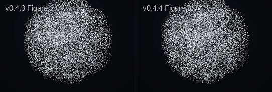
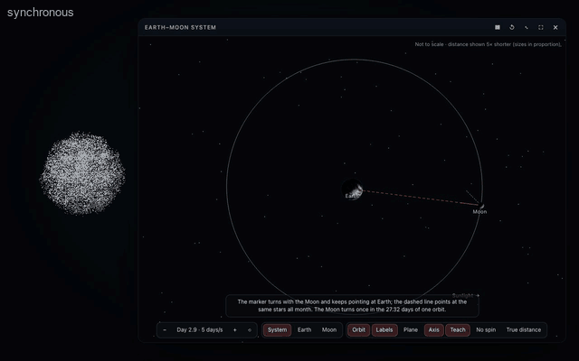

# Aion Presence

**Aion is how Codex becomes visually present.** Codex remains the intelligence: it reasons, reads, edits, tests,
builds and talks with you. While Aion is open you meet it *as Aion*: one embodied presence, in the foreground, a
living particle body — a sphere, a pair of expressive eyes, or a stick figure that gestures and explains — that
listens, reflects what is really happening, visibly answers, and shows you things: as its own body (including
genuine 3D objects you can turn and maps with places marked on them), as a high-fidelity card, or both — in Aion
Silver or the colours you choose.

```text
inside:   Codex = intelligence (reasoning, coding, tools, conversation, voice)
          Aion  = embodiment   (listening, state, body language, presentation)
to you:   one presence, speaking in the first person — "Here's Nikola Tesla."
```

Aion is not another AI model, assistant or personality. It makes **no model API calls and needs no API key**: no
`OPENAI_API_KEY`, no Realtime or Live session, no second subscription, no speech-to-text or text-to-speech of its
own. Everything Aion says, Codex says.

Aion is an interactive AI presence of **Intelligent Presence**, created by **Spirit Connect**, led by **Fulong**.

## Install

Ask Codex: **"Install Aion Presence from https://github.com/FulongLi/Aion-Presence-Plugin"**. Codex follows
[INSTALL.md](INSTALL.md). By hand, it is two commands (no clone, no npm, no build — the runtime is committed):

```bash
codex plugin marketplace add FulongLi/Aion-Presence-Plugin
```

```bash
codex plugin add aion-presence@spirit-connect
```

Then **restart Codex once** and **trust the hooks** when Codex asks. Aion opens by itself on the first session
after installation; afterwards say **"Open Aion"**. Fallback from a clone: `node scripts/install.mjs` (one command,
built-ins only, verifies the install). Requirements: Node 22+ on the PATH and a Codex with plugins (the CLI, the
IDE extension or the ChatGPT/Codex desktop app); for the full body, a browser with WebGPU (others get a canvas
fallback).

## What it does

```text
"Open Aion."                 →  Aion comes to the foreground, fills the screen, waves once and says hello;
                                one click on "Enter Presence" makes it truly fullscreen
you speak                    →  Aion visibly listens (locally); you stop → it turns to thinking
Codex works                  →  reading · editing · testing · building (from Codex's lifecycle hooks)
Codex answers                →  Aion visibly answers, for as long as the answer is being said
"What did Nikola Tesla look like?"   →  his heritage portrait (an antique oval of particles) forms beside the original photograph
"What is the terrain of Scotland like?" → Aion becomes Scotland's real relief
"What does Orion look like?" →  Aion becomes Orion — no card needed
"Show me the change."        →  the exact code, in a quiet card beside a body that keeps living
"Show your eyes." · "Look happy." →  Aion becomes two simple cartoon eyes, and smiles with them: ^ ^
"Show me where Los Angeles is in the USA." →  the United States forms; a marker lights up at Los Angeles, labelled
"Mark New York in yellow." · "Make LA blue." →  markers change in place; the map stays
"展示一下中国的地形。"                →  China's real relief, from elevation data
"Change your colour to blue."        →  every particle turns blue (remembered); "Restore your original colour" → silver
"Explain a² + b² = c²."      →  the figure looks at the equation, points at c² and explains with its hands
"Show me the classic portrait instead." →  the head-and-shoulders particle portrait
"Show me an Egyptian pyramid in 3D." · "Rotate it." →  a real 3D pyramid that turns; drag it, zoom, reset
"I want to learn how to read music." →  lesson 1: an engraved staff beside Aion, its five lines lit one by one
"Play the C major scale."    →  the scale appears and plays; each note lights up the moment it is heard
"Show me the treble clef."   →  Aion's particles form a treble clef beside the notation
"Visualize the music."       →  the music you play (another app, a tab) turns Aion into a circular particle spectrum
"React to your own voice."   →  on macOS, with your permission, Aion moves with Codex's real voice — every time it opens
"Teach me how to write 永."   →  the body writes 永's true stroke shapes in order, beside a card writing the same stroke
"Show the traditional form of 国." →  國, from about 9,500 characters bundled offline (simplified and traditional)
"Repeat the third stroke."   →  strokes 1–2 stay written while the third is written again, on the card too
"Write HELLO." · "Write my name." →  manuscript letters, one after another, on one baseline
"Teach me how to draw a treble clef." →  the hand-drawn clef, beside the engraved clef on a staff
"Show me a 4/4 measure with four quarter notes." →  engraved, played, each note lighting up
"Show a stick figure jumping over a box."  →  Aion's flexible figure gathers, jumps the box, lands soft, returns
"Animate the figure thinking." →  it pauses, hand to chin, and gets it — the "?" above it becomes "!"
"Tell me the story of Nikola Tesla."  →  a heritage portrait and a calm story, told in parts as you ask
```

- **Three persistent bodies**, one Aion: the original particle **Sphere** (abstract intelligence, visuals),
  **Aion Eyes** (conversation, attention, expression) and the **Particle Figure** (gesture, explanation). Every
  visual forms out of, and returns to, the chosen body (figure → Tesla → figure); switching bodies is one particle
  transition. See [docs/EYES.md](docs/EYES.md) and [docs/FIGURE.md](docs/FIGURE.md).
- **SCF Presence's visual language**: portraits and images of almost anything (looked up on open sources), real
  terrain from elevation data, Tao forms (yin-yang, lines, trigrams, bagua), constellations, zodiac and planetary
  signs, clocks, key numbers, short words, symbols and emoji — plus, in v0.4, **genuine 3D objects** built from
  validated primitive scenes ([docs/SCENES.md](docs/SCENES.md)).
- **v0.4.1**: every portrait is a **heritage** oval portrait by default (classic on request); **Aion Eyes** redesigned
  as minimal cartoon eyes that squash, stretch and bend ([docs/EYES.md](docs/EYES.md)); **maps and markers** for any
  country, continent or region, and **global terrain** in true equal-area shape, with markers on both
  ([docs/MAPS.md](docs/MAPS.md), measured coverage in [docs/GEO-COVERAGE.md](docs/GEO-COVERAGE.md)); **your colours**
  for the particles and the markers, remembered ([docs/COLORS.md](docs/COLORS.md)).
- **v0.4.2**: the **Music Library** — engraved notation (VexFlow, Bravura), local playback where each note lights up
  as it is heard, eight lessons in English and Chinese, note-reading practice, music symbols formed by the body, the
  figure pointing at the note ([docs/MUSIC.md](docs/MUSIC.md)); and an **audio-reactive presence** — one analyser
  for every source (the microphone, a shared tab, the Music Library, other apps and Codex's own voice through the
  macOS bridge), a sphere that moves with real sound and a **circular particle spectrum** for music
  ([docs/AUDIO-REACTIVE.md](docs/AUDIO-REACTIVE.md)). Codex Voice through the bridge is implemented but not yet verified.
- **v0.4.3**: **stroke animation** — characters, letters, digits, music and maths symbols written stroke by stroke from
  curated, convention-named data, never guessed from a font ([docs/STROKE-ANIMATION.md](docs/STROKE-ANIMATION.md));
  **short particle animations** of Aion's own figure — walk, jump, pick up, point, react — composed from approved
  primitives on one Animation Core ([docs/ANIMATION.md](docs/ANIMATION.md)); **Storyteller Mode** and a calmer
  narration style ([docs/STORYTELLING.md](docs/STORYTELLING.md)); **local photographs** as heritage portraits; and
  **Codex Voice Sync**, a remembered opt-in that reconnects Aion to Codex's voice whenever it opens
  ([docs/AUDIO-REACTIVE.md](docs/AUDIO-REACTIVE.md)).
- **v0.4.4 — Intelligent Writing & Living Figure**: the **Chinese Writing Pack** — all 9,574 characters of Hanzi Writer's
  dataset (7,465 for simplified writing, 7,260 for traditional), offline, written into their true stroke outlines with a
  synchronized reference card, words, simplified ↔ traditional, radicals, structure and tracing practice
  ([docs/CHINESE-WRITING.md](docs/CHINESE-WRITING.md)); one **Writing Education Core** for Chinese, English (letters, words,
  names) and music handwriting measured against engraved Bravura ([docs/STROKE-ANIMATION.md](docs/STROKE-ANIMATION.md));
  the **Music Education Pack** — alto clef, key signatures, ties, slurs, dynamics, bar lines and a 40-concept notation
  glossary ([docs/MUSIC.md](docs/MUSIC.md)); **Figure 3.0**, a flexible character with continuous limbs, no joint beads,
  restrained secondary motion and new behaviours (thinking, exploring) ([docs/FIGURE.md](docs/FIGURE.md),
  [docs/ANIMATION.md](docs/ANIMATION.md)); and **reliable tool discovery** — Aion's tool metadata cut from 302 KB to 62 KB, so
  hosts that budget it (Codex dropped 8 tools in v0.4.3) see every tool ([docs/MCP-TOOLS.md](docs/MCP-TOOLS.md)).

  
- **v0.4.5 — Interactive Cards & Spatial Applications**: **Card 2.0**, a container for registered applications that run
  beside Aion's living body in an isolated frame (an opaque-origin sandbox with no network, a validated MessageChannel
  bridge, manifests that cannot widen their own permissions), with compact, expanded and fullscreen layouts, universal
  controls and a formal lifecycle ([docs/CARDS.md](docs/CARDS.md), [docs/CARD-BRIDGE.md](docs/CARD-BRIDGE.md),
  [docs/CARD-SECURITY.md](docs/CARD-SECURITY.md)). Two applications on a shared Three.js engine: the **Earth–Moon system**
  — Earth's rotation, the Moon's orbit and why the same side faces Earth, with educational scaling it always declares
  ([docs/EARTH-MOON.md](docs/EARTH-MOON.md)) — and a **CAD viewer** for glTF/GLB models: orbit, select, metadata, hide,
  isolate, with a bundled transformer ([docs/CAD-VIEWER.md](docs/CAD-VIEWER.md)). Codex opens, controls and inspects them
  with `show_interactive_card`, `control_interactive_card` and `inspect_interactive_card`; the user manipulates them
  directly.

  
- **The Presentation Router**: BODY (the particles become it), CARD (exact, high-fidelity, beside the living body)
  or HYBRID (both), decided deterministically from what the information is; the model may prefer, the policy
  overrides clearly bad choices (long text never becomes particles). Cards show the original picture, never the
  particle raster, and retire by themselves.
- **Immersive mode**: "Open Aion" gives the cleanest Aion-only view the environment permits — the host's fullscreen
  when embedded, a foreground, screen-filling window plus one-click true fullscreen in the companion.
- **Concise presentation of Codex's work**: results, short text, code excerpts, file-change summaries, SVG
  diagrams and local images. Logs never go into Aion.
- **Natural visual intent**: you never need to name a tool. The Skill and the tool descriptions (tuned in SCF
  Presence) let Codex show something whenever you ask to see it — and stay quiet otherwise.

## How it works

```text
┌──────────────────────────── Codex (the host AI) ────────────────────────────┐
│ conversation · reasoning · tools · voice                                    │
│   ├─ skill  aion-presence      identity, greeting, visual intent, restraint │
│   ├─ MCP    aion-presence      open_presence · show_portrait · show_terrain…│
│   └─ hooks  aion-hook.mjs      UserPromptSubmit · Pre/PostToolUse · Stop …  │
└───────────────┬──────────────────────────────────────┬──────────────────────┘
                │ MCP (stdio)                          │ hook events (loopback HTTP)
                ▼                                      ▼
┌─────────────────────── Host Adapter (Node, local) ──────────────────────────┐
│ MCP server ─► presence hub (127.0.0.1, per-user token)                      │
│   Visual Resolver: Wikipedia · Commons · Openverse · OSM · elevation tiles  │
│   (only names and places are sent; results checked and kept as local media)│
└───────────────┬──────────────────────────────────────┬──────────────────────┘
                │ MCP Apps (embedded)                  │ companion window (SSE)
                ▼                                      ▼
┌──────────────────────── Presence Surface (one page) ────────────────────────┐
│ Presence engine: host state + local listening (VAD) ─► Aion Core            │
│ particle renderer (WebGPU, canvas fallback) · visual forms · samplers       │
└──────────────────────────────────────────────────────────────────────────────┘
```

Details: [docs/architecture.md](docs/architecture.md). Parity with SCF Presence Realtime, capability by
capability: [docs/PARITY.md](docs/PARITY.md).

### Surfaces and immersive mode

- **Embedded** when the host declares MCP Apps support (`io.modelcontextprotocol/ui` with
  `text/html;profile=mcp-app`). Immersive asks the host for its fullscreen display mode; the host decides, and its
  own composer or voice controls may stay visible — that is the host's UI, not something Aion fights.
- **Companion** otherwise: a chrome-less Chromium app window (else the default browser) that opens in the
  foreground and sizes itself to the screen. Browsers allow true fullscreen only from a user gesture, so it offers
  one quiet **Enter Presence**; after that click Aion stays fullscreen for the whole session (visuals never leave
  it). Esc always exits and is respected; **F** returns.

Codex currently runs plugin skills, MCP servers and hooks, but its MCP Apps rendering (`enable_mcp_apps`) is under
development and off by default, so with a default Codex Aion uses the companion window. Aion never pretends a
capability exists; `open_presence` reports the mode and the immersive path it used. What every host and browser
actually allows — assistant audio, fullscreen, foreground, always-on-top — is in [docs/HOST.md](docs/HOST.md).

## The MCP tools

| Tool | Purpose |
| --- | --- |
| `open_presence` | Open Aion (embedded or companion); `display: "immersive"` for "Open Aion". Reports the mode, the immersive path, whether hooks are active, and `greeting.due` once per newly opened Presence. |
| `set_presence_state` | `idle listening thinking working reading editing testing building responding presenting complete error`. |
| `set_body_form` | `sphere`, `eyes` or `figure`: the persistent body. |
| `express` | An expression (neutral, attentive, thinking, curious, happy, surprised, confused, sleepy, concerned) or a gesture (wave, nod, point, shrug, surprise, jump, step, turn, look-around, think): the eyes wear it, the figure acts it out. |
| `show_portrait` | A real person's face, from public photos (Wikipedia first): a heritage oval particle portrait and the original photograph (hybrid). `style: "classic"`: the head-and-shoulders portrait. |
| `show_image` | A picture of almost anything: `query` (+ `intent`) looks it up on open sources; `source` shows a local file; `detail: true` keeps it exact. |
| `show_terrain` | A real region's terrain from elevation data (terrain, topography, relief, heightmap), any size from a mountain to a continent; `markers` pins places on it; `presentation: "hybrid"` adds a relief map card. |
| `show_map` | A map of a continent, country, part of one, state or city, with its neighbours, and `markers` at real coordinates (colour, label, highlight). |
| `mark_map` | Add, recolour, relabel, highlight or remove markers on the map or terrain on show, without forming it again. |
| `set_colors` | Aion's base particle colour and accent colour (names in any language, presets, `#RRGGBB`), or `reset`; remembered. |
| `show_form` | Aion's own forms: Tao, trigrams, bagua, constellations, zodiac and planetary signs. (`show_visual_form`: the v0.1 name.) |
| `show_scene` | A genuine 3D object: a `preset` (pyramid, saturn, dna) or a validated `scene` of primitives (box, sphere, pyramid, cylinder, cone, torus, ring, line, tube, curve, helix). |
| `set_scene_view` | Turn, tilt or zoom the 3D object on show, stop its turn, or reset the view. |
| `show_stroke_animation` | Handwriting: a Chinese character or word (true outlines, `form` simplified/traditional, `highlight: "radical"`, `practice`), English letters, words and names, digits, music and maths symbols — written stroke by stroke beside a synchronized reference card. Never a guessed order. |
| `play_animation` · `control_animation` | Short scenes of Aion's flexible figure (walk, think, notice, examine, touch, jump, point …; demos `thinking`, `exploring` …) and control of any animation: pause, resume, replay, speed, next/previous stroke, repeat a stroke or a character, complete. |
| `show_music` · `play_music` · `music_lesson` | Engraved notation (clefs incl. alto, keys, ties, slurs, dynamics, bar lines; a glossary of 40 concepts), playback that lights each note, lessons in English and Chinese. |
| `set_audio_visualizer` | How Aion moves with sound (microphone, Codex Voice Sync, another app, a tab, Aion's own music). |
| `show_clock` · `show_number` · `show_text` · `show_symbol` · `show_emoji` | Local, instant glyphs. The clock result tells Codex the local time. `show_text` `emphasis` marks a term the figure points at. |
| `show_result` · `show_artifact` | A concise outcome, or a code excerpt, list, file changes, SVG or local image, in a card beside the body. |
| `show_interactive_card` · `control_interactive_card` · `inspect_interactive_card` | An interactive 3D application beside the body (`earth-moon`, `cad-viewer` with a bundled or local glTF/GLB model), kept until closed; universal actions (pause, resume, reset, expand, collapse, fullscreen, close) and the app's commands, confirmed by the card; its state, selection and metadata as the user sees it. |
| `clear_presentation` | Return to the persistent body now (also closes an interactive card). |

`show_image`, `show_portrait`, `show_terrain`, `show_map`, `show_text`, `show_result` and `show_artifact` accept `presentation`
(`auto` · `body` · `card` · `hybrid`); every result reports the route taken and why.

## Lifecycle hooks

| Codex event | Aion |
| --- | --- |
| `UserPromptSubmit` | thinking (with a small acknowledging nod) |
| `PreToolUse` | editing · reading · testing · building · working, by tool and command |
| `PostToolUse` | back to thinking after a short settle |
| `Stop` | complete, then rest — after `responding`, Aion keeps answering for as long as the answer takes to say |
| `Interrupt`, `SessionEnd` | idle |

The hook prints nothing, always exits 0 and never blocks a tool. It forwards only the event name, the tool name,
for shell tools the start of the command line, and at the end of a turn one number: how many seconds the final
answer takes to say (computed from its length inside the hook; the text itself is never forwarded). Without trusted
hooks Aion still works; the Skill then sets the main states itself.

## Privacy and security

- **No credentials**: no OpenAI key, ChatGPT or Codex token is read, stored or requested.
- **Interactive cards** (v0.4.5): only registered applications run, each in a sandboxed frame with an opaque origin and
  no network; they never see the hub token, cannot reach the hub or any tool, and receive models only as validated,
  self-contained bytes (no remote or out-of-folder files). See [docs/CARD-SECURITY.md](docs/CARD-SECURITY.md).
- **Microphone**: analysed in the Presence window only, as loudness and voice activity, so Aion can look
  attentive. Never recorded, stored, uploaded or transcribed; refusing it is fine. Real-device check:
  [docs/MICROPHONE.md](docs/MICROPHONE.md).
- **Network**: the hub listens on `127.0.0.1` only (per-user token, loopback `Host` check). Countries, continents, their
  named parts and about 1,250 cities are known offline (Natural Earth, bundled). When Codex asks for a portrait,
  picture, terrain or a place the offline world does not know, the MCP process sends only the name, search phrase or region to public data
  providers on a fixed allowlist (Wikipedia, Wikimedia Commons, Wikidata, Openverse, OpenStreetMap Nominatim, Photon, the
  public AWS elevation tiles), identifying itself by User-Agent. Downloads are size-limited and checked by their
  bytes before the surface sees them; the surface itself never contacts a remote host. Repository and
  conversation content is never sent anywhere. An optional keyed image search
  (`AION_PRESENCE_BRAVE_SEARCH_KEY`) is off unless you set it.
- Presented content is rendered as text (never as HTML), images only through `` or as particles. Cards and the
  Presentation Router run locally; card contents are never sent anywhere.
- **3D scenes are data, never code**: every scene is validated strictly (known fields and names only, bounded
  numbers, at most 24 objects, 256 after repeats, 80,000 triangles, 16 KB) in the MCP server, again in the hub and
  again before geometry is built. No 3D asset is ever fetched.
- **Sound** (v0.4.2): every source is reduced to loudness and frequency bands on this device; nothing is recorded,
  stored, sent or transcribed. A browser tab is shared only through the browser's own picker. Codex's voice and other
  apps' sound are captured only when you ask, by the macOS Aion Audio Bridge (built locally, with macOS's System Audio
  Recording permission), which talks only to the local hub over a private socket; capture sources are never
  remembered. See [docs/AUDIO-REACTIVE.md](docs/AUDIO-REACTIVE.md) and [docs/AUDIO-BRIDGE.md](docs/AUDIO-BRIDGE.md).

## Development

```bash
npm install
npm run dev
```

| Command | |
| --- | --- |
| `npm test` | Unit and integration tests (no network) |
| `npm run typecheck` / `npm run lint` | TypeScript and ESLint |
| `npm run build` | The self-contained runtime in `plugins/aion-presence/runtime/` (committed) |
| `npm run runtime:check` | Fails if the committed runtime differs from what the sources build |
| `npm run plugin:validate -- --runtime` | Agent Plugins schema, paths, skills, hooks, marketplace and versions |
| `npm run smoke` | The surface in headless Chrome: renderers, routes, the microphone path, responding, immersive, embedded, v0.4's eyes, explanation, heritage and 3D, v0.4.1's default heritage, maps and markers (pixels checked), terrain pins and colours, v0.4.2's lessons, engraving, playback timing, spectrum and Codex-voice paths, v0.4.3's stroke writing, action sequences, local portraits and Codex Voice Sync, v0.4.4's Chinese pack, words, practice, music handwriting and Figure 3.0 behaviours, and v0.4.5's interactive cards (isolation probed from inside the frame, selection by click, Codex control, layouts, repeated open/close with nothing left behind, timings, a browser without WebGL, a card in an MCP Apps host) — in both renderers (`-- --offline` skips lookups; `-- --only=v45` one section) |
| `npm run audio:eval` | Measures the music detector on real recordings on this Mac (Apple Loops, system voices); nothing is kept |
| `npm run audio-bridge:install` | Builds the macOS Aion Audio Bridge into `~/.aion-presence/audio-bridge` (Xcode command-line tools) |
| `npm run audio:verify -- --play-loops` / `-- --codex` | Real-device check of the bridge: a real app's sound, or Codex's voice while you talk to it |
| `npm run showcase` | The visual review: records each demo in the real renderer through the real MCP tools (`.e2e/showcase/*.webm`, screenshots, filmed frames for `scripts/media/gif.py`); `-- --list`, `-- map-usa eyes-motion`, `-- --headed`, `-- --canvas` |
| `npm run geo:coverage` | Geography against the live services (continents, the largest and smallest countries, high latitudes, the date line, OSM regions, markers, terrain); writes [docs/GEO-COVERAGE.md](docs/GEO-COVERAGE.md) |
| `npm run geo:build -- <dir>` | Rebuilds the bundled world from the Natural Earth GeoJSON files (see [docs/MAPS.md](docs/MAPS.md)) |
| `npm run codex:verify` | A from-scratch Git install and the one-command fallback with the real Codex CLI, in throwaway homes (v0.4.4: the pack installed, every tool reaching Codex within the metadata budget, Chinese writing offline; v0.4.5: the Earth–Moon card and the bundled transformer from the installed runtime) |
| `npm run mcp:budget` · `npm run codex:tools` | Aion's tool metadata against its budget · what your Codex receives from every MCP server (see [docs/MCP-TOOLS.md](docs/MCP-TOOLS.md)) |
| `npm run chinese:build` · `chinese:export` · `chinese:coverage` | Rebuild the Chinese Writing Pack from pinned upstream releases · write the original JSON back (lossless) · re-verify all characters and measure the particle letterforms |
| `npm run writing:sheet` | Contact sheets of every curated letter, digit and symbol (start points, directions) |
| `npm run cards:models` · `cards:earth-mask` | Regenerate the CAD viewer's transformer (and the test bracket) · the Earth–Moon card's land mask from Natural Earth |
| `npm run notices` | Regenerate `plugins/aion-presence/THIRD-PARTY-NOTICES.md` |
| `npm run release` | The reproducible installable archive in `dist/` |
| `npm run check` | lint, typecheck, tests, runtime check, validation |

After changing sources, run `npm run build` and commit the runtime (CI checks it). Environment:
`AION_PRESENCE_SURFACE=companion`, `AION_PRESENCE_BROWSER=default|chrome|none`, `AION_PRESENCE_PORT` (47231),
`AION_PRESENCE_HOME`, `AION_PRESENCE_AUTO_OPEN=first-run|always|never`, `AION_PRESENCE_DEBUG=1` (open the companion
with diagnostics; `npm run diagnose` prints them). Add `&debug=1` to the companion URL for
diagnostics (the whole live chain: surface, fullscreen, microphone, RMS, VAD, host → effective activity, Aion state,
user amplitude, responding, route, card, hooks), `&renderer=canvas` for the fallback, `&mic=0` to skip listening.

## Relationship to SCF Presence Realtime

Aion Presence ports SCF Presence Realtime's Presence: identity, body, Particle Figure and gestures, the WebGPU
renderer and adaptive quality, visual forms, the Visual Resolver (portraits, images, terrain), glyphs and emoji,
the microphone/VAD/emphasis pipeline, greeting and onboarding, and the tuned tool descriptions. It replaces only
SCF's AI transport — Realtime/GPT-Live sessions, keys and WebRTC — with the Codex host. See
[docs/PARITY.md](docs/PARITY.md).

## Credits

Chinese characters: [Hanzi Writer](https://github.com/chanind/hanzi-writer) and [hanzi-writer-data](https://github.com/chanind/hanzi-writer-data)
by David Chanin, from [Make Me a Hanzi](https://github.com/skishore/makemeahanzi) by Shaunak Kishore (graphics derived
from Arphic Technology's AR PL KaitiM GB and AR PL UKai fonts, Arphic Public License; dictionary from Unihan and CJKlib,
LGPL-3.0-or-later); simplified ↔ traditional tables from [OpenCC](https://github.com/BYVoid/OpenCC) (Apache-2.0). The data
keeps its own licenses in `plugins/aion-presence/packs/chinese-writing` ([docs/CHINESE-WRITING.md](docs/CHINESE-WRITING.md));
bundled libraries are listed in `plugins/aion-presence/THIRD-PARTY-NOTICES.md`.

Country outlines, continents and the city gazetteer: [Natural Earth](https://www.naturalearthdata.com) (public domain).
Places beyond it: © [OpenStreetMap](https://www.openstreetmap.org/copyright) contributors, via Nominatim and Photon.
Elevation: [AWS Terrain Tiles](https://registry.opendata.aws/terrain-tiles/) (Mapzen terrarium; SRTM, GMTED, ETOPO1 and others).
