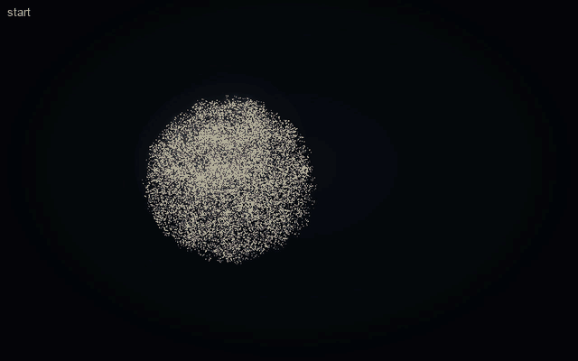
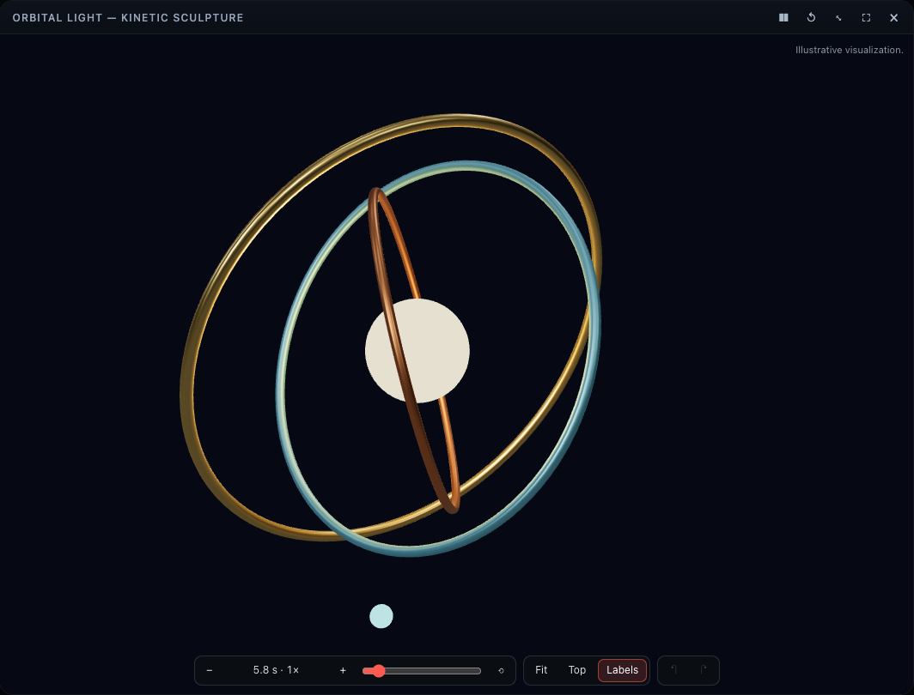
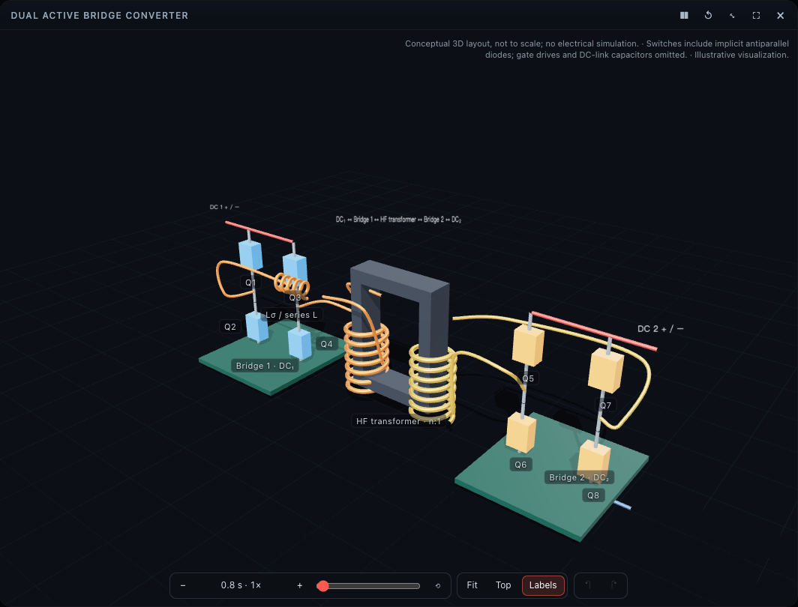

# Aion Presence

**Aion is how Codex becomes visually present.** Codex stays the intelligence — it reasons, reads, edits, tests and
talks with you. While Aion is open you meet it as one embodied presence: a living particle body that listens, reflects
what Codex is really doing, answers visibly, and shows you things — as its own particles, as quiet high-fidelity cards,
or as interactive 3D scenes generated from what you describe.

Aion is not another AI model. It makes **no model API calls and needs no API key**; everything Aion says, Codex says.

*Aion Presence — Intelligent Presence, created by Spirit Connect.* Current version: **0.6.0** (in review) ·
[Changelog](CHANGELOG.md)

```text
inside:   Codex = intelligence (reasoning, coding, tools, conversation, voice)
          Aion  = embodiment   (listening, state, body language, presentation)
to you:   one presence, speaking in the first person — "Here's Nikola Tesla."
```

## What Aion does

- **Presence** — three bodies (a particle sphere, expressive eyes, a gesturing figure) that follow Codex's real state:
  listening, thinking, reading, editing, testing, answering.
- **Shows things** — portraits and pictures from open sources, maps with marked places, real terrain, symbols,
  constellations, 3D objects, and concise views of Codex's work (results, code, file changes).
- **Plans journeys** — real walking, cycling and hiking routes on the particle terrain, with an exact map and an
  elevation profile beside it: "Plan a cycling route from Glasgow to Edinburgh."
- **Teaches** — about 9,500 Chinese characters written stroke by stroke (offline), English handwriting, music notation
  with playback, short figure animations and stories.
- **Real CAD in FreeCAD** — with FreeCAD installed, Codex creates and changes parametric `.FCStd` models ("a 120 × 80 ×
  40 mm enclosure", "20 mm longer", "four 6 mm holes near the corners", "move this hole 5 mm inward", "undo") and Aion
  shows each revision FreeCAD recomputed.
- **Interactive 3D cards** — an Earth–Moon system, a glTF/GLB CAD viewer, and **generated scenes**: describe a solar
  system, a gear train or a converter and Codex writes it as validated Scene IR; you turn it, select parts, move them by
  hand, and change it by asking — every change a revision you can undo.
- **Moves with sound** — your voice, the music you play and, on macOS with permission, Codex's own voice.
- **Honest** — illustrations say they are illustrations; requests that need a numerical solver are refused plainly.

More, with things to say: [docs/FEATURES.md](docs/FEATURES.md).

## See it



| | |
| --- | --- |
|  |  |
| *"Create a kinetic sculpture with three rotating rings, a glowing sphere, and a moving particle."* — written by Codex, rendered by Aion (v0.5.1) | *"Create a simplified three-dimensional Dual Active Bridge converter…"* — written by Codex, labelled as not a simulation |


## Install

Ask Codex: **"Install Aion Presence from https://github.com/FulongLi/Aion-Presence-Plugin"** (it follows
[INSTALL.md](INSTALL.md)). By hand, two commands — no clone, no npm, no build:

```bash
codex plugin marketplace add FulongLi/Aion-Presence-Plugin
```

```bash
codex plugin add aion-presence@spirit-connect
```

Then **restart Codex once** and **trust the hooks** when asked. Aion opens by itself on the first session, in its own
window, and speaks a short welcome; afterwards say **"Open Aion"**. Optional: [FreeCAD](https://www.freecad.org/) 1.0+
for parametric CAD. Requirements: Node 22+ on the PATH, a Codex with plugins (CLI, IDE extension or the desktop app),
and for the full body a browser with WebGPU (others get a canvas fallback). Fallback from a clone:
`node scripts/install.mjs`.

## Try

```text
"Open Aion."
"What did Nikola Tesla look like?"
"Show me where Los Angeles is in the USA."
"Show me Scotland's terrain."  →  "Plan a cycling route from Glasgow to Edinburgh."  →  "Show me the highest point."
"Teach me how to write 永."
"Create a 3D solar system with the Sun and eight planets."  →  "Make Earth three times larger."  →  "Undo that."
"Create a 120 by 80 by 40 mm enclosure in FreeCAD."  →  "Add four 6 mm mounting holes near the corners."
```

## Documentation

| | |
| --- | --- |
| [FEATURES](docs/FEATURES.md) | Everything Aion does, by area, with example requests |
| [INSTALL](INSTALL.md) | Installation for people and for Codex |
| [Generative Visual Engine](docs/GENERATIVE-VISUAL-ENGINE.md) | Generated scenes: [Scene IR](docs/SCENE-IR.md), [animation](docs/SCENE-ANIMATION.md), [interaction](docs/SCENE-INTERACTION.md), [Router 2.0](docs/PRESENTATION-ROUTER-V2.md), [real-Codex tests](docs/SCENE-GENERATION-TESTS.md) |
| [Interactive cards](docs/CARDS.md) | Card 2.0, [bridge](docs/CARD-BRIDGE.md), [security](docs/CARD-SECURITY.md), [Earth–Moon](docs/EARTH-MOON.md), [CAD viewer](docs/CAD-VIEWER.md) |
| [FreeCAD](docs/FREECAD.md) | Parametric CAD in the user's FreeCAD: the backend, operations, revisions, the hand-off, limits |
| [Route Explorer](docs/ROUTE-EXPLORER.md) | Routes on the terrain and in their card: providers, elevation, tiles, limits |
| [Architecture](docs/architecture.md) | How Codex, the hub, the surface and the renderer fit together |
| [MCP tools](docs/MCP-TOOLS.md) · [Host](docs/HOST.md) | Tool reference and discovery · what each host and browser allows, lifecycle hooks |
| [Privacy and security](docs/PRIVACY.md) | What stays local, what is fetched, and from where |
| [Development](docs/DEVELOPMENT.md) · [CLAUDE.md](CLAUDE.md) | Commands, testing, releases · rules for contributors and coding agents |
| [Licensing](docs/LICENSING.md) | The license model, third-party components, open legal questions |

Topic guides: [Eyes](docs/EYES.md) · [Figure](docs/FIGURE.md) · [Maps](docs/MAPS.md) · [Music](docs/MUSIC.md) ·
[Chinese writing](docs/CHINESE-WRITING.md) · [Stroke animation](docs/STROKE-ANIMATION.md) · [Audio-reactive](docs/AUDIO-REACTIVE.md) ·
[Parity with SCF Presence](docs/PARITY.md).

## License

**Source-available, personal use only.** The source is public, and a person may use, study and modify Aion Presence
for their own non-commercial purposes. **Commercial use, and any use by or for an organization** — including
non-profit, educational and research institutions — **needs a separate written license**: info@spiritconnect.co.uk.
Third-party components keep their own licenses ([THIRD-PARTY-NOTICES](plugins/aion-presence/THIRD-PARTY-NOTICES.md),
[Chinese Writing Pack](plugins/aion-presence/packs/chinese-writing/NOTICE.md)). This is not an open-source license.

The terms are in [LICENSE](LICENSE) — currently a **draft pending legal review**; see [docs/LICENSING.md](docs/LICENSING.md).

## Credits

Aion Presence is created by Spirit Connect, led by Fulong. It ports the presence of *SCF Presence Realtime*
([parity](docs/PARITY.md)).

Chinese characters: [Hanzi Writer](https://github.com/chanind/hanzi-writer) and
[hanzi-writer-data](https://github.com/chanind/hanzi-writer-data) by David Chanin, from
[Make Me a Hanzi](https://github.com/skishore/makemeahanzi) by Shaunak Kishore (graphics from Arphic Technology's fonts,
Arphic Public License; dictionary LGPL-3.0-or-later); simplified ↔ traditional tables from
[OpenCC](https://github.com/BYVoid/OpenCC) (Apache-2.0). 3D: [three.js](https://threejs.org). Notation:
[VexFlow](https://www.vexflow.com) with the Bravura font (SIL OFL). Maps: [Natural Earth](https://www.naturalearthdata.com)
(public domain) and © [OpenStreetMap](https://www.openstreetmap.org/copyright) contributors via Nominatim, Photon and
OpenStreetMap's tiles. Routes: [Valhalla](https://github.com/valhalla/valhalla) on FOSSGIS e.V.'s public server.
Elevation: [AWS Terrain Tiles](https://registry.opendata.aws/terrain-tiles/).

## Support the project

Enjoying Aion Presence? If you find it useful, consider giving it a ⭐ on
[GitHub](https://github.com/FulongLi/Aion-Presence-Plugin) — it helps more people discover the project. Entirely
optional: nothing in Aion depends on it.
