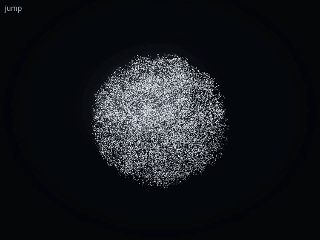

# Animation (v0.4.3; v0.4.4 Figure 3.0 behaviours)

Aion can demonstrate how things happen: a symbol being written ([STROKE-ANIMATION.md](STROKE-ANIMATION.md)) and short
action scenes performed by its own figure. Both rest on one small Animation Core; each keeps its own semantics.

```text
Animation Core (animation/timeline.ts, animation/control.ts)
    │   playback state anchored to the clock · keyframes and easing · sequenced segments · one control vocabulary
    ├── Stroke Animation (animation/stroke/)   ordered writing paths, reveal keys, the pen
    ├── Figure Animation (core/figure/)         Figure 2.0's skeleton, poses and two-bone IK (unchanged, extended)
    └── Scene Sequencer (animation/scene/)      approved motion primitives + a few objects, compiled to a timeline
```

## Animation Core

- **Playback** is plain data: duration, playing, rate, the playhead at a wall-clock instant, an optional stop (`until`)
  and a revision. `position(now) = position₀ + (now − at) × rate`, clamped. The hub applies commands (pause, resume,
  seek, replay, speed); every surface — the companion window, an embedded view — computes the same frame from the same
  state, so a replay or a slower speed is identical everywhere and nothing streams per frame.
- **Easing and keyframes**: cubic in/out/in-out, an overshooting `back` (follow-through), `hold`; keyframed values;
  segments laid end to end. Figure 2.0's clips now use the same easing (one implementation).
- **Control** (`control_animation`): play/resume, pause, replay, speed (slow, normal, fast, slower, faster), next and
  previous stroke, repeat a stroke, complete, stop. Commands that do not apply (a stroke of a figure's scene, the ninth of
  five strokes) are refused with the reason, before anything changes.
- **Lifetimes**: writing stays until replaced or cleared (the user is learning it); a scene lasts as long as it plays
  (at its speed) and a moment after; a paused scene waits a minute; any new presentation replaces it. One animation at a
  time.

## Scene Sequencer

A short scene is declarative data — never code, joint values or curves — validated with hard bounds and compiled
onto Figure 2.0:

```json
{ "title": "Jump over a box", "start": { "x": -1.05, "facing": "right" },
  "objects": [{ "id": "box", "type": "box", "x": 0.05, "size": "medium" }],
  "actions": [{ "do": "jump", "over": "box" }, { "do": "face", "toward": "viewer" }] }
```

| Primitive | What the figure does |
| --- | --- |
| `walk` (to an x or an object; slow, normal, brisk) | Turns toward it, eases into motion, walks with planned footsteps, eases to a stop with the feet together |
| `jump` (over a box or ball, or on the spot) | Runs up if needed; crouches (anticipation), launches, tucks over it, lands soft, stands |
| `pick-up` (a box or ball) | Walks to it, squats with the back bent, reaches with both hands (IK), lifts it to the chest, overhead, and back |
| `put-down` | Bends and sets the object down in front, lets go, stands |
| `point` (an object — a panel's mark — or a stage point) | Looks, gathers the arm, points (IK; straight toward a point out of reach), holds, returns |
| `face` (left, right, viewer, an object) | Turns on the spot, the head leading |
| `gesture` (wave, nod, shrug, surprise, think, look-around) | Figure 2.0's existing clips, where the figure stands |
| `react` (to an object) | Surprise: a start back away from it with arms up, then a slow recovery and a nod |
| `crouch`, `wait` | As named |

Objects: `box`, `ball` (it may roll in at the start), `panel` (a diagram card standing in the air, with a small bar chart
whose mark lights in the accent while the figure points at it). Bounds: ≤ 3 objects, ≤ 12 actions, ≤ 16 s, positions within
the stage (−1.25 … 1.25), known ids only, nothing to put down unless held, no jump while holding, room to land. The same
validator runs in the MCP server, the hub and the page.

**Motion quality.** Walking is planned as footsteps: the pelvis follows a smooth acceleration–cruise–deceleration profile;
each foot swings in turn and lands where the pelvis will be at mid-stance, so **a planted foot never slides** (tested
frame by frame). Limb lengths never change (two-bone IK; tested). A deep lean now pitches the torso keeping its length
(state poses, whose leans are small, are unchanged). Anticipation, eased acceleration, follow-through and settles are
written into each primitive; the figure's final spring removes any seam between them.

**Five curated scenes** (`play_animation` `demo`): `walk-and-stop` (7.5 s), `jump-over-obstacle` (7.0 s), `pick-up-object`
(8.8 s), `explain-diagram` (11.6 s), `surprised-reaction` (7.0 s). Each includes 1.9 s at the start while the body forms
into the figure and 0.9 s of settling at the end; the action itself is 4–9 s.

**On screen.** The body becomes the figure for the scene without changing the persistent body (`AionBody.override`), on a
smaller, lower stage so it can travel and jump; the pose is the sequence's, eased in (0.8 s) and out (1.1 s) from the
state's own motion, so entering and leaving never snap. Afterwards the particles re-form into the persistent body
(sphere, eyes or figure). The objects and a faint ground line are drawn as glowing grains on an overlay, at the screen
positions the renderer's own projection gives (like map markers) — identical in WebGPU and the canvas fallback. A held
object follows the hands (from the solved pose).



## Figure 3.0 behaviours (v0.4.4)

The figure is now a flexible character ([FIGURE.md](FIGURE.md)); the sequencer gained behaviours that use it. No second
sequencer: the same declarative actions, validated with hard bounds, compiled onto the same skeleton.

| Action | What the figure does |
| --- | --- |
| `walk` (improved) | weight shifts over the planted foot (sway, hip roll), shoulders counter-turn against the hips, the upper body leads into the motion (`curl`), elbows bend more on the forward swing; it slows before stopping and settles back a touch |
| `think` (`about?`: a `question` object) | a pause, head tilt, weight onto one leg, a hand to the chin and the other across the waist, small searching movements of the head, then the "got it" — the hand up, finger raised, the back straightening — and the question's "?" turns to "!" in the accent |
| `notice` (an object) | the head snaps toward it, a small start (lift, draw back), then it settles |
| `examine` (a box or ball) | walks up slowly, leans in and down, looks it over from one side to the other, straightens a little |
| `touch` (a box or ball) | the near hand reaches slowly (IK), taps, pulls back fast as the body starts back; the object hops and wobbles, glowing briefly in the accent |
| `jump` (improved) | a deeper, gathered crouch with the arms swinging back, an explosive extension with the back arching, a tuck with the back rounding, a landing that absorbs through the knees with the arms forward, and a recovery that rises a touch past standing |

New object: `question` (a floating "?" above head height). New demos: `thinking` (11.0 s) and `exploring` (15.2 s);
`walk-and-stop` walks further (7.5 s); `jump-over-obstacle` (7.4 s) and `explain-diagram` use the new body unchanged in
logic. Bounds: ≤ 18 s (was 16) so a demo can notice, approach, examine and touch; Codex's own sequences stay short.
Every channel is continuous across primitives (tested at 1/120 s: no snapping).

## MCP

| Tool | |
| --- | --- |
| `play_animation` `{ demo? \| sequence?, speed?, hold_seconds? }` | Plays a curated demo or a validated sequence; the result gives its title, length and actions |
| `control_animation` `{ action, stroke?, speed? }` | Pause, resume, replay (optionally slower), speed, stop — and, for writing, the strokes |

## Verification

- Tests (`tests/v43.test.ts`): the core's arithmetic (pause, resume, seek with a stop, rate, replay; keyframes; segments);
  every demo validates and stays short; the validator refuses unknown actions, off-stage positions, too many actions or
  objects, duplicates, unknown objects, lifting a panel, putting down nothing, over-long scenes and code; the tool schema
  refuses joint values; planted feet never slide, limbs keep their length, feet never go below the ground; the jump's
  feet pass over the box; the pick-up lifts the object; interrupting a performance eases out from where it was.
- Real renderer: `npm run smoke -- --only=v43` (the body becomes the figure, its box is drawn, it jumps, it returns), in
  both renderers; `npm run showcase -- figure-jump figure-demos figure-transition` records the five scenes and the
  transitions (sphere → figure → sphere; figure body → scene → back; a slow replay, paused and resumed).

## Known limitations

- The objects are drawn on an overlay as particle grains, not by the GPU particle pool; they glow like map markers but
  have no bloom.
- In profile the figure's two arms and two legs overlap (it is a stick figure); turning uses a whole-body heading, so
  there is no turning step pattern.
- `explain-diagram` runs 11.6 s, beyond the 3–8 s target, because it walks there and back.
- Scenes are composed only from the primitives above; there is no free-form character animation by design.
