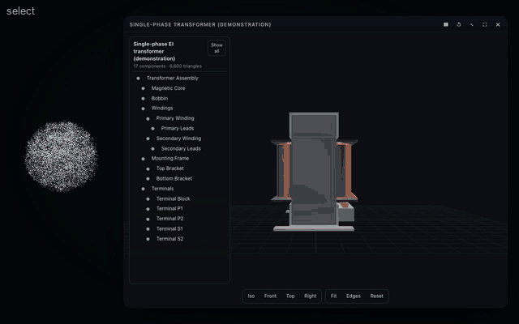

# The CAD viewer card (`cad-viewer`, v0.4.5)

An interactive glTF/GLB model viewer with an engineering feel: orbit, zoom, pan, standard views, fit, selection with
highlight and metadata, a component hierarchy, hide, isolate and restore.



## A viewer, not a CAD kernel

Three.js is a **visualization engine**. The viewer renders, navigates, selects, highlights and hides; it never edits
geometry. Exact geometry, parametric dimensions, topology, booleans, constraints and regeneration belong to a CAD
kernel (future candidates: FreeCAD, Open CASCADE Technology). Changing a mesh in a GLB is not editing a parametric CAD
document, and Aion never pretends it is.

```
Codex ─► engineering parameters ─► CAD backend (FreeCAD / OCCT) ─► export glTF/GLB ─► show_interactive_card { model } ─► viewer
```

**Replacing the displayed model** is the documented hand-off: call `show_interactive_card { app: "cad-viewer",
model: "/absolute/path/new.glb" }` while the viewer is open — the same card (same instance) loads the new model, the
old one is released. A backend only has to write a GLB (or a `.gltf` with its files beside it).

## Formats

GLB and glTF 2.0, read with Three.js's GLTFLoader: hierarchy, transforms, materials (PBR), normals, names and extras.
`.gltf` files are packed into one self-contained GLB on the host (their buffers and images from their own folder only).
Refused, with a clear code: remote URLs, files outside the model's folder, Draco/meshopt/KTX2 compression, WebP/AVIF
textures, over-limit models (16 MB, 2,000,000 triangles, 4096 px textures). See [CARD-SECURITY.md](CARD-SECURITY.md).

## Component ids

Each node becomes a component with a stable id: `extras.aionId` when the model declares one, otherwise the path of
its names, slugged (`assembly/core`, `angle-bracket/bolts/bolt-1`), with `#2`, `#3` for duplicates. Display names come
from `extras.label`, the node name, or its type.

## Selection and metadata

Click a part (or a row in the hierarchy): it highlights (accent emissive plus feature edges), its name and id appear,
and its properties: first everything the model's extras say about it (text, numbers, booleans; at most 24), then what
is **measured**: type (part or assembly), components, triangles, bounding size (in mm when the model declares metres),
render material. The card reports `SELECTION_CHANGED` with the id, name and properties, and where the part is on
screen; Codex reads it with `inspect_interactive_card`. It must not add properties the model does not carry — the Skill
says so, and the tool result reminds it.

## The demonstration model

`plugins/aion-presence/assets/cards/transformer.glb` (≈ 475 KB, 17 nodes, 13 meshes, 6,600 triangles), generated by
`npm run cards:models` (`scripts/cards/build-models.ts`) — reproducible, no third-party licence. A single-phase EI
transformer:

| Id | Component |
| --- | --- |
| `assembly` | Transformer Assembly |
| `assembly/core` | Magnetic Core (EI laminations) |
| `assembly/bobbin` | Bobbin |
| `assembly/windings` | Windings (group) |
| `assembly/winding-primary`, `…/leads` | Primary Winding and its leads |
| `assembly/winding-secondary`, `…/leads` | Secondary Winding and its leads |
| `assembly/frame`, `…/top`, `…/bottom` | Mounting Frame and its brackets |
| `assembly/terminals`, `…/block`, `…/p1` … `…/s2` | Terminals |

Its metadata (part number, materials, turns, wire diameters, functions) are **nominal demonstration values**, and the
model says so in every part (`dataStatus`) and at its root. The same script writes `tests/fixtures/cards/bracket.gltf`
(+ `.bin` + texture), an unrelated model used to verify importing and packing another glTF.

## Interaction

Left-drag orbits, scroll or pinch zooms (a trackpad's two-finger scroll too), right-drag or Shift-drag pans, `F` fits (with the view focused), Escape
clears the selection. The hierarchy panel selects and toggles visibility; the property panel has Hide, Isolate and
Focus; the bar has Iso / Front / Top / Right, Fit, Edges and Reset.

## Commands

| Command | Value |
| --- | --- |
| `select`, `hide`, `show`, `isolate`, `focus` | a component id (a name also works) |
| `clear-selection`, `show-all`, `fit`, `reset-camera` | — |
| `set-view` | `iso`, `front`, `back`, `left`, `right`, `top`, `bottom` |
| `show-edges` | true / false (models up to 600,000 triangles) |

Hiding a group hides everything in it ("hide the winding" → `assembly/windings`); showing a part inside a hidden group
shows the path to it; isolate shows only one component (and what it contains). Settings: `view`, `edges`.

## State

`model`, `components` (the hierarchy, at most 400 entries; `componentCount`, `truncated`), `selected`, `hidden`,
`isolated`, `view`, `edges`, `triangles`.
