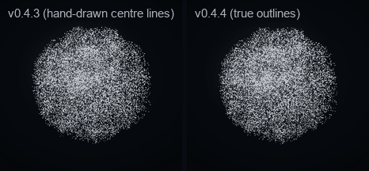
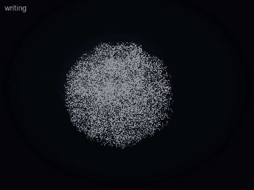

# Chinese Writing Pack (v0.4.4)

Aion writes Chinese characters with their real shapes: every stroke's true filled outline, revealed in the correct order
along the stroke's own centre line, by the same particles that form everything else. "Teach me how to write 永" →
the body writes 永 stroke by stroke while a reference card writes the same stroke at the same moment.



| | v0.4.3 | v0.4.4 |
| --- | --- | --- |
| Characters | 19, drawn by hand as centre lines | **9,574** from Hanzi Writer data (simplified and traditional) |
| Shape | a centre line with an even pen width (and two tapers) | the source font's true outline for every stroke |
| Agreement with the reference outline (永, IoU of 96 × 96 rasters) | 0.245 | **0.623** |
| Words | — | up to 4 characters, each in its own order |
| Reference card | numbered centre lines | Hanzi Writer's technique (outline clip + median brush), in step with the particles |
| Practice | — | Hanzi Writer's tracing quiz on the same data |



## Coverage (exact)

From hanzi-writer-data 2.0.1 (9,574 character files), built by `npm run chinese:build`:

| | Characters |
| --- | --- |
| Upstream files | 9,574 |
| Imported, validated, composed and written by the production pipeline | **9,574** |
| Failed validation | 0 |
| Missing usable stroke data | 0 |
| Stored verbatim (a file not in the canonical JSON layout; still lossless) | 23 |
| Without radical strokes in the data (radical highlight unavailable) | 556 |
| Dictionary entries (Make Me a Hanzi: pinyin, definition, radical, decomposition, etymology) | 9,574 |

Each character counted **once**, by its form (OpenCC 1.4.2 tables):

| Form | Characters |
| --- | --- |
| Simplified only (国, 爱, 发 …) | 2,305 |
| Traditional only (國, 愛, 鬱 …) | 2,100 |
| Shared — written the same in both (永, 人, 大 …) | 5,160 |
| Component forms (⺀ ⺈ ⺊ ⺌ ⺍ ⺗ ⺮ ⺳ ⺼) | 9 |
| **Total** | **9,574** |
| Usable for simplified writing (simplified only + shared) | **7,465** |
| Usable for traditional writing (traditional only + shared) | **7,260** |

The machine-readable report is `plugins/aion-presence/packs/chinese-writing/coverage.json` (every character by form, the
failures, the verbatim and radical-less ones). `npm run chinese:coverage` re-verifies the whole pack through the
production pipeline and measures the particle letterforms (`docs/CHINESE-COVERAGE.json`): on a sample of 255 characters,
99.35 % of stroke grains lie inside their own stroke's outline (min 98.88 %; the rest are within the sampler's 0.003
scanline tolerance), and the grains cover 100 % of the reference glyph's area even at the lowest quality tier (6,000
particles).

## Architecture

```text
Character Dataset              packs/chinese-writing/strokes.ahpk (block-compressed, lazily read)
      │                        host/writing/chinesePack.ts: index on first use, one block per character, LRU cache
      ▼
Character Data Loader ───────► stroke outlines (SVG paths) + medians (ordered centre lines) + radical strokes
      │                        host/writing/resolve.ts: text → characters (simplified/traditional), facts from the dictionary
      ▼
Stroke Geometry Processor      writing/hanzi/geometry.ts: flatten outlines (M L Q C Z), the shared em box
      │                        animation/stroke/compose.ts: one em box for every character, words side by side,
      │                        medians smoothed without rounding corners, timing by size, validation
      ▼
Particle Shape Sampler         visual/points.ts: grains fill each true outline (scanline spans), golden-ratio + Halton
      │                        sequences (every quality tier is an even prefix), reveal key = stroke + position along
      │                        the median of each grain's nearest point; later strokes dimmer where they cross earlier ones
      ▼
Writing Timeline               animation/stroke/timeline.ts: form · preview · clear · stroke · pause · stroke …
      ▼
Progressive Particle Reveal    render/physics/writing.ts (GPU) = render/writing.ts (CPU reference, canvas fallback)
      ▼
Aion Renderer                  the existing WebGPU and Canvas renderers, unchanged storage-buffer budget (7 of 8)
```

The writing presentation carries its **source** — each character's data inline (≈ 2–8 KB per character) — so the hub,
the companion window and an embedded MCP Apps view all compose the identical sequence, and the 9,574-character pack never
enters the page bundle. Every receiver re-validates the data with the same geometry rules the pack was built with.

**Outline, not centre line.** The final shape is the font's outline: grains are sampled inside it, never along a centre
line with a constant width (v0.4.3's limitation). The median only orders the reveal: a grain lights when the pen's
progress along the median passes its nearest point, so curves, turns, hooks and endings appear in writing order with no
gaps or early regions. Characters keep Hanzi Writer's 1024-unit em box (x 0…1024, y −124…900): proportions and positions
inside the square are the font's; nothing is stretched to fill a bounding box.

**Performance.** Composing a character takes 1–6 ms; sampling it 20–60 ms, once per presentation (the GPU then changes
only a few uniforms per frame). The index is 76 KB, read on first use; each character costs one positional read of a
≈ 23 KB compressed block and ≈ 0.3 ms to decode. Nothing is loaded at startup.

## Reference card, practice and views

- **Hybrid** (default): the body writes; the card draws each stroke Hanzi Writer's way (the outline as a clip path, a wide
  brush along the median) driven by Aion's own writing frame, so card and particles show the same moment at every
  speed, pause, seek and repeat. Hanzi Writer's own animator runs on its own clock and cannot be seeked, which is why the
  card reproduces its technique instead of embedding its animator. Stroke numbers appear for the stroke being written
  (all of them for simple characters at rest). The card also shows reading and meaning (pinyin · definition).
- **Body** (`presentation: "body"`): the particles alone.
- **Reference** (`presentation: "card"`): a large card that writes on the shared timeline.
- **Practice** (`practice: true`): the Hanzi Writer library itself runs its tracing quiz on the same character data — the
  user writes each stroke; mistakes are counted and hints shown after two misses.
- **Radical** (`highlight: "radical"`): the radical's strokes (from the data's `radStrokes`) stay bright in the particles and
  turn gold on the card.

## Teaching

| Request | Tool |
| --- | --- |
| "Teach me how to write 永" | `show_stroke_animation {text: "永"}` |
| "How do you write 国?" / "Show the traditional form" | `{text: "国"}` / `{text: "国", form: "traditional"}` → 國 |
| "Write 爱国" | `{text: "爱国"}` (each character in its own order; up to 4) |
| "Repeat the third stroke" | `control_animation {action: "repeat", stroke: 3}` (of the character in hand; `character: 2` in a word) |
| "Write the second character again" | `control_animation {action: "repeat", character: 2}` |
| "Write more slowly" / "faster" | `control_animation {action: "replay", speed: "slow"}` / `{action: "speed", speed: "faster"}` |
| "Show the whole character" | `control_animation {action: "complete"}` |
| "Explain the structure" | the result's `decomposition` (⿰女子), `radical`, `radical_strokes`, `etymology`; add `highlight: "radical"` |
| "Let me practise" | `{text: "永", practice: true}` |

The result gives Codex, per character, every stroke's direction in order (read from the median: "right, then down, then a
hook up-left"), pinyin, a short definition, the radical and its strokes, the ideographic description and the etymology
when the dictionary has one. Codex names the character from the user's words ("the character for eternity" → 永); the tool
never guesses a character or an order.

## Conventions

The stroke order and shapes are those of the data: Make Me a Hanzi's, derived from Arphic's KaitiM GB and UKai fonts.
Simplified characters follow the mainland order; traditional characters follow the data's own order, which is **not**
claimed to be Taiwan's 國字標準字體, Hong Kong's or Japan's 筆順指導の手びき — where those differ, the data is what Aion
shows, and the documentation and Skill say so. Stroke names (横, 竖 …) are not in the data and are not invented; the
directions are computed from each median.

## Package

`plugins/aion-presence/packs/chinese-writing/` — a separate, license-governed resource module inside the plugin:

| File | Size | Contents |
| --- | --- | --- |
| `strokes.ahpk` | 6.9 MB | outlines + medians + radical strokes of 9,574 characters, brotli blocks of 32 |
| `dictionary.ahpk` | 0.4 MB | Make Me a Hanzi dictionary lines, verbatim |
| `variants.json` | 68 KB | OpenCC simplified ↔ traditional tables, reduced to the pack's characters |
| `coverage.json`, `manifest.json` | | coverage report; version, upstream pins with SHA-256, every file's SHA-256 |
| `NOTICE.md`, license files | | attribution, modification notices, ARPHICPL.TXT, LGPL + GPL texts, OpenCC's Apache-2.0 |

The container (`writing/pack/container.ts`) starts with a plain-text notice (`head strokes.ahpk` shows it), then an index of
code points and the compressed blocks. Records are a compact, **lossless** binary form of the upstream JSON (half-unit
zigzag varints, 4-bit path commands): `npm run chinese:export -- <dir>` writes every original file back, byte for byte,
and `--check <upstream dir>` compares them (9,574 identical). The build is reproducible: rebuilding from the pinned inputs
gives byte-identical files. It ships with the plugin (Git install or the release archive); nothing is downloaded at run
time and no CDN is used (the page always gives Hanzi Writer its data; MCP Apps' CSP would block a CDN anyway).

`npm run chinese:build [-- --from <dir>]` rebuilds it from the pinned upstream releases (downloaded and checked by
SHA-256, or read from a directory offline); `npm run plugin:validate` checks every file against the manifest.

## Licensing and compliance assessment

Three separately licensed datasets, kept apart from Aion's code and from each other:

| Data | Upstream | License | How Aion complies |
| --- | --- | --- | --- |
| Stroke outlines + medians | hanzi-writer-data 2.0.1, from Make Me a Hanzi `graphics.txt`, derived from Arphic PL KaitiM GB and UKai | **Arphic Public License** | ARPHICPL.TXT unaltered beside it (§1); the file starts with a prominent notice of how and when it was changed (§2a); the modified data is freely available to all under the same license in this public repository, with the build and the lossless export that recover the upstream form (§2b); no further restrictions are imposed (§5). §2c (interactive programs) does not apply to a data file; the card credits the data anyway. |
| Dictionary (pinyin, definition, radical, decomposition, etymology) | Make Me a Hanzi `dictionary.txt` (from Unihan and CJKlib) | **LGPL-3.0-or-later**, Unicode notice for Unihan data | lines stored verbatim; the LGPL text (with the Unicode notice), the GPL-3.0 text it incorporates, and Make Me a Hanzi's COPYING ship beside it; the data stays replaceable (a separate file read at run time). |
| Simplified ↔ traditional tables | OpenCC 1.4.2 `STCharacters.txt`, `TSCharacters.txt` | **Apache-2.0** | license text beside it; the modification (reduced to the pack's characters) stated in the file and in NOTICE.md. |
| Hanzi Writer library (bundled in the page) | hanzi-writer 3.7.3 | MIT | its license in `plugins/aion-presence/THIRD-PARTY-NOTICES.md` |

None of the data is relicensed or described as MIT. The packaging rests on the Arphic license's own aggregation clause
("mere aggregation of another work not based on the Font with the Font on a volume of a storage or distribution medium
does not bring the other work under the scope of this License"): the pack is a separate directory of data files that
Aion's independent code reads at run time; no Aion source is derived from the font.

**Unresolved uncertainty (not legal advice).** The Arphic Public License was written for TrueType fonts; whether a
particle rendering or a screenshot of a character is a "derivative of the Font" is untested. The common reading — the
one Make Me a Hanzi and Hanzi Writer rely on — is that the license governs the data, not what is drawn with it. The
LGPL's application to a data file (rather than a library) is likewise interpreted by analogy. Commercial distribution is
not prohibited by any of these licenses (all three permit it under their conditions), but this assessment is the
author's reading; a lawyer should confirm it before a commercial release.

## Known limitations

- 9,574 characters: anything outside the dataset (e.g. 曌, Wu Zetian's character, and the CJK extension blocks) is refused
  with `character-not-in-pack`; Aion says so and never guesses an order.
- Words are limited to 4 characters so each stays legible at the lower particle tiers.
- Stroke names are not in the data; directions are computed from the medians (e.g. a 横折's corner is detected from the
  median's turn; a few brush entries are trimmed from the wording only).
- Traditional characters follow the data's order, not a regional standard.
- 556 characters have no radical strokes in the data, so `highlight: "radical"` cannot light them (the result says so).
- Practice (the quiz) is available in the companion window and embedded views; its result is shown on the card and is
  not yet reported back to Codex.
