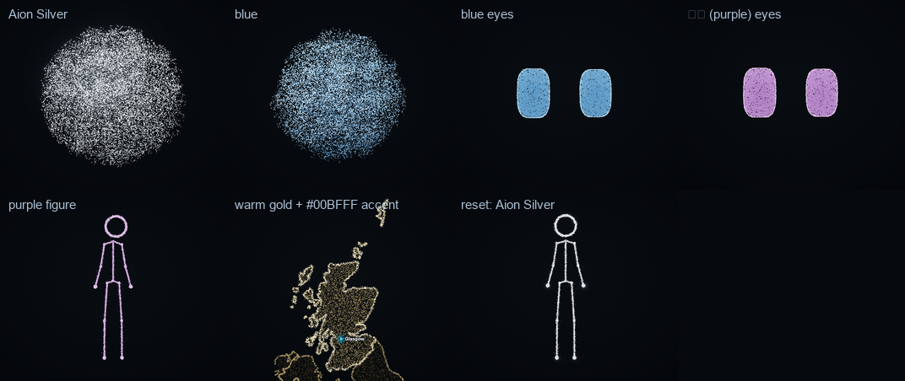

# Aion's colours (v0.4.1)

Aion has two colours, chosen independently and remembered across sessions:

| | Default | What it colours |
| --- | --- | --- |
| **base** | Aion Silver `#A8BED1` | Every particle: the sphere, the eyes, the figure, every visual they form, 3D objects. |
| **accent** | Aion Coral `#FF5A4F` | Map markers, highlighted places, an emphasised term in a card. |

```text
"Change your colour to blue."     set_colors { base: "blue" }
"把粒子颜色改成紫色。"              set_colors { base: "紫色" }
"Use warm golden particles."      set_colors { base: "warm gold" }
"Use #00BFFF."                    set_colors { base: "#00BFFF" }
"Make the markers yellow."        set_colors { accent: "yellow" }
"Restore your original colour."   set_colors { reset: "base" }        (reset: "accent" | "all")
```



- **Words, presets, hex** (`src/core/colors.ts`): common names in English and Chinese (red 红色, orange 橙色, yellow 黄色,
  gold 金色, green 绿色, teal, cyan 青色, blue 蓝色, sky blue 天蓝, navy 深蓝, indigo, purple 紫色, violet, pink 粉色, rose,
  white 白色, grey 灰色, champagne…), "light …"/"dark …" (浅/深), presets (Aion Silver, Aion Coral, warm gold, sky blue…),
  and validated `#RGB`/`#RRGGBB`. Anything else is refused with the list, so Codex can ask or choose.
- **Shading preserved**: the particle palette keeps the body's light. Aion Silver is exactly the renderer's original
  colours. Any other colour is scaled to the same peak brightness (shading and bloom behave as always), its chroma raised a
  little (the brightly lit body would otherwise pale toward white), and lifted until it has at least 4.5:1 contrast on
  the black stage — navy stays visibly navy, black becomes a dark grey you can see. Markers are lifted to 4:1.
- **Immediate, never a cut**: the palette eases over about a second in both renderers (WebGPU uniforms, and the canvas
  fallback from the same palette). The base colour drives the body's colour, its warm variant (answering's faint warm
  light) and the tint of formed visuals.
- **Photographs and cards are never tinted**: a portrait's original photograph, a card, a screenshot keep their own
  colours. Only particles change.
- **Remembered**: the hub keeps the choice in `appearance.json` in the plugin data directory and every surface receives
  it in the snapshot; a new session, a new window or a restarted Codex starts in the user's colours. A damaged file falls
  back to the defaults.
- No settings screen: natural language first.

Proof: `tests/v41.test.ts` (names, hex, refusals, the silver palette exact, contrast for every preset and for dark
colours, the hue kept, persistence across a hub restart, the reset of one colour only); `npm run smoke` (the body's lit
pixels turn blue, then purple, then back to silver, in both renderers); `npm run showcase -- colors`.
