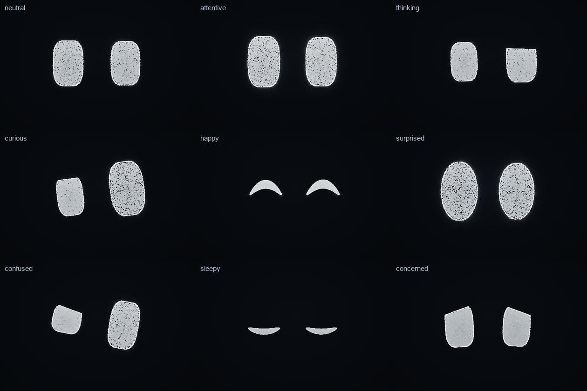

# Aion Eyes

The third persistent body, for daily conversation, attention and expression. It is the same Aion and the same
particles as the sphere and the figure: switching bodies is one particle transition, and every temporary visual
still forms out of the eyes and returns to them.

```text
set_body_form { "body": "eyes" }        "Show your eyes."
express { "expression": "happy" }        "Look happy."
```



## Design (v0.4.1: the cartoon redesign)

Minimal, friendly, expressive: the visual language of simple animated robot eyes, in Aion's silver-white particles on
black. v0.4's eyes had an iris ring, a dark pupil, glints and brows; users found them too realistic. They are gone.
Each eye is now **one luminous shape** — a solid body of particles inside a crisp, finer edge — and it says everything
with its outline:

| Means | What changes |
| --- | --- |
| size, squash and stretch | width, height and overall scale (a blink squashes to a line and springs back a touch taller) |
| roundness | the superellipse exponent: 2 is round (surprise), about 3 the friendly rounded rectangle at rest |
| lids | a flat or slanted cut from above (thinking, worry, drowsiness), a rise from below |
| arc | the whole eye bends: the middle lifts into a "^" (happy) or sags into a "‿" (asleep) |
| tilt | each eye turns about its own centre (confusion, worry), and the pair rolls (curiosity) |

| Component | Share | What it is |
| --- | --- | --- |
| edge | 30 % | A fine bright line around the shape (finer grains). It glows a little more where the lids close. |
| fill | 70 % | The eye's solid body, in larger grains so it reads as one luminous form at every quality tier, lit slightly from above. |

There are no background particles: every grain belongs to an eye.

Geometry: `src/core/eyes/layout.ts` (binding and the CPU reference `eyesPoint`), evaluated identically on the GPU by
`src/render/physics/eyes.ts`. Each grain is bound to a direction and a share of the outline's reach in that direction,
so the fill stays inside the outline whatever the roundness and every particle keeps its place as the shape deforms.
Per eye, 16 live parameters: centre and size; upper and lower lid, lid slope, lower-lid rise; roundness, arc, tilt,
brightness; edge light, fill light, shimmer. The buffer layout (four vec4 per eye) is the same as v0.4's.

## Expressions

`src/core/eyes/expression.ts`. Each is a shape for each eye plus the pair's roll, lift and gaze, and an **entry**:
the small action that makes the change read as a gesture rather than a cross-fade. Slopes and tilts are
"inner-positive", so each eye mirrors the other.

| Expression | Shape | Entry |
| --- | --- | --- |
| neutral | Calm rounded rectangles looking at the user. | — |
| attentive | A little larger and taller, brighter, very still. | perks up |
| thinking | One eye narrows under a flat lid; then the pair glances up and aside. | the glance waits 0.38 s |
| curious | One eye opened wider, the other smaller, the pair tilted. | a tilt |
| happy | Two smiling arcs, "^ ^". | a hop |
| surprised | Popped open: big, round, bright-edged. | a squash, then the pop |
| confused | Lopsided: one eye squashed under a slanted lid, the other tall, each tilted its own way. | a wobble |
| sleepy | Heavy lids sinking at the outer corners, closing over about two seconds into soft curves, "‿ ‿". | slow tempo |
| concerned | The inner corners up, a little smaller, the gaze lowered (errors). | sinks |

## Motion

- **Springs, not eases.** Every number is a damped spring (shapes elastic, about 15 % overshoot on a pop; lids firmer;
  light smooth; the gaze quick), stepped at 240 Hz so it stays stable at any frame rate. Transitions are continuous.
- **Tempo** per expression: sleepy moves at a third of the speed, surprise faster.
- **Asymmetry**: the right eye trails the left by a hair, so changes never land in perfect lockstep.
- **Blinks** every 2.5–6 s (18 % of them double, slower when sleepy): a squash to a line, slightly wider, then a
  rebound a touch taller than rest before settling.
- **Gaze**: saccades every 2–4.5 s, most of them back to the user, now and then a brief glance further. Looking aside
  the pair shifts that way and the nearer eye grows a little (as if the head turned).

## Behaviour

| Aion's state | Eyes |
| --- | --- |
| idle | Neutral, blinking and glancing; after two quiet minutes they grow sleepy; anything wakes them. |
| listening | Attentive, holding the user's gaze. The user's loudness makes them a little larger and brighter. |
| thinking, working… | Thinking: one eye narrows, the gaze drifts up and aside. |
| reading | The gaze scans along a line in small steps, then returns to the start of the next. |
| responding | A light, irregular bounce with the answer, each eye a little out of step: never a loop. |
| complete | A brief happy moment, then neutral. |
| error | Concerned. |
| greeting | Happy. |
| a card appears | A glance toward it; with an emphasised term, a curious look. |

A state change is met with a blink, as people blink when their attention shifts. An acknowledgement dips both eyes
like a nod. **Manual expressions**: `express` with an expression, or a gesture mapped to its nearest expression
(wave → happy, jump → happy, shrug → confused…), held for about four seconds (`seconds`, 1–30).

## Proof

- Real renderer: `npm run showcase -- eyes eyes-motion transitions` — the nine expressions, filmed motion clips
  (`.e2e/showcase/frames/`, turned into [eyes-motion.gif](media/v0.4.1/eyes-motion.gif) by `scripts/media/gif.py`),
  and sphere → eyes → figure → sphere. `-- --canvas` for the Canvas 2D fallback
  ([eyes-expressions-canvas.png](media/v0.4.1/eyes-expressions-canvas.png)).
- Tests: `tests/v41.test.ts` — no anatomy (only edge and fill), every expression a distinct silhouette, the shapes
  (arched happy, sagging asleep, round surprise, lopsided confusion, worried inner corners, a narrowed thinking eye),
  blink squash and rebound, elastic overshoot and continuity, entries and tempo, the trailing eye.
- Smoke: the eyes body forms and `express` reaches it, in WebGPU and in the canvas fallback.
