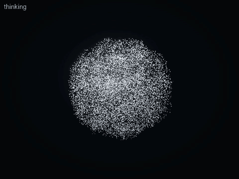
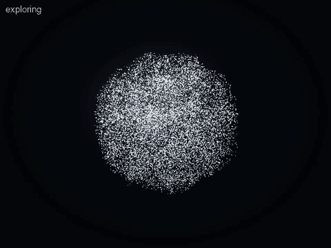
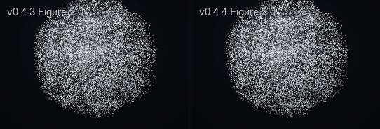
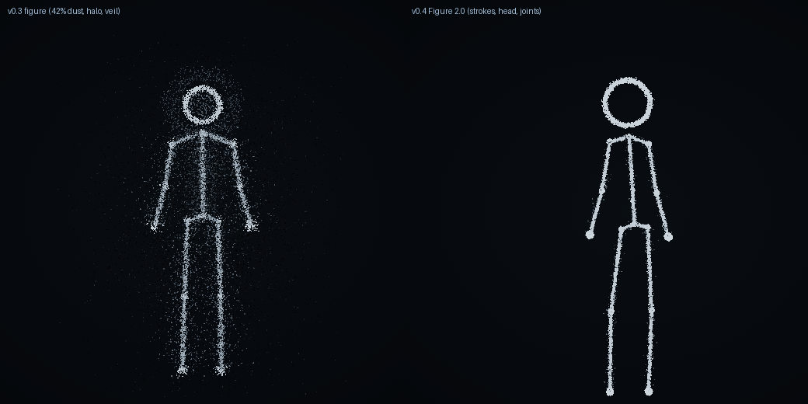

# Figure 3.0 (v0.4.4) and Figure 2.0

## Figure 3.0: a flexible character

Figure 2.0 drew each limb as straight bones between visible joint beads: it read as a skeleton. Figure 3.0 keeps the same
skeleton, poses, two-bone IK and motion system — the joints are still the animation's control points — and changes what
is drawn between them and how it moves.


| | Figure 2.0 (v0.4–v0.4.3) | Figure 3.0 (v0.4.4) |
| --- | --- | --- |
| Limbs | straight bones shoulder → elbow → hand, hip → knee → foot | one continuous curve per limb: neck ⌒ shoulder ⌒ elbow ⌒ hand; pelvis ⌒ knee ⌒ foot |
| Torso | a straight neck → pelvis line | a curve through a new `chest` anchor: it bends to the side, leans and arcs (`curl`) |
| Joints | luminous beads (16 % of the particles) | none; their particles went to the curves (limbs 79 %, head 15 %, hand/foot ends 3 %, glow 3 %) |
| Thickness | even | a little fuller at the root, finer toward the hand or foot |
| Motion | the pose | the pose + restrained secondary motion (the limb's middle lags fast movement and settles) |

```text
Behaviour / Animation Command ─► Motion Controller (motion.ts, scene sequencer) ─► Skeleton + IK (pose.ts)
   ─► Flexible Curve Solver (layout.ts limbCurve; GPU physics/figure.ts) ─► Secondary Motion (secondary.ts)
   ─► Particle Layout ─► Aion Renderer (WebGPU and Canvas)
```

**The curve.** Each span between two anchors is a cubic Hermite segment whose tangents are the average of the
neighbouring directions, scaled to the span's own length (`limbCurve`, evaluated identically on the GPU and by the CPU
reference). The curve passes exactly through every anchor with a continuous direction — no corner at an elbow, knee or
shoulder — never overshoots a short span (the shoulder), and is perfectly straight when the limb is straight. At strongly
bent joints the tangents shorten (`tight`), so a folded arm keeps a tight, natural turn instead of a rubbery loop. Legs
leave the pelvis together as a clean V (the hip anchors only steer the IK); arms flow from the neck over the shoulder.

**Secondary motion.** Each limb's middle lags a little behind fast movement and settles with a soft, slightly elastic
response (ω 9.5 rad/s, ζ 0.6), applied along the limb with a sin(πs) profile — so hands, feet, the neck and the pelvis
stay exactly where the pose puts them (contacts, IK and planted feet are untouched). Live motion uses an underdamped
follower integrated at a fixed 240 Hz (frame-rate independent: 30 and 120 fps give the same lag, tested). During a scene
the lag is a pure function of the scene's own past poses (a 14-tap filter with the same impulse response), so a replay, a
pause or a seek always shows exactly the same frame. Bounded to 0.05 of the figure's height; reduced motion lowers it.

**Uniforms.** The 16 anchors (the chest is the 16th — exactly the 4-bit packing's limit) and five limb offsets share one
uniform array; no storage buffer was added (the compute stage stays within WebGPU's default eight).

 



The behaviours (natural walking, thinking, exploring, the improved jump, explaining) are in [ANIMATION.md](ANIMATION.md).

---

# Figure 2.0 (v0.4)

The Particle Figure, redrawn and re-animated in v0.4: a clean, readable, expressive stick figure made of Aion's
particles (never SVG lines or a separate animation), for gesture, explanation and demonstration.

## Before and after

| | v0.3 | v0.4 |
| --- | --- | --- |
| Particles | bone 24 %, ring 7 %, joint 5 %, veil 4 %, aura 14 %, halo 4 %, **dust 42 %** | **bone 66 %, ring 14 %, joint 16 %**, aura 4 % (a thin glow on the strokes); veil, halo and dust 0 % |
| Strokes | three parting filaments, each grain wobbling ±0.006 | one even stroke per bone (Gaussian σ 0.0042, round from any angle), ±0.0012 of life |
| Sphere field | 6 % of the sphere's turbulence leaked into the strokes | none: the figure's life comes from its pose |
| Joints | small Gaussian clusters | luminous beads (even discs): shoulders, elbows, wrists, hips, knees, ankles; hands and feet a little larger |
| Head | ring with a dim interior, an orbiting halo | one clean ring, the same line weight, a touch denser |
| Proportions | 8.5 heads, wide clavicles | about seven heads, short shoulders (so the joints show), scale 1.65 |
| Motion | per-state sines, two envelopes, legs fixed | the Expressive Motion System (below) |



Same renderer and particle tier. Record it yourself with `npm run showcase -- figure-idle`.

## The Expressive Motion System

`src/core/figure/motion.ts` (clips and tracks) and `src/core/figure/pose.ts` (pose, IK, animator).

- **Pose**: pelvis sway, crouch and roll (contrapposto); torso lean, side bend and twist; head roll, nod and turn;
  shoulder lift; a jump; per-arm angles *or* an IK reach target *or* the chin; per-foot offsets.
- **Solver**: forward kinematics for the trunk and head; two-bone IK for arms and legs. Limb lengths never change
  (tested). Feet stay planted unless a clip steps or jumps. Knees bend forward and a little outward, so a crouch
  reads from the front. A target out of reach is pointed at with a straight arm.
- **Clips**: keyframes with easing: `in`, `out`, `inOut`, an overshooting `back` for follow-through. Each key is a
  stage of the movement. Body channels are additive (a nod during a listening lean keeps the lean), arm channels
  absolute. Every clip fades in from, and back out to, the pose underneath. Anticipation is written into the keys
  (an arm dips before a wave, a crouch before a jump, the pointing arm gathers before it extends).
- **Tracks**: each state schedules clips from a fixed seed with real pauses between them, never the same action
  twice in a row: idle (weight shifts, looking around, settling the shoulders), listening (nods, attentive tilts, an
  "mm-hm" hand), thinking (pondering up and aside, weight shifts), responding (an offered open hand, both hands
  laying out an idea, beats, making a point; hands alternate).
- **Animator**: critically damped springs ease each state's held pose (gentle start, no overshoot). The state's
  clips play on top, then a one-shot cue (a gesture, pointing, an explanation), then breathing. A fast final
  spring removes any seam. The state just left keeps playing its clips while they fade out, so an interrupted
  gesture never snaps (tested: the per-frame velocity changes by less than 0.02 at every state or cue boundary).

### Library

Natural idle stance · weight shifting · looking around · listening lean and nods · thinking (hand to chin, arm
across the waist, head tilt) · responding gestures · pointing (IK) · greeting wave · surprise (a start back with a
small hop) · a step to the side and back · a turn · a joyful jump · a shrug · drowsiness · concern.

`express { "gesture": … }`: wave, nod, point, shrug, surprise, jump, step, turn, look-around, think. Expressions
map to the nearest movement (happy → a pleased bounce, surprised → surprise, curious → a tilt, confused → a shrug,
sleepy → drowsy).

### Explaining (Demo C)

When a card appears beside the figure it turns to it. `show_text` with an `emphasis` term (`"a² + b² = c²"`,
emphasis `"c²"`) gives a card that marks the term. About a second later the figure plays `EXPLAIN`:

1. looks at the equation (head leads, torso turns, a slight lean),
2. tilts its head as it considers it,
3. gathers its arm, then points at the term (IK to the term's position on screen, mapped to the body's plane),
4. two small taps of emphasis toward it,
5. turns back to the viewer and explains with both hands,
6. relaxes.

The term's position comes from the card's layout. Both renderers map a screen point to the body's plane
(`RuntimeHandle.toWorld`). Not an animation editor: a reusable cue that later lessons can build on.

## Action sequences (v0.4.3)

The figure performs short scenes ([ANIMATION.md](ANIMATION.md)) with the same skeleton, solver and particles — no second
skeleton or renderer:

- Two pose channels: `rootX` (where it stands on the stage) and `heading` (which way it faces: the whole skeleton turns
  about its vertical axis, so walking is seen in profile, local forward becoming screen right or left). Both are 0 for
  every state pose, which is therefore unchanged.
- A deep `lean` pitches the torso keeping its length (to bend over and pick something up); leans up to 0.06 — all the
  state poses — are exactly as before.
- `FigureAnimator.perform(channels)`: a sequence drives the whole pose, eased in over 0.8 s and out over 1.1 s from the
  state's own motion (out of the last performed pose, so an interruption never snaps), on a smaller, lower stage.
- Easing comes from the Animation Core (one implementation for clips, writing and scenes).

## Proof

- Real renderer: `npm run showcase -- figure-idle figure-listening figure-explain figure-gestures`.
- Tests: allocation, stroke precision on every bone in several poses, IK, clip easing and bounds, seamless
  transitions, track pacing, the explanation's pointing direction, and every state's motion (limb lengths kept,
  feet planted, head above the neck).
- Smoke: the figure answers with its hands (range 0.03 → 0.42 world units idle → responding) and explains an
  emphasised term, in both renderers.
