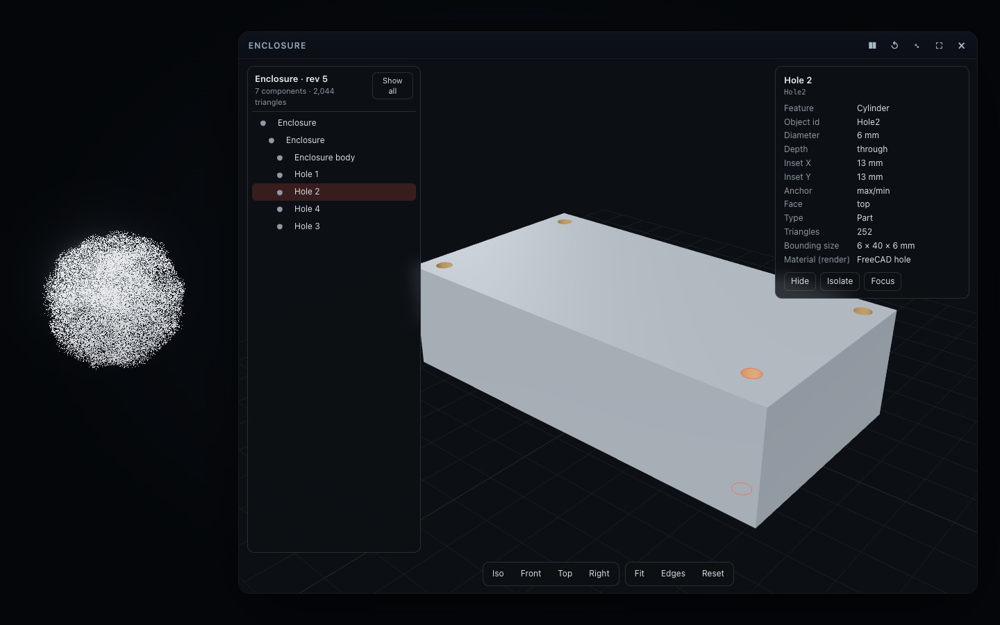

# FreeCAD: parametric CAD behind the CAD viewer (v0.7)

Aion's CAD viewer showed glTF/GLB models; since v0.7 it is also the visual front of a **real FreeCAD document**. The user
talks to Codex; Codex calls one tool, `cad_model`; FreeCAD — installed on the user's machine — owns the parametric model
and recomputes every change; Aion shows each confirmed revision. *Aion is the interface. Codex is the intelligence.
FreeCAD is the engineering backend.*

```
User ── "Make the enclosure 20 mm longer" ──► Codex (understands, plans, chooses the operation)
                                                 │  cad_model { action: "set_parameter", args: { component: "Enclosure", parameter: "Length", delta: 20 } }
                                                 ▼
Aion MCP server ── validates the arguments (src/host/cad/commands.ts), resolves "$selected", one call at a time
                                                 │  JSON line on stdin (no network port)
                                                 ▼
FreeCAD worker (FreeCAD's own freecadcmd running plugins/aion-presence/cad/aion_freecad_worker.py)
   transaction → change → recompute → refresh edge rules → validity check → commit, or abort (previous model kept)
   → document report (revision, components, parameters, solids) + preview: each face tessellated and assigned to the
     feature that made it
                                                 │  JSON line on fd 3
                                                 ▼
Aion MCP server ── GLB (src/host/cad/preview.ts) ── the same validation as any model ── hub ── CAD viewer card
                                                 │  (camera, selection, hidden parts kept; the card confirms the revision)
                                                 ▼
User sees the new revision; Codex answers from the result (revision, sizes, volume) — only what FreeCAD confirmed.
```

FreeCAD's `.FCStd` is the engineering document. The GLB in the viewer is a picture of it, rebuilt after each change.



*"Move this hole 5 millimeters inward." — Hole 2 selected in the viewer; Codex called `set_parameter {component:
"$selected", parameter: "Inset", delta: 5}`; FreeCAD recomputed revision 5; the viewer kept the view and the selection.*

## Choosing the connection

| Option | Verdict |
| --- | --- |
| A worker run by FreeCAD's own `freecadcmd` (headless), over pipes | **Chosen.** FreeCAD's bundled Python imports `FreeCAD`, `Part`, `Sketcher` with no setup; ≈ 0.2 s to start; no GUI needed; nothing listens on the network; Aion decides the operations. |
| A system Python importing FreeCAD's modules | Rejected: it only works when the Python version and paths match FreeCAD's build (on macOS FreeCAD bundles its own conda Python 3.11). |
| An add-on inside the FreeCAD application (RPC server) | Rejected as the primary path: needs the GUI running and a listening port; typical FreeCAD MCP add-ons accept arbitrary Python (`execute_code`), which Aion will not expose. |
| An existing FreeCAD MCP server | Not adopted for the same reason (code execution as the interface), plus a second MCP server for Codex to discover and a separate tool budget. |

## Installation and discovery

FreeCAD is **optional**. Aion looks for `freecadcmd` in this order: `AION_FREECAD` (the `freecadcmd` binary, or the
`FreeCAD.app` bundle); `/Applications/FreeCAD.app` and `~/Applications/FreeCAD.app` (macOS); `/usr/bin/freecadcmd` and
similar (Linux); `Program Files\FreeCAD 1.x\bin\freecadcmd.exe` (Windows); then `PATH`. A candidate is proven by
starting the worker, which reports FreeCAD's version. Without FreeCAD, `cad_model` answers `backend-unavailable` with
the install line (FreeCAD 1.0 or newer from <https://www.freecad.org/downloads.php>), and everything else in Aion works.
FreeCAD is never bundled with Aion (LGPL-2.0-or-later; see [THIRD-PARTY-NOTICES](../plugins/aion-presence/THIRD-PARTY-NOTICES.md)).

**Tested:** macOS 26.6.2 (Apple silicon) with FreeCAD 1.1.4 (the official build, Python 3.11.14). Linux and Windows
discovery is implemented from FreeCAD's standard locations but **not tested**.

## Documents, revisions, history

- **Documents** are FreeCAD documents with Aion ids (`cad-3f9a1c`). `create_document`, `open_document` (an absolute
  `.FCStd`), `save` (an absolute `.FCStd`), `close` (refused with unsaved changes unless `discard: true`). Without
  `document`, an action applies to the document the CAD viewer shows, else the last one used.
- **They persist.** Codex may start a new MCP server — and so a new FreeCAD worker — for every turn (`codex exec`
  does; this was found in the first real-Codex run, where each turn lost the model), and the user may restart Codex.
  So every confirmed revision is also saved as a FreeCAD document in Aion's workspace (`cad/` in the plugin data
  directory: `<id>/r000005.FCStd`, the revisions the undo and redo stacks still need, and `documents.json` with each
  document's name, history, stacks and file). The next worker opens the latest revision and carries on. A lock file
  keeps two conversations from changing one document at the same moment; a worker that finds the document moved on
  by another conversation reloads it first (or refuses a change made against the older state).
- **Revisions** are monotonic per document: every successful change, undo, redo or reload adds one. A change sent with
  `revision` against an older one is refused (`stale-revision`).
- **Transactions**: every change is one FreeCAD transaction. It is recomputed and checked (no object `Invalid`, every
  shape valid, every visible solid a solid with volume; a hole or pocket must actually remove material); otherwise it
  is aborted, the document recomputes to its previous state, and the error says why (`regeneration-failed`,
  `invalid-parameter`). Nothing is half-applied.
- **Undo / redo** restore the saved FreeCAD state from before (or after) a change — real backend states, never an
  imagined history — as a new revision ("Undo: Enclosure Length: 120 → 150"); they work across workers and restarts.
  (FreeCAD's in-memory undo stack would not survive a new worker.) Up to 30 steps.
- **Files**: `save` never writes over a file that is not this document's own unless `overwrite: true` (the Skill allows
  it only when the user said so); `export` (STEP, STL) likewise. A document whose file changed on disk since Aion last
  saved or opened it refuses changes (`modified-externally`) until `reload`.

### The FreeCAD application (single writer)

Live two-way synchronisation with a running FreeCAD GUI is **not implemented** (it would need an add-on inside the GUI).
Instead there is one writer at a time: `open_in_freecad` saves the document and opens it in the FreeCAD application;
from then on Aion refuses changes (`handed-off`) until the user has saved in FreeCAD and asks to `reload`, which reads
the file again (a new revision, the user's changes included). A file changed elsewhere without a hand-off is caught by
its modification time. Verified with a second FreeCAD process standing in for the application (`npm run cad:verify`);
`-- --open-gui` also opens the real application (it started with the file; its window was not inspected).

## What can be modelled

| Operation | Notes |
| --- | --- |
| Box, cylinder, sphere, cone | Part primitives with their parameters; position `at` and `rotate` |
| Holes | Through or blind, Ø any, on the top, bottom, front, back, left or right face; four `corners` at an inset, or `positions`. On a box they are bound by **FreeCAD expressions** to its `Length`/`Width`/`Height` and position, so "make it longer" keeps them at the corners — in FreeCAD itself too. Each hole: `Diameter`, `Depth`, `Inset X`, `Inset Y`. Implemented as Part cylinders cut from the body (a compound tool), not PartDesign Hole features. |
| Sketches | Sketcher sketches on XY, XZ or YZ (with an offset), made of rectangles and circles, **fully constrained** with named dimensions (`Width`, `Height`, `Diameter`, `X`, `Y`); `set_constraint` changes one. |
| Pad / pocket | `Part::Extrusion` of a sketch (pad), or extrusion cut from a body (pocket, a depth or through all). |
| Booleans | Union, subtract, intersect of two visible solids. |
| Fillets / chamfers | On an **edge rule** — all, vertical, top or bottom edges — kept with the feature and re-applied after every change (FreeCAD 1.x re-links edges by topological names, which an upstream change can break; Aion re-selects by the rule). |
| Parameters | `set_parameter` with `value` or `delta`; moves (`transform`); visibility; colour and a material name (metadata). |
| Delete | A hole, fillet, chamfer, pocket or boolean is unwrapped (whatever used it uses its base again); a body still used is refused. |
| Units | Millimetres and degrees throughout; Codex converts other units before calling. |

**Not supported** (refused or simply not offered): PartDesign bodies and its feature tree (Pad/Pocket/Hole as PartDesign
features), arbitrary sketch geometry (lines, arcs, polylines), sketch constraints other than the named dimensions, fillets
on individually picked edges, face selection (a click selects a *feature*), patterns and mirrors, threads, assemblies and
constraints between parts, drawings, FEM, arbitrary Python. Units other than millimetres in the document.

## Geometry in Aion

After each change the worker tessellates every visible solid **face by face** (deflection ≈ 0.08 % of its size) and
assigns each face to the feature that produced it: a face lying on a hole's or pocket's tool surface belongs to that
hole or pocket; a face on a primitive's surface belongs to it; anything else (a fillet's rounds) to the fillet. This is
geometric (distances to each feature's faces), so it survives recomputes. The GLB (src/host/cad/preview.ts) has one
node per visible solid and one child per feature, each with `extras.aionId` = FreeCAD's object name (`Enclosure`,
`Hole2`, `Fillet1`) and its parameters as metadata; units metres (`extras.units`), Y up (FreeCAD's Z), normals smooth
within a face and sharp between faces. It passes the same validation as any model before the card sees it.

The CAD viewer (1.1.0) loads a new revision of the same document **in place**: the camera stays, hidden parts stay
hidden, the selection stays on the same FreeCAD id. If the selected feature no longer exists, the viewer clears the
selection and reports it as `lost`; the tool result says so — it never moves the selection to another part. While
FreeCAD recomputes, a small "FreeCAD is recomputing…" note sits on the card and the previous revision stays on show.

**"This part"**: a click selects a feature; `"$selected"` in `component`/`target` is resolved by the MCP server to that
FreeCAD id before the worker sees it.

## Performance

Measured on the tested Mac (`npm run cad:verify`, `npm run smoke -- --only=cad`), per small edit:

| Stage | Box only | With 4 holes, a pocket and a fillet |
| --- | --- | --- |
| FreeCAD recompute (+ checks) | 1–3 ms | ≈ 45 ms (median of 8) |
| Tessellation | 2–4 ms | ≈ 35 ms |
| GLB build + validation | 1–2 ms | 1–2 ms |
| Asset transfer to the hub | ≤ 3 ms | ≤ 1 ms |
| Card shows the revision | 25–260 ms (first card ≈ 800 ms) | — |

The worker starts in ≈ 0.2 s on first use (and reopens the latest revision when a new one starts). With the real Codex,
a request takes 6–10 s from Enter to the viewer showing the new revision (19 s for the first, which creates the document
and opens the card); almost all of it is Codex's turn — [SCENE-GENERATION-TESTS.md](SCENE-GENERATION-TESTS.md#results--2026-10-22-freecad-scenario-k-v07). Large models are bounded (1.5 M triangles a preview,
60 s an operation; a recompute that runs longer stops the worker, and unsaved changes are lost — said in the error).

## Security

- **No port.** The worker is a child process of the MCP server, reached only through its pipes.
- **No code.** Codex sends an action name and arguments; the MCP server validates them against a strict schema (unknown
  actions or keys are refused), the worker validates them again against the live document. There is no "run Python".
- **Cards cannot reach it.** The CAD viewer only displays a GLB and reports a selection (an id), as before; it never
  calls the backend. Selections are resolved to ids by the MCP server.
- **Files**: absolute `.FCStd` paths only for documents; no silent overwrites; nothing outside what Codex names.
- FreeCAD itself runs with the user's permissions, as the FreeCAD application would.

## Verification

Kept apart, as for scenes ([SCENE-GENERATION-TESTS.md](SCENE-GENERATION-TESTS.md)):

| Kind | Where | Proves |
| --- | --- | --- |
| Unit | `tests/v07-cad.test.ts` | the command schema, discovery order, the preview GLB (ids, units, axes), the viewer manifest |
| Mocked backend | `tests/v07-cad.test.ts` | the tool: arguments checked before FreeCAD, `$selected`, a refusal never reported as success, no FreeCAD → a clear message |
| Real FreeCAD | `tests/v07-cad.test.ts` (skipped without FreeCAD), `npm run cad:verify` | scenarios A–G; sketches, pockets, fillets, STEP/STL, reopen in another FreeCAD process, the hand-off and reload, external changes refused |
| Real FreeCAD, real renderer | `npm run smoke -- --only=cad` | the viewer follows revisions, keeps the view and the selection, reports a lost one, keeps the previous revision on a refusal |
| Real Codex | `npm run scene:eval -- --only freecad` | natural language → `cad_model` → FreeCAD → viewer (scenario K): every request one call, first attempt; 6–10 s from request to the viewer's confirmation, almost all of it Codex's turn ([results](SCENE-GENERATION-TESTS.md#results--2026-10-22-freecad-scenario-k-v07)) |

A mocked test is never evidence that FreeCAD works.
