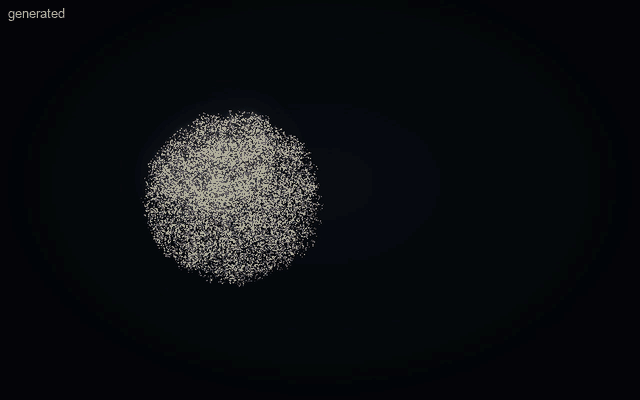

# The Generative Visual Engine (v0.5)

**One intelligence. One scene model. Multiple visual representations.**

v0.4.5 could show what was built in advance: forms, portraits, maps, an Earth–Moon card, a CAD viewer. v0.5 lets Aion
show what the user describes. Codex, still the only intelligence, writes the scene as data (a **Scene IR** document).
Aion validates it, decides how to show it, builds it, animates it, lets the user turn and select it, and changes it in
place as the conversation goes on. There is no second model, API key or subscription, and the scene is never code.



## The loop

```
User ── "Create a 3D solar system" ──► Codex ── Scene IR document ──► show_interactive_card (app generative-scene)
                                                                          │
                                         validate (src/scene/validate.ts) │ refused: code + problem, nothing shown
                                         capabilities (capabilities.ts)   │ UNSUPPORTED: said plainly, nothing substituted
                                         Presentation Router 2.0 (router.ts)
                                            │                │                    │
                                          BODY             CARD               HYBRID
                                            │                │                    │
                       particle adapter (particleAdapter.ts) │  hub: card.scene (document, revision, history)
                       → the body's 3D scene (scene3d)       │  → page → LOAD_SCENE over the Card Bridge
                                                             ▼
                                        sandboxed card: Scene Compiler (reconciler) + timeline + selection
                                                             │
                              the card reports what it built ("rendered" revision), the selection, the timeline
                                                             │
User ── clicks Earth, "make this twice as large" ──► Codex ── inspect (selection) ── patch "$selected" ──► hub
                                       transactional patch → new revision → LOAD_SCENE → the same objects change
                                                             │
                                         "Done and rendered (revision 5)" — only once the card confirmed it
```

| Concern | Where |
| --- | --- |
| Scene IR (types, limits, conventions) | `src/scene/ir.ts` — [SCENE-IR.md](SCENE-IR.md) |
| Validation (strict, a clean copy, error codes) | `src/scene/validate.ts` |
| Patches (transactional, `$selected`) | `src/scene/patch.ts` — [SCENE-INTERACTION.md](SCENE-INTERACTION.md) |
| History (revisions, undo, redo, reset, stale detection) | `src/scene/history.ts`, kept by the hub's store (`src/core/store.ts`) |
| Animation (timeline, per-animation clocks, poses) | `src/scene/animation.ts`, `src/scene/paths.ts`, `src/scene/math.ts` — [SCENE-ANIMATION.md](SCENE-ANIMATION.md) |
| Capability detection | `src/scene/capabilities.ts` |
| Presentation Router 2.0 | `src/scene/router.ts` — [PRESENTATION-ROUTER-V2.md](PRESENTATION-ROUTER-V2.md) |
| Particle Renderer Adapter | `src/scene/particleAdapter.ts` (→ `src/visual/scene3d`, the body's own 3D scenes) |
| Three.js Renderer Adapter | `src/cards/apps/generativeScene/` — `compiler.ts` (Scene Compiler), `geometry.ts`, `app.ts` (the card) |
| Card 2.0 integration | `scene-documents` capability and `LOAD_SCENE` (`src/cards/manifest.ts`, `protocol.ts`), `card.scene` (`src/cards/state.ts`), the page's card host (`src/surface/cards/host.ts`) |
| MCP | the existing `show_/control_/inspect_interactive_card` (`src/host/mcp/server.ts`) — no new tools |
| What Codex reads | `plugins/aion-presence/skills/aion-presence/SKILL.md` (Generated scenes) and `references/scene-ir.md` |
| Engineering backends (interface only) | `src/scene/cad.ts` — [FUTURE-CAD-INTEGRATION.md](FUTURE-CAD-INTEGRATION.md) |

The concerns stay separate: interpretation is Codex's; representation is the Scene IR; the router decides
presentation; compilation (`SceneCompiler`) is separate from rendering (`ViewerEngine`, unchanged from v0.4.5);
animation is a pure function of time; interaction (selection, camera) is state the card reports; and the
authoritative scene state lives in the hub. Nothing in the Scene IR knows about Three.js. The particle body and the
Three.js card are two adapters of one document, and neither tries to be the other.

## What was reused, and what was added

Reused unchanged: the Card 2.0 container (sandboxed frame, opaque origin, MessageChannel bridge, lifecycle, universal
controls, layouts), the `ViewerEngine` (WebGL2 renderer, orbit controls, picking, camera flights, on-demand rendering,
disposal), the hub and its snapshot transport, the body's 3D scene renderer, the MCP tools and the metadata budget.

Added: one registered application (`generative-scene`), one capability (`scene-documents`), one bridge message
(`LOAD_SCENE`), one hub command (`scene`), a scene state on the hub's card, and the renderer-independent `src/scene/`.
Earth–Moon and the CAD viewer are untouched.

## Demonstrations (real renderer)

Each one is a Scene IR document in `tests/fixtures/scenes/`, sent through the real MCP tools (the solar system also in an embedded MCP Apps host, `--only=embedded`). None is a separate
application. `npm run smoke -- --only=v05` checks them in both body renderers, and `npm run showcase -- scene-solar
scene-edits scene-select scene-time scene-field scene-buck scene-gears` films them.

| Demo | What happens | Evidence |
| --- | --- | --- |
| **A** Solar system | The Sun and eight planets with named, selectable objects, orbits and spins. The router picks **hybrid** (the body forms it while the card stays). The user drags and zooms. The card always shows "Not to scale". | [GIF](media/v0.5/01-solar-system-generated.gif), [still](media/v0.5/solar-system.png), [canvas renderer](media/v0.5/solar-system-canvas-renderer.png) |
| **B** Incremental edits | "Make Earth three times larger" → `0 created, 1 updated, 0 rebuilt`. "Stop Mars" → Mars holds still while Earth moves. "Change the orbit colour to blue" → `8 updated, 0 rebuilt` (the materials change in place). "Resume". Same card, same frame, same objects throughout. | [GIF](media/v0.5/02-incremental-edits.gif), [still](media/v0.5/solar-system-edited.png) |
| **C** Abstract → concrete | "Visualize the passage of time" → the router picks the **body** (an hourglass and a spiral in particles). "Turn this into an interactive 3D timeline" → a card opens beside the living body. "Add the major geological periods" → 15 objects added to the same scene, selectable, with their dates. | [GIF](media/v0.5/04-abstract-to-timeline.gif), [body](media/v0.5/time-in-the-body.png), [timeline](media/v0.5/timeline-periods.png) |
| **D** Three-phase field | Coils brighten with their phase currents 120° apart, the phasors rotate, and the resultant field turns. Pause, seek and speed all work. Routed as PARTIALLY_SUPPORTED: no field solver, so it is labelled illustrative. | [GIF](media/v0.5/05-three-phase-field.gif), [still](media/v0.5/three-phase-field.png) |
| **E** Buck converter | Source, switch, diode, inductor, capacitor and load, each identifiable with a role. The switch and diode conduct in turn, current streams around the on-loop and then the freewheeling loop, and the inductor glows as it stores energy. "Not a circuit simulation" is on the card. | [GIF](media/v0.5/06-buck-converter.gif), [still](media/v0.5/buck-converter.png) |
| **F** Select and edit | A click selects the Sun; `inspect_interactive_card` names it; a `$selected` patch moves it left and enlarges it; the planets follow their moved centre. The runtime confirms it. | [GIF](media/v0.5/03-select-edit-undo.gif), [still](media/v0.5/selected-sun-moved.png) |
| **G** Unsupported | "Calculate the accurate magnetic flux density…" (`compute:magnetic-flux-density`, fidelity measured) → `unsupported: accurate magnetic flux density needs a numerical field solver (FEM/BEM)…`. Nothing is shown and nothing is substituted. | smoke and unit tests |
| **H** History | Undo restores the previous revision (as a new revision), redo re-applies it, revert returns to the original. Stale and invalid patches are refused and the scene is untouched. | [GIF](media/v0.5/03-select-edit-undo.gif), smoke |
| Extra | Two meshing gears (`couple`, ratio −2) and a bead following a closed curve (`path`, oriented) | [GIF](media/v0.5/07-gears-and-path.gif) |

## Performance (measured)

From `npm run smoke -- --only=v05` (headless Chrome, Apple-silicon Mac, 1440 × 900). The numbers are in
[`media/v0.5/performance.json`](media/v0.5/performance.json):

| | WebGPU body | Canvas body |
| --- | --- | --- |
| Solar system: tool call → built and confirmed by the card (hybrid) | ≈ 0.14 s | ≈ 0.10 s |
| Card compile time for the solar system (18 objects, 17 animations) | ≈ 9 ms | ≈ 9 ms |
| Patch latency: tool call → hub → page → card → built → confirmed ("Earth ×3") | ≈ 40 ms | ≈ 40 ms |
| Adding 15 objects (the geological periods) | ≈ 40 ms | ≈ 40 ms |
| Open → build → close, averaged | ≈ 0.69 s | ≈ 0.69 s |
| Body and card together, both animating | 60 fps + 60 fps | 60 fps + 60 fps |
| Solar system on the card: draw calls, triangles, geometries, JS heap | 20, ≈ 27 k, 19, ≈ 7–9 MB | same |
| Left behind after 13 generated scenes | 0 geometries, 0 textures, 0 URLs, 0 loops, no WebGL warnings | same |

GPU utilization is not measurable from the page. Policies: render on demand (the card draws continuously only while
the timeline runs and has animations), a paused timeline draws only when something changes, hidden pages suspend the
card, the pixel ratio is capped at 2, geometry and materials are reused across revisions, and closing releases
everything (`DISPOSED` reports zero).

## Security

Generated scenes do not widen Card 2.0's guarantees. The Scene IR has no field that can carry code, markup, a shader
or a URL. Every number is bounded, every name comes from a fixed list, and text is drawn with `textContent` or into a
canvas. The document is validated three times: by the MCP server, by the hub (when it arrives from another process),
and by the card itself (`parseToCard` runs `validateScene`). Scenes are bounded (48 KB, 256 objects, 600 k triangles,
60 k particles) and the card refuses anything above its own triangle limit before building. A compile failure leaves
the previous scene on show. The MCP server then undoes the revision, so the document and the picture agree again.
Errors inside the card stay inside the card.

## Known limitations

- **No automatic AI turn from a click.** Selecting an object stores the selection (hub `card.selection`). Codex reads
  it when the user next speaks (`inspect_interactive_card`, `"$selected"`). No host offers starting a turn without
  undocumented APIs.
- **Illustrative motion only.** Orbits are geometric, not gravitational. "Current" in the buck converter is a
  particle animation, not a circuit solution. Nothing is a physical simulation, and requests that need one are
  refused or labelled.
- **Direct manipulation is view-only.** The user turns, zooms, pans, selects and focuses, but does not drag objects to
  move them. Moving happens through Codex patches.
- **Repeats copy a node's own geometry.** Its children are attached once, to the first copy.
- **Rendering features.** There are no shadows, post-processing, image textures or URL-loaded models in generated
  scenes (asked for, they are reported as approximated or unsupported; models belong in the CAD viewer). Lines are
  1 px (WebGL).
- **The body form is a moment.** In hybrid mode the body forms the scene's starting arrangement (no motion, no text)
  and then returns to its own body; it does not follow later patches.
- **Default orbit radius.** If an orbit gives no `radius`, it is the distance to its centre when the scene is built,
  and moving the centre later changes it. Write `radius` when the centre may move (the skill says so).
- **Paused-animation positions are not persisted.** A paused animation is stopped at the time the card had reached. A
  window that opens later rebuilds it at the start of its motion.
