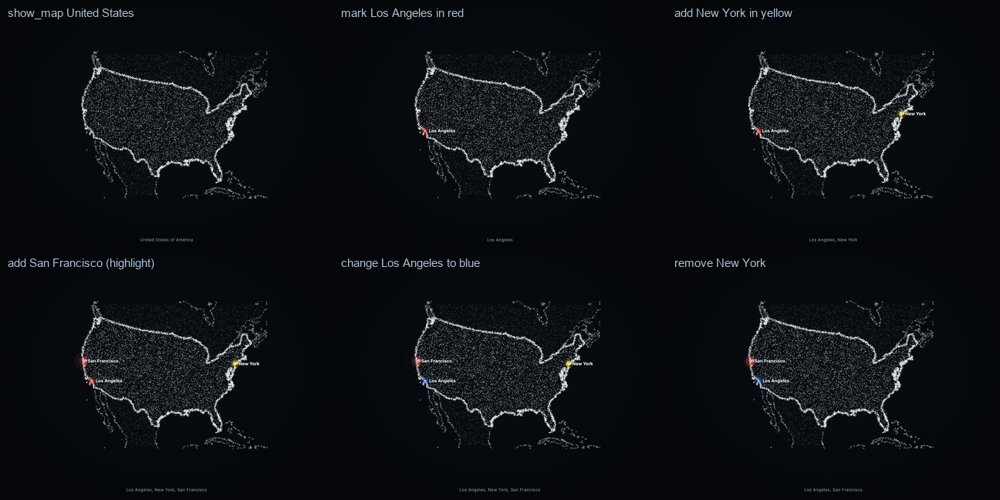

# Maps, markers and terrain (v0.4.1)

Aion shows geography in two modes, and can combine them:

| Mode | Tool | What the body becomes |
| --- | --- | --- |
| **Map** | `show_map` | The outline of a continent, country, part of one, state or city: its coast and borders bright, its land a veil of particles, its neighbours faintly around it. For *where* things are. |
| **Terrain** | `show_terrain` | The real relief from elevation data: mountains rise, valleys sink. For *what the land is like*. |
| **Markers** | `show_map` / `show_terrain` `markers`, `mark_map` | Places at their real coordinates, each a small cluster of glowing grains in its colour, with a crisp label, on either mode. |

```text
"Show me the United States."                 show_map  { region: "United States" }
"Mark Los Angeles in red."                   mark_map  { add: [{ place: "Los Angeles", color: "red" }] }
"Add New York in yellow."                    mark_map  { add: [{ place: "New York", color: "yellow" }] }
"Change the Los Angeles marker to blue."     mark_map  { change: [{ place: "Los Angeles", color: "blue" }] }
"Remove the New York marker."                mark_map  { remove: ["New York"] }
"Show me Scotland's terrain. Mark Glasgow."  show_terrain { region: "Scotland" } · mark_map { add: [{ place: "Glasgow" }] }
"Show me where Los Angeles is in the USA."   show_map  { region: "United States", markers: [{ place: "Los Angeles", highlight: true }] }
```



## Where the geography comes from

1. **Aion's offline world** — `src/host/geo/world-data.json`, built by `npm run geo:build -- <dir>` (`scripts/geo/build-world.ts`)
   from [Natural Earth](https://www.naturalearthdata.com) 1:50m (public domain): every country (242), the parts people ask for
   by name (Scotland, England, Wales, Northern Ireland, Svalbard, the Azores, French Guiana…), their names in English and
   Chinese (`中国`, `美国`, `苏格兰`…) plus common aliases (USA, UK, Britain…), continents and well-known groups (the Middle
   East, Scandinavia, Southeast Asia, the Balkans, the British Isles…), and about 1,250 cities and towns. Simplified to
   about a kilometre and delta-encoded: 512 KB (190 KB gzipped). Instant, and no network at all.
2. **OpenStreetMap** — anything else (a state, a province, a city, a mountain range, a landmark): Nominatim with its
   outline, then Photon. Only the name is sent. A place found there is labelled with the user's own words.
3. **Elevation** — AWS Terrain Tiles (terrarium PNG, metres), fetched by coordinates: at most 16 tiles a request.

Nothing of the world's elevation is in the repository; terrain stays on demand.

## Projection

Every region is drawn in a **Lambert azimuthal equal-area** projection centred on the region itself
(`src/visual/geo/projection.ts`): areas are true and shapes faithful near the centre (a country, even a continent, keeps
its familiar outline), north is up through the centre, and because longitudes are only ever taken relative to the
centre, **the date line is not a seam** (Fiji, Chukotka, the Aleutians) and **the poles are ordinary points**
(Antarctica and the Arctic get polar views). The whole world uses **Equal Earth**. Long straight segments in the data
(the 49th parallel) are densified so they curve as they should.

## What is framed

A country can be scattered across the globe. Framing all of the United States (with Guam and the Aleutians) would
shrink what was asked about to a speck, so `primaryExtent` (`src/visual/geo/extent.ts`) frames the **largest part plus
every part within reach of it**, step by step: an archipelago chains together (Indonesia, Japan, the Philippines),
Corsica stays with France, Kaliningrad and Chukotka with Russia; far territories stay out (Alaska, Hawaii, Réunion,
the Canaries, Svalbard from Norway). A **marker outside the view widens it** (Honolulu brings Hawaii in). Continents
have a window (Europe is seen from the Atlantic to the Urals; Russia is clipped there, not dropped).

## Markers

- **Coordinates are looked up, never estimated**: Aion's gazetteer first, preferring a place inside the region on show
  (Glasgow on Scotland is Glasgow, Scotland — not Kentucky), then Nominatim **bounded to the view**, then anywhere, then
  Photon. The tool result returns every marker's coordinates.
- **Placed through the same geometry as the particles**: `markerWorldPoint` (`src/visual/geo/markers.ts`) uses the map's
  frame, or the height field's frame, cell and relief — the functions the samplers themselves use — and the renderer's
  own `project()` (framing, perspective and the formed visual's sway included), every frame.
- **Drawn over the body** (`src/surface/markers.ts`): glowing grains, a bright core, a quiet pulse (a highlighted place
  pulses more), and a crisp label with a dark halo, kept clear of other labels. On terrain a marker stands on a thin
  stem above the relief. Exact and readable where particles alone would not be.
- **Changed in place**: adding, recolouring, relabelling or removing markers never forms the map again — the same
  presentation, a new marker list, the map held a while longer (60 s from the change). Markers pop in, ease to their
  new colour, fade out. At most 12.
- **Colours**: names in English or Chinese, presets or `#RRGGBB`; by default Aion's **accent** colour (see
  [COLORS.md](COLORS.md)). Lifted if needed so a marker never vanishes on black.
- **Context is kept**: `mark_map` works on the map or terrain on show; if it has already gone, it comes back with the
  change. The hybrid route adds a crisp SVG reference map card with every marked place and its coordinates.

## Terrain

`show_terrain` resolves the region exactly as maps do, plans tiles from the window its frame covers, and **resamples the
elevation mosaic into the region's equal-area frame** before masking it by the region's outline. So a continent is
never cropped (v0.4 capped spans at 70°), Svalbard keeps its true proportions (Web Mercator would make it 3–4× taller),
and the date line is no seam. The height field carries its frame through the crop and its byte codec (flag 4 of
`AHF1`), so a marker lands on the right cell and stands at the right height.

## Fallbacks

| What fails | What happens |
| --- | --- |
| A name the offline world does not know, and the geocoders are unreachable | `region-unavailable`: countries, continents and their parts still work; Codex answers in words. |
| A place to mark is unknown | `place-not-found` (with a hint: add the country). |
| Geocoders unreachable for a marker | Major cities still come from the gazetteer; otherwise `place-unavailable`. |
| Elevation tiles unreachable | `terrain-unavailable`; `show_map` still works offline. Since v0.5.2 the result says which stage failed: "the elevation service timed out / could not be reached / answered HTTP 503", "an elevation tile was invalid (…)", or "the height field could not be built". |
| Near the poles | Web Mercator elevation tiles end at ±85.05°: Antarctica's terrain stops there; its map is complete. |

## If terrain does not appear (v0.5.2)

The chain is: Codex's tool list → `show_terrain` → region → AWS Terrain Tiles → PNG decoding → mosaic → height field →
the hub (media) → the Presence surface → the particle body. Each stage fails differently:

| Symptom | Stage | Check |
| --- | --- | --- |
| Codex says it has no terrain tool, or shows a map instead | Codex's tool exposure (v0.4.5–v0.5.1: hidden by Codex's plugin budget, see [MCP-TOOLS.md](MCP-TOOLS.md#v052-the-terrain-regression)) | `npm run codex:tools`: the version Codex runs and how many Aion tools a new conversation gets; start a new conversation after updating |
| `region-not-found` / `region-unavailable` | Region lookup | the name, or the geocoders (countries and continents work offline) |
| `terrain-unavailable (…)` | Elevation service, a tile, or the height field | the cause in brackets; `npm run geo:coverage` measures the live services |
| A result, but nothing forms | Media delivery or the renderer | `npm run smoke -- --only=v41` (terrain and maps in both renderers); the surface's `&debug=1` line |

## Proof

- `tests/v41.test.ts`: every one of the ≈ 290 offline regions and groups resolves, frames and maps within bounds and
  survives the codec; projections invert exactly and have no seam at the date line or the pole; extents (contiguous
  US, Corsica, Hokkaido and Kyushu, Java–Sumatra–Papua, Chukotka, Fiji, Svalbard's shape, an unwidened Honolulu);
  markers through the samplers' own geometry, on maps and on a georeferenced height field; the tools, in-place updates,
  validation, holds.
- `npm run geo:coverage`: the live services, measured — see [GEO-COVERAGE.md](GEO-COVERAGE.md).
- `npm run smoke`: through the real MCP tools in Chrome, in both renderers — markers appear in their colours at their
  places (the screen's pixels are checked), change in place, and stand on terrain.
- `npm run showcase -- map-usa terrain-scotland geo-coverage`: the visual review.

## Limits

- Natural Earth 1:50m is simplified to about a kilometre: right for countries and continents; a small island or a city
  boundary from OpenStreetMap is more detailed. Gazetteer coordinates are city centres to within a few kilometres.
- Borders follow Natural Earth's de facto boundaries (`ADM0`); a disputed border is drawn as Natural Earth draws it.
- Region groups are a curated list, not every possible grouping; anything else goes to OpenStreetMap.
- The map shows the outlines of the region and its neighbours, not internal subdivisions (states, provinces) unless the
  region is a group of countries.
