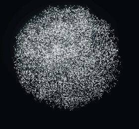

# The model library: 3D models as Aion's particles (v0.9)

Aion can *become* a 3D model — a character, an animal, an object — not by showing a shaded model in a window, but by
converting the model's surface into its own particles and forming them out of the sphere. "Show me the fox" and the
sphere unfolds into the fox, in its own colours or in Aion's silver; "show me another one" and the fox flows straight
into the next model; "make it walk" and the particles follow the model's own animation; "return to your original form"
and the sphere gathers again.



The library is general: a model is data (a GLB file and a manifest), never code, and adding one changes neither the
renderer nor the tools. The first catalogue covers Pokémon, as references only (see [Rights](#rights-and-the-three-states)).
What works, what is experimental and what was not verified: the [v0.9 development report](v0.9/REPORT.md).

## Pipeline

```text
model file (.glb .gltf .obj+.mtl .stl)            the user's own download, or a bundled model
  │ import (src/host/models/library.ts)            type by content, size, the glTF asset policy; OBJ/STL → GLB
  ▼
the library (plugin data dir: models/)             library.json + files/<id>.glb — this machine only
  │ convert (once, cached by hash · detail · clip · converter version)
  │   GltfModel (src/visual/models/gltf.ts)        accessors (strides, normalized, sparse), strips/fans, node TRS,
  │                                                skins evaluated in the rest pose, materials, KHR_texture_transform
  │   textures (src/host/models/textures.ts)       PNG; JPEG with Aion's own decoder (baseline/progressive), ≤ 1024 px
  │   sampler (src/visual/models/sampler.ts)       normalize → area-weighted seeded sampling (+ colour detail) →
  │                                                visibility (BVH rays) → colour + baked light
  │   correspond.ts                                point i ↔ sphere grain i (recursive median matching)
  │   animation.ts                                 a clip baked through the skeleton (optional)
  ▼
particle bundle (application/vnd.aion.particles)   "AIPM": int16 positions, sRGB colours, light, frames — ~0.5 MB
  │ hub media → surface (view.ts) → VisualActionController (forms, holds, cross-morphs)
  ▼
renderer (WebGPU and canvas)                       target vec4 (place + writing key), look vec4 (colour + tone),
                                                   previous vec4 (cross-morph), formedOwn, ModelPlayback
```

### Conversion

- **Geometry**: every primitive of the default scene, in world space; triangle lists, strips and fans; disconnected parts
  and several materials are normal. A skinned mesh is placed by its joints (glTF ignores its node transform), so a rigged
  character stands as authored. Points and lines are skipped with a warning.
- **Normalization** (`normalization.ts`): up axis to +Y (glTF is Y-up; STL and many OBJ files are Z-up, which a manifest
  says with `particle.orientation.up`), optional yaw and rotation, centred on the bounding box, scaled so the farthest
  point is at 1.75 (the same stage as `show_scene`).
- **Sampling** (`sampler.ts`): triangles receive particles in proportion to their **area** — never one per vertex, which
  would follow the tessellation instead of the shape. Uniform barycentric points from one seeded sequence: the same model
  and options give the same particles. Up to 18 % of the particles favour **colour detail** (triangles whose colour varies:
  an eye, a mouth, a stripe), capped so no patch exceeds three times its area density.
- **Visibility**: a candidate point is kept only if a ray in one of 14 directions (along its normal first) leaves the
  model (`bvh.ts`, any-hit traversal). This removes what no one could see — a head's surface under an embedded eye, mouth
  interiors, overlapping parts — which otherwise shows through the particle surface as noise. The outward side of the
  escaping ray also orients the point's normal.
- **Colour**: material base colour (or the spec-gloss diffuse of older exports) × vertex colour × base-colour texture
  (wrap modes and texture transforms honoured); alpha-masked or near-transparent texels are not surface. Only textures a
  material uses for colour are decoded. A texture that cannot be decoded (16-bit or interlaced PNG, CMYK JPEG) falls back
  to the material colour, reported in the result.
- **Light**: each point carries a baked Lambert light from a soft top-front key, so the form reads even in silver.
- **Silver tone**: in Aion's silver, a particle's tone is its light darkened by the model's own lightness — dark eyes and
  markings stay dark, so a character remains recognisable without colour.

### Correspondence: why the transformation is orderly

The renderer moves grain *i* of the body to point *i* of the target. With an arbitrary order every grain crosses the
body and the change reads as an explosion. `correspond.ts` reorders the model's points so that point *i* lies, relative
to the model, where sphere grain *i* lies relative to the sphere: both sets are split at their medians by the same axis
(vertical first), recursively, and the halves paired — a deterministic O(n log² n) approximation of optimal transport.
The top of the sphere becomes the ears, its left the left arm; the mean distance a grain travels drops by about half
(test: `correspondence`). Because the sphere is the renderer's own seeded sequence, any prefix of grains — any quality
tier — keeps the correspondence. And because every model is matched to the same sphere, two models correspond to each
other too.

## Morphing

- **Sphere → model**: the existing staggered morph, now orderly (above), over 2.4 s; it returns in 1.8 s.
- **Model → model** (v0.9): the controller replaces a formed model *while formed* (`crossing`); the renderer keeps the
  previous target in a third buffer and blends each grain on its own staggered schedule, with a slight outward breath at
  mid-way (`crossTarget`, mirrored in the canvas fallback). Colours blend with the positions. The user's view (how they
  turned it) is kept. A third request during the 2.2 s morph waits for it to finish. Anything that is not a model still
  returns through the sphere, as before.
- **Colours** (`colors: "original" | "silver"`): the same particles; the renderer eases `formedOwn` over half a second.
  No re-form.
- **WebGPU limits**: the compute stage still uses 7 storage buffers of the default 8. The writing reveal key moved into
  the target's w (one vec4 per grain), which freed the buffer the previous target needs; the look (colour + tone) is a
  vertex attribute.

## Animation

A model's **own** clips only, for any body plan — quadrupeds (the Fox), soft-bodied characters (Lumen's bounce), bipeds
with tails — because nothing assumes a humanoid skeleton:

```text
animated GLB  →  deforming mesh  →  surface-attached particles  →  Aion's renderer
(skins, morph    (GltfModel: TRS channels with step/linear/      (each particle sampled once on the rest pose: a
 targets, clips)  slerp/cubic spline, morph weights, linear        triangle + barycentric weights; re-placed on that
                  blend skinning, at any time)                     spot in every frame — never resampled)
```

`bakeAnimation` evaluates the clip at up to 15 frames a second and places every frame with the rest pose's matrix, so
the character keeps its size; the frames travel in the bundle (at most 6 MB of them), **quantized over the extent of every
frame** (v0.9.1: v0.9.0 clamped frames to the rest pose's range, which flattened the running Fox's nose —
[report](v0.9.1/REPORT.md#1-the-foxs-clipped-nose--root-cause)). `ModelPlayback` loops them, interpolating between frames,
at the clip's speed, in both renderers. Morph targets (v0.9.1) are evaluated before skinning, as glTF specifies.

Control: `show_model {animation: "<clip>"}` starts one of the clips the result lists (`"stop"` ends it); while it plays,
`control_animation` pauses, resumes, replays it or changes its speed (slow, normal, fast, slower, faster; 0.25–2.5×), in
place. Not done (on purpose): no motion is invented. A model without clips has no animation — Aion says so and offers to
turn it (`set_scene_view`); `express` gestures belong to Aion's own bodies. No retargeting between skeletons, no motion
capture, one clip at a time.

**Making an animated model** (v0.9.1): any tool that exports glTF 2.0 with a skin and/or morph targets and named clips
(Blender: File → Export → glTF 2.0, "Animation" on). For Aion's own fixtures, `scripts/lib/rig.ts` builds one in code:
bones with rest positions, skinned parts with soft joints (`segmentSkin`, `blend`), morph targets, looping clips sampled
from a function of time, two-bone leg IK (`legIk`) for planted feet, a reusable soft-body bounce (`softBounce`). Lumen's
"Bounce" is built this way. Check a model in Aion's renderer, not just a GLB viewer:
`npx tsx scripts/models/playback.ts --out <dir> --model <file.glb>=<Name>` (frames, a GIF, frame-time percentiles per
detail level and render tier, load times, and the viewport checks).

**Characters with third-party rights** (a franchise's characters) are evaluated in the git-ignored `local-models/`
folder and imported into the user's own library; they are never committed or bundled. v0.9.1's Koromon and Agumon
evaluation is described in the [report](v0.9.1/REPORT.md#3-koromon-and-agumon-local-only).

## The tool

One tool for every model — never one per character (budget: [MCP-TOOLS.md](MCP-TOOLS.md#v09-one-tool-for-the-model-library)):

| Request | Call |
| --- | --- |
| "Show me the fox." | `show_model {model: "fox"}` |
| "Show me another character." | `show_model {model: "another one"}` — the next installed character |
| "Change it to your original silver." · "Show its original colours." | `show_model {colors: "silver"}` · `{colors: "original"}` |
| "Can you make it walk?" · "Stop." | `show_model {animation: "Walk"}` · `{animation: "stop"}` |
| "Rotate it." · "From above." · "Zoom in." | `set_scene_view` (unchanged; now also for models) |
| "Return to your original form." | `clear_presentation` |
| "Which models do you have?" · "Do you have Eevee?" | `show_model {action: "find"}` · `{action: "find", model: "Eevee"}` |
| "Import the Pikachu I downloaded." | `show_model {action: "import", file: "/abs/path.glb", model: "<catalogue id>"}` |
| "Remove it from your library." | `show_model {action: "remove", model: "<id>"}` (imported models only) |

`show_model` resolves names through the registry (`registry.ts`): ids, names, aliases in other languages ("皮卡丘"),
Pokédex numbers ("#0025") and small misspellings ("Pickachu"). If only catalogue references exist, the tool **fails** with
`model-not-installed`, lists them with author, licence and rights, and gives the import path; with nothing at all,
`model-unknown`. Either way nothing else is shown (the Skill tells Codex never to substitute). The result reports the
particle count, whether the conversion was cached, the model's own clips, and its credit — which the surface also shows
as a caption while the model is formed.

The original, shaded model stays separate from its particle form: to inspect it as authored, the existing CAD viewer card
opens a .glb or .gltf file by path (`show_interactive_card` with `app: "cad-viewer"`). Loading is cancellable: a newer
request aborts a model that is still being fetched or decoded in the surface, and the renderer reuses its buffers (no
reallocation per model); the library keeps at most four converted bundles in memory and the hub's media store is bounded.

## Rights and the three states

| State | What it means | Where | Example |
| --- | --- | --- | --- |
| **catalogued** | Source, author, licence and rights recorded; no file distributed or kept | `assets/models/catalogue/*.json` | 626 Pokémon fan models on Sketchfab (236 characters) |
| **local** | The user downloaded the file themselves, under its terms, and imported it | the plugin data dir's `models/`, fed by `action: "import"` or the user's own models folder (never in the repository, never uploaded) | a Pikachu model the user imports |
| **redistributable** | The model's licence *and* any underlying design rights allow shipping it | `assets/models/` (bundled) | Lumen (Aion's own), the Khronos Fox (CC0 + CC BY 4.0) |

The manifest schema (`aion.model/1`, `manifest.ts`) enforces it: a redistributable model needs a licence that allows
redistribution, `redistributionVerified`, an original or public-domain subject, and a bundled file; an extracted game
asset (`extractedGameAsset: "yes"`) is never imported. Every catalogue record keeps the character, title, author, URL,
formats, download availability and size, licence (SPDX id where one exists) with what it permits (modification,
redistribution, commercial use), the underlying design's owner, the date checked and the download status.

**A Creative Commons licence on a fan model covers the modeller's work, not the character.** Every Pokémon entry records
`underlyingIp: "third-party"` (Nintendo / Creatures Inc. / GAME FREAK inc.) and stays `catalogued`. Aion never downloads
them: Sketchfab downloads need the user's own account, and the decision (and the terms) are the user's. A user may
download one for their own private use and import it; it then stays on their machine. Titles, tags or descriptions that
suggest a model was ripped from a game (Smash Bros., the main-series games, "models-resource"…) mark it **restricted**
(`extractedGameAsset: "suspected"`): a deliberately cautious heuristic (it also catches fan models whose description
names a game), and a restricted reference is never linked by an import.

Discovery (`npm run models:discover`) uses only Sketchfab's public search API (no account, no token, paced at one request
every 1.5 s, an identifying User-Agent) and never downloads a model. free3d.com and CGTrader have no public search API;
they were not scraped. The readable catalogue — available, catalogued and restricted entries — is
[MODEL-CATALOGUE.md](MODEL-CATALOGUE.md).

## The user's own models folder (v0.9.2)

`~/.aion-presence/my-models/` (`sharedModelsDir()` in `src/host/paths.ts`) is where a user keeps models they want Aion to
have everywhere on their machine. It sits outside every plugin host's data directory, so each Aion install (another Codex
profile, a reinstalled or updated plugin with an empty data directory) finds the same models, and updates never touch it.

- **What it reads**: `.glb`, `.gltf`, `.obj`, `.stl` at the top level or one folder down (a `.gltf` or `.obj` with its
  own files); dot-files and other files are ignored.
- **Sidecar** `<file>.aion.json` (all optional; unknown keys are refused, so a typo is reported): `name`, `category`,
  `author`, `licence`, `url` (https), `underlyingIp` (`original`, `third-party`, `public-domain`, `unknown`), `ipOwner`,
  `notes`. Without one, the name comes from the file name and the rights are `unknown`.
- **Mirroring**: whenever the library is read (at most one directory listing when nothing changed, and once shortly
  after the server starts), new files are imported exactly like `action: "import"` (validated, converted once, id
  `my-<name>`), changed files or sidecars are re-imported under the same id, and deleted files leave the library with
  their cached particles. A copy imported earlier by hand is adopted rather than duplicated. A folder that does not exist
  changes nothing (an unmounted disk never empties the library). Files that cannot be imported are listed by
  `action: "find"`, which also names the folder.
- **Rights**: everything imported from it is `local` (`redistributionVerified: false`): the folder is the user's, not
  the plugin's, and nothing in it is uploaded or published. It is the place for models whose designs belong to someone
  else (a fan likeness of a franchise character) that the user wants on every install without putting them in a
  repository.
- `AION_MODELS_DIR` moves the folder; with `AION_PRESENCE_HOME` set (development, tests) it is `<home>/my-models`, so a
  test never reads the real one. Only the plugin's entry point mirrors it; scripts and tests construct libraries without.

## Files

| Path | |
| --- | --- |
| `src/visual/models/` | Pure core: `geometry.ts` (neutral geometry, matrices), `gltf.ts`, `obj.ts`, `stl.ts`, `jpeg.ts`, `writeGltf.ts`, `normalization.ts`, `bvh.ts`, `sampler.ts`, `correspond.ts`, `animation.ts`, `bundle.ts`, `manifest.ts`, `registry.ts` |
| `src/host/models/` | `library.ts` (import, cache, removal, the user's models folder), `textures.ts`, `service.ts` (what `show_model` does and says) |
| `src/render/` | `ParticleSystem.ts` (target, look and previous buffers), `rendering/material.ts`, `physics/morph.ts` (`crossWeight`, `crossTarget`), `modelPlayback.ts`, `fallback/canvasRuntime.ts` |
| `src/visual/controller.ts` | Model → model cross-morph |
| `plugins/aion-presence/assets/models/` | `library.json` (bundled models), `originals/lumen.glb`, `khronos/fox.glb`, `catalogue/pokemon.json` |
| `scripts/models/` · `scripts/lib/rig.ts` | `make-originals.ts`, `discover.ts` (+ `pokemon.ts`), `import.ts`, `build-catalogue.ts`, `measure.ts`, `demo-gif.ts`, `playback.ts` (v0.9.1) · the rig builder |

Commands: `npm run models:originals` · `models:discover` · `models:import -- --file <path> [--catalogue <id>]` ·
`models:catalogue` · `models:measure [-- --file <path>]` · `models:demo` · `npm run smoke -- --only=models`.

## Performance

Measured on the development Mac (Apple silicon, Node 22) with `npm run models:measure`; conversion happens once per model,
detail and clip, then loads from the cache in milliseconds.

| Model | File | Triangles | Textures | 12k / 30k / 50k particles | Notes |
| --- | --- | --- | --- | --- | --- |
| Lumen (original) | 0.5 MB | 25,832 | — | 0.22 / 0.45 / 0.70 s | a third of the candidates are hidden (overlapping parts) |
| Fox (Khronos) | 0.2 MB | 576 | 1 × 1024² | 0.05 / 0.12 / 0.21 s | Survey clip: 20 frames in 33 ms (+5.7 MB) |
| Avocado (Khronos, CC0, not bundled) | 7.7 MB | 682 | 1 × 2048² used | 0.06 / 0.14 / 0.24 s + 0.24 s textures | |
| A Beautiful Game (Khronos, CC BY 4.0, not bundled; stress test) | 41 MB | 1,499,072 | 13 × 2048² JPEG used | 1.3 / 1.5 / 1.7 s + 3.1 s textures | BVH 0.7 s; process resident memory 665 MB during conversion |

A 50,000-particle bundle is 488 KB; the cache holds one per model, detail and clip. The Pokémon catalogue (626 references)
is 1.1 MB of JSON, read by the MCP server on the first `show_model` call only; nothing of it reaches the renderer, and startup is
unchanged. Renderer: see [the smoke results](#testing).

## Security

A model is data. The import refuses URLs (Aion never downloads), relative paths, unsupported types (FBX, BLEND, DAE,
USDZ: "export it as .glb"), files over 96 MB, and anything that fails the glTF asset policy (self-contained, no decoder
extensions — Draco, meshopt, KTX2, WebP — bounded counts, consistent ranges, an acyclic node graph); a `.gltf` or `.obj`
reads its textures and buffers from its own folder only. Accessors, indices and texture coordinates are range-checked;
non-finite numbers are refused. The JPEG and PNG decoders are strict and bounded. The surface receives only the particle
bundle, validated again on decode (header, counts, exact length). Catalogue JSON is schema-checked on every load.

## Testing

- **Unit and integration** (`tests/v09-models.test.ts`, 24 tests): JPEG against libjpeg (baseline 4:2:0, progressive
  4:4:4 and 4:2:0 with successive approximation, restart intervals, greyscale, scaled decoding, refusals); the Fox through
  its skin and clips; channel interpolation; OBJ/MTL and STL, OBJ → GLB round trip; area weighting, determinism,
  normalization, hidden-surface removal, alpha cut-outs, texture colours; correspondence (bijection, order independence,
  less travel); baked animation; the bundle codec and media sniffing; target points; the controller's cross-morph; clip
  playback; manifest rights rules; the bundled library and its notices; the Pokémon catalogue's rules; the registry
  (languages, misspellings, resolve); the library (import, duplicate, refusals, cache, provenance from a catalogue entry,
  restricted entries, removal); `show_model` through MCP.
- **Real renderer** (`npm run smoke -- --only=models`, WebGPU and canvas, through the real `show_model`): the sphere
  becomes Lumen in teal, silver applied in place (no re-form), Lumen → Fox directly (no phase back to the sphere), the Fox
  orange, turned by `set_scene_view`, walking with its own clip (screen motion measured), an uninstalled model refused
  with nothing else shown, "another one", back to the sphere, no page errors. The frames are the GIF above.
- **Not verified**: a real Codex conversation choosing `show_model` (only the MCP path and the Skill's examples were
  tested); real Sketchfab Pokémon models (none was downloaded — see Rights); Windows and Linux renderers; WebGPU on a
  discrete GPU or a phone.

## Limits

- glTF 2.0 (GLB or .gltf with its files), OBJ (+ MTL, diffuse colour and map), STL. FBX, BLEND and others must be
  exported to glTF first. Compressed geometry or textures (Draco, meshopt, KTX2, WebP, AVIF) are refused.
- Base colour only (no lighting from the model's normal maps or PBR); vertex colours, textures and material colours mix.
- Up to 50,000 particles (the renderer's top tier); devices on lower tiers show a uniform subset. The canvas fallback shows
  4,000 particles, with colours batched to 4 bits a channel.
- Animation: skinned and morph-target clips, baked at ≤ 15 fps, ≤ 6 MB per clip; colours do not animate; visibility is
  decided on the rest pose.
