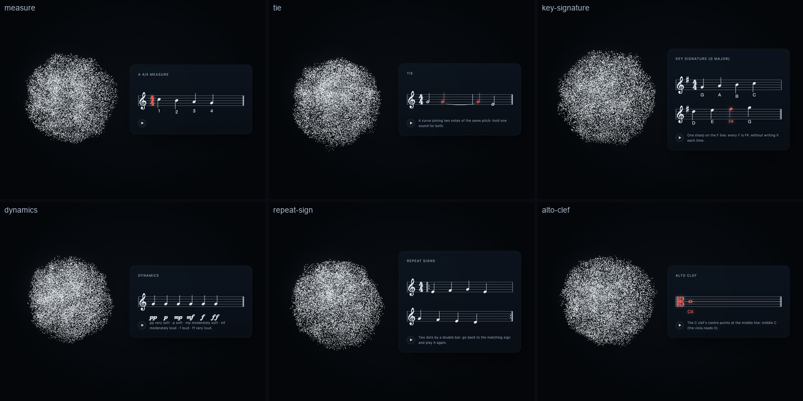

# Music Library (v0.4.2)

Aion teaches music theory through conversation: Codex explains, and Aion shows exact notation, lights up what is
being explained, plays the notes on the user's device, and forms musical symbols with its body. The Music Library is
structured knowledge — validated scores, never drawings — so every note sits where theory puts it, sounds at its
equal-tempered frequency (A4 = 440 Hz), and can be named, pointed at and checked. No model generates music; nothing
is fetched.

```text
"I want to learn how to read music."   →  lesson 1: a five-line staff, its lines lit one by one
"What does this note mean?"             →  Codex answers from the note's facts (name, solfège, frequency, position)
"Can you play it?"                      →  it sounds, and lights up while it sounds
"Play the C major scale."               →  the scale appears; each note lights the moment it is heard; the body moves with it
"Show me the treble clef."              →  the card's clef lights up while Aion's particles form a treble clef beside it
"Explain that in Chinese."              →  the same lesson and step, in Chinese terminology
```

## Music Education Pack (v0.4.4)

The Music Library gained the rest of the introductory vocabulary — in the same validated score model, engraved by the same
VexFlow + Bravura card (no second renderer):

- **Clefs**: treble, bass, and now **alto** (C clef: middle C on the middle line).
- **Key signatures** (`key`: C … C♯, F … C♭, and minor keys), with accidentals shown as engraving does: the key's sharps and
  flats are not repeated, an accidental lasts to the end of its bar for that letter and octave, a return to the key's
  spelling shows a natural (tested rule by rule).
- **Ties** (`tie` on a note, to the next note of the same pitch — across bar lines too), **slurs** (`slur: start/end`),
  **dynamics** (pp p mp mf f ff, engraved in Bravura's SMuFL dynamic glyphs, never typed text), **stem direction**
  (`stem`), **bar lines** (`end`: single, double, final, repeat) and a start-repeat sign.
- **A glossary** (`music/glossary.ts`, `show_music {concept}`): 40 concepts — clefs, the staff's lines and spaces, ledger
  lines, bar lines, every note value and rest, stems, flags, beams, dotted notes, sharps, flats, naturals, 2/4 3/4 4/4 6/8
  and common time, a key signature, ties, slurs, repeat signs, dynamics, note positions and note values — each a small
  validated score with what to light up and a teaching point in English and Chinese. Where a validated handwriting
  sequence exists, the result says so and `show_stroke_animation` draws it; concepts without one are shown engraved only.



Handwriting demonstrations of symbols are described in [STROKE-ANIMATION.md](STROKE-ANIMATION.md) (Music); they are measured
against the engraved shapes and never presented as the engraving.

## Architecture

```text
src/music/
  theory/     pitch.ts (scientific pitch, MIDI, frequency, solfège), rhythm.ts (note values, time signatures, tempo),
              scales.ts (spelled scales and step patterns)
  notation/   staff.ts (clefs, staff positions, ledger lines, names of positions), score.ts (the validated score,
              highlights, playback events, audio-clock scheduling)
  lessons/    lessons.ts (eight lessons, English and Chinese)
  exercises/  reading.ts (deterministic note-reading questions and answer checking)
  visual/     bravura.ts (SMuFL outlines), glyphForms.ts (the "music" visual-form pack for the body)
src/host/music.ts           tool arguments → scores, note facts, lesson moves, answers (pure)
src/surface/music/
  notation.ts               the notation engine: VexFlow + Bravura → SVG, note groups indexed for highlighting
  player.ts                 the playback engine: Web Audio, scheduled on the audio clock, analysed in-graph
```

Separation, as asked: the **theory engine** (`theory/`, `notation/staff.ts`, `notation/score.ts`) is pure and
exhaustively tested; the **notation engine** only draws a validated score; the **playback engine** only plays
validated events; the **interaction controller** is the MCP tools (`show_music`, `play_music`, `music_lesson`) and
the view, which routes, highlights, plays and turns the figure to the note.

## Notation

**Engine: VexFlow 5.0.0** (MIT licence; github.com/vexflow/vexflow) with the **Bravura** font (SIL Open Font
License 1.1, Steinberg). Evaluated against drawing symbols by hand: VexFlow engraves clefs, noteheads, stems, flags,
beams, ledger lines, accidentals, dots, rests, bar lines and time signatures with standard spacing and SMuFL glyphs,
which a hand-drawn approximation would not match. Integration: the `vexflow/core` build (no bundled text fonts) and
Bravura loaded from its bytes with the FontFace API — no URL, so no font request and no CSP exception. Cost:
about 670 KB of the single-file surface (2.46 MB in total).

- Supported: treble and bass clefs; whole, half, quarter, eighth and sixteenth notes and rests, dotted values;
  sharps, flats, naturals and doubles; ledger lines to four either way; bar lines from the time signature
  (2/4, 3/4, 4/4, 3/8, 6/8, 9/8, 12/8, 2/2, C); beams by the felt beat (pairs in 4/4, threes in 6/8); labels under
  notes; lines wrap so nothing is squeezed.
- **Validation** (`checkScore`): pitches must parse and lie on a piano (A0–C8) and within four ledger lines of the
  chosen clef; each bar must be exactly full (a note may not cross a bar line); at most 48 notes; labels plain.
  Errors come back to Codex in words ("note 2 crosses a bar line: each 4/4 bar holds 4 quarter notes").
- **Positions**: a staff position counts lines and spaces from the bottom line (0). Treble lines E4 G4 B4 D5 F5,
  spaces F4 A4 C5 E5; bass lines G2 B2 D3 F3 A3, spaces A2 C3 E3 G3; middle C at −2 in treble (one ledger line below)
  and 10 in bass (one above). Positions are named as teachers do, in English ("the first ledger line below the staff")
  and Chinese (下加一线, 第三间).
- **Highlights**: notes by index, a staff line (1–5) or space (1–4), the clef, the time signature. Lit items take
  Aion's accent; the note sounding now glows white.

Accuracy is checked in the real renderer: the smoke test reads every notehead of an engraved C major scale and
compares it with its theoretical staff position — the largest error is **0.5 px of a 10 px staff space**.

## Playback

Web Audio on the device: one oscillator per note with a piano-like set of partials, a quick attack, a pitch-dependent
decay, a low-pass that darkens as the note fades, and a short release; a gentle compressor; master volume.
Frequencies are exact equal temperament from MIDI numbers (`frequency(m) = 440 · 2^((m − 69)/12)`).

- **Deterministic scheduling.** All notes of a request are scheduled ahead on the AudioContext clock (`schedule()`,
  120 ms look-ahead), never on animation frames. The highlight reads the same clock, corrected for output latency
  (`getOutputTimestamp`), so each note lights as it is heard. Measured in Chrome: at 80 bpm the lit note changed every
  **0.748–0.752 s** (0.750 expected) through C4…C5.
- **Controls**: tempo (30–240 quarter notes a minute), volume, chosen notes only (`only`), stop, and the card's own
  play button.
- **Autoplay**: browsers keep audio suspended until a click. A request then waits (`blocked`); the next click in Aion's
  window starts it. The tool result says `blocked` so Codex can ask for that click. The companion's "Enter Presence"
  click already counts.
- **One player**: only the newest companion window plays (or the embedded view when no window is open), so two
  surfaces never double the sound.
- **Analysed in-graph**: the master bus passes through an AnalyserNode into the shared Audio Analysis Engine, so the
  body moves with the music without the microphone or any loopback, and the microphone ignores the speakers meanwhile
  (see [AUDIO-REACTIVE.md](AUDIO-REACTIVE.md)).

## Presentation

| Route | Music |
| --- | --- |
| CARD (default) | Exact notation beside the living body; Aion keeps listening and answering beside it |
| HYBRID | With `symbol` (or a lesson step that has one): the body forms a treble clef, bass clef, note value, rest or accidental from the Bravura outlines while the card shows the staff |
| BODY | `show_form` with a music form (`music.treble-clef`, `music.quarter-note`, `music.sharp`…), when only the symbol matters |

**Figure 2.0**: when a music card appears with something lit, the figure turns to it and points at the lit note
(the same EXPLAIN/POINT clips as a card's emphasised term); while music plays it points at each note as it sounds; the
eyes glance at it. No new animation system.

## Lessons

| # | Lesson | Steps |
| --- | --- | --- |
| 1 | The five-line staff · 认识五线谱 | lines; spaces; notes on lines and spaces climbing; a ledger line |
| 2 | Treble and bass clefs · 高音谱号与低音谱号 | the G clef names line 2 (G4); the F clef names line 4 (F3); middle C in each |
| 3 | Note names and pitch · 音名与音高 | treble lines E G B D F; spaces F A C E; bass lines and spaces; 440 Hz and 880 Hz |
| 4 | Whole, half, quarter and eighth notes · 全音符、二分音符、四分音符与八分音符 | one value per step, then all four |
| 5 | Musical rests · 休止符 | quarter rests heard; half and whole rests (hat and hole); eighth rests |
| 6 | Basic time signatures · 基本拍号 | 4/4, 3/4 (waltz), 2/4 (march), 6/8 (two beats of three) |
| 7 | The C major scale · C大调音阶 | the scale (solfège in Chinese); the half steps E–F and B–C; descending |
| 8 | Note-reading practice · 识谱练习 | six treble and four bass questions, checked |

A step carries the teaching point, not a script: Codex says it in its own words, in the user's language, then waits.
`music_lesson` continues (`next`, `previous`, `repeat`, a number), switches language without losing the lesson or the
step, and checks answers ("E", "E4", "mi", "F sharp"; an octave, if given, must match).

## Tools

| Tool | Does |
| --- | --- |
| `show_music` | Notes, a scale or an empty staff; highlight, caption, a body symbol; `play: true` also plays it. The result lists every note's pitch, name, solfège, frequency, duration and position (English and Chinese) |
| `play_music` | The music on show (or chosen notes of it), or notes/a scale it shows as it plays; tempo, volume, stop. Reports `playing`, `blocked`, `requested` (embedded view) or `no-window` |
| `music_lesson` | Starts and moves through lessons; switches language; checks practice answers |

## Tests

`tests/v42.test.ts`: pitch arithmetic and frequencies, clef lines and spaces, middle C's ledger lines, staff position
names in both languages, note values and time signatures, correctly spelled scales and step patterns, strict score
validation, exact scheduling, practice questions and answers, every lesson step valid in both languages, the
host-side flow, the body's music forms. `npm run smoke` (v42 section): lessons through MCP, the engraving checked
against theory, playback timing, the hybrid clef, the language switch and practice answers in Chrome.

## Limits

- Two clefs (treble, bass), one voice per staff, no chords, ties, tuplets or key signatures yet (accidentals are
  written on each note). Lessons are the first eight; the structure takes more.
- The tone is a synthesised piano-like voice, not a sampled instrument.
- In MCP Apps hosts the embedded view plays only when no companion window is open, and cannot report whether the
  browser blocked the sound (`requested`).
