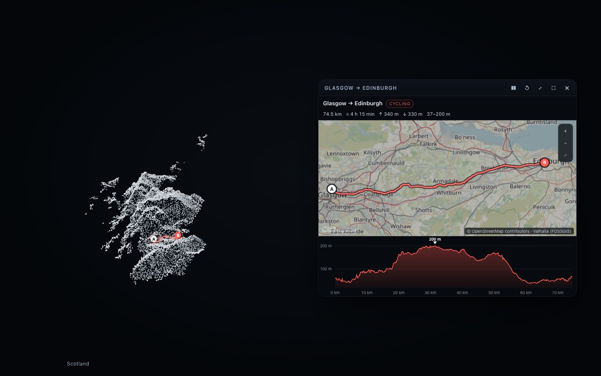
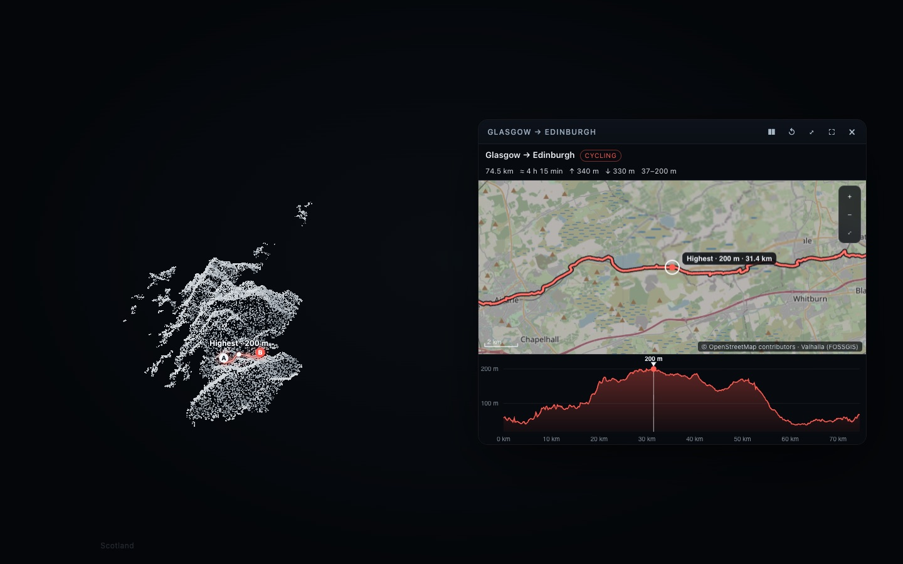
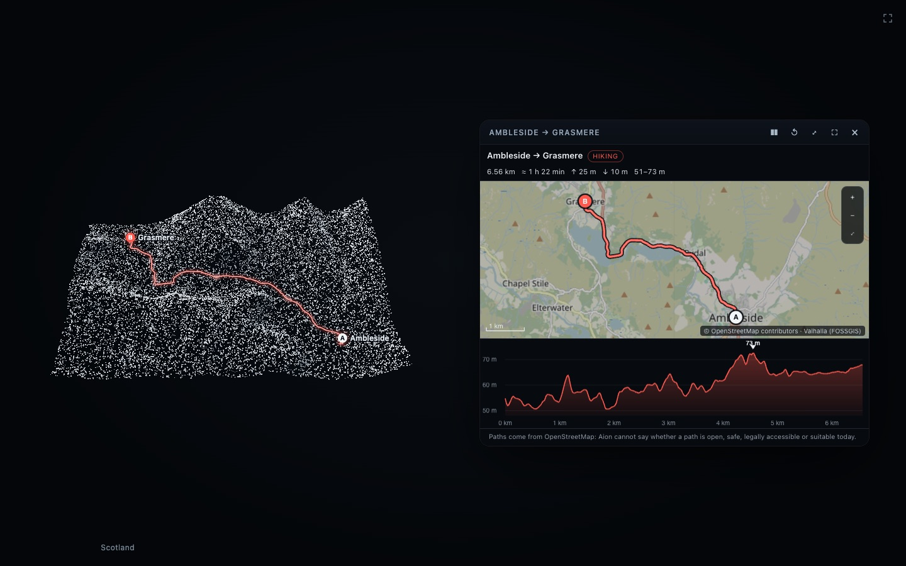

# Route Explorer (v0.6)

Real walking, cycling and hiking routes between places, shown twice from **one geographic state**: on Aion's particle
terrain (expressive) and in the Route Explorer card (precise). Codex plans nothing itself and never supplies
coordinates: a routing service plans the path over OpenStreetMap's network, and Aion draws exactly that.

```text
"Show me Scotland's terrain."                    show_terrain { region: "Scotland" }
"Plan a cycling route from Glasgow to Edinburgh." plan_route { from: "Glasgow", to: "Edinburgh", mode: "cycling" }
"Show me the highest point."                      control_interactive_card { action: "show", value: "highest" }
"Reverse the route."                              plan_route { reverse: true }
"Change to walking." / "Add Linlithgow."          plan_route { mode: "walking" } / plan_route { via: ["Linlithgow"] }
"Zoom in on km 12 to 30."                         control_interactive_card { action: "section", value: "12-30" }
"Remove the route."                               plan_route { clear: true }   (the terrain stays)
```

| Scotland's terrain, the route on it, the card | The highest point on both | A hike on its own surroundings |
| --- | --- | --- |
|  |  |  |

## Architecture

```text
plan_route ─► Route Planner (src/host/route/planner.ts)
               places: Aion's gazetteer → Nominatim → Photon (only names), or "lat, lon"
               path:   routing provider (only coordinates)      ─► Valhalla (FOSSGIS or your own) | OpenRouteService
               checks: real coordinates, ends near the places, no jumps; simplified within a stated tolerance
               elevation along the path: AWS Terrain Tiles, the same model as show_terrain
            ─► one GeoRoute (src/visual/geo/route.ts), validated
            ─► hub: the presentation (kind interactive, app route-explorer, terrain body) + card.route (revisioned)
                   ├─► page: the particle terrain + the route overlay (src/surface/markers.ts)
                   └─► card (sandboxed): LOAD_ROUTE → map, profile, figures; CURSOR → the body; TILE_REQUEST → hub tiles
```

- **One state.** The `GeoRoute` is the only description of the route. The hub keeps it on the card (`card.route`, with
  a revision for every change); the body overlay and the card both draw that document, and positions along the route
  (the card's pointer, a highlight, a section) are distances along it, so both views show the same place. Neither view
  builds its own approximation.
- **The existing geography is reused**: regions and places resolve exactly as for maps and markers; elevation comes from
  the same tiles and decoder as `show_terrain`; the overlay is placed with `markerWorldPoint`, the samplers' own
  geometry; the card is a Card 2.0 application with two new capabilities (below).
- **The terrain**: if a terrain is on show and the route lies well inside it (all of it in view, and at least 6 % of the
  view across), the route is drawn on it — the terrain is not formed again. Otherwise Aion forms the terrain of the
  route's surroundings (a box 1.5× the route, framed tightly so a 6 km hike gets the whole grid). Changing the route
  (reverse, mode, waypoint), adding a marker, or removing the route never re-forms the terrain.
- **Presentation**: Presentation Router reason `route-hybrid` — the particle terrain and the card, both until dismissed
  or replaced (no hold timer while the user is planning). Closing the card (×, or Codex's `close`, or
  `plan_route { clear: true }`) removes the route and keeps the terrain for a while with its markers.

### The GeoRoute

| Field | |
| --- | --- |
| `id`, `origin`, `destination`, `waypoints` | places `{ name, lat, lon }` — the name is what the user said |
| `travelMode` | `walking` · `cycling` · `hiking` |
| `source` | `{ routing, elevation, attribution }` — who computed what |
| `coordinates` | `[lon, lat]` (WGS 84, GeoJSON order), the provider's own vertices, at most 1,500 |
| `toleranceMeters` | how far the displayed line may stray from the provider's (Douglas–Peucker; 0 when not simplified) |
| `distanceMeters`, `estimatedDurationSeconds` | the provider's figures |
| `elevationSamples`, `sampleSpacingMeters` | `[distance, elevation]` pairs at a uniform spacing, at most 600 |
| `totalAscentMeters`, `totalDescentMeters`, `minimumElevationMeters`, `maximumElevationMeters`, `highest`, `lowest` | from the samples (null when no elevation could be read) |
| `warnings` | up to six short lines (an end far from the path, a ferry, the hiking caveat, no elevation) |

`validateRoute` refuses unknown fields, non-finite or out-of-range coordinates, a line whose length does not match the
route's distance, a segment that jumps (more than half the route or 25 km between two vertices), a "route" of two points
longer than 250 m, non-increasing samples, oversized documents (44 KB) and control characters. The planner, the hub and
the card each validate it.

## Routing backend

### Evaluation (October 2026)

| | Valhalla (FOSSGIS public server) | Valhalla (self-hosted) | OpenRouteService | GraphHopper | OSRM (FOSSGIS) |
| --- | --- | --- | --- | --- | --- |
| Walking / cycling / hiking | pedestrian, bicycle; hiking by SAC scale (`max_hiking_difficulty`) | same | foot-walking, cycling-*, foot-hiking | foot, bike; hike in some plans | foot, bike; no hiking profile |
| Coverage | planet | what you import | planet | planet | planet |
| Geometry | real OSM edges | same | same | same | same |
| Access restrictions | OSM access tags | same | same | same | same |
| Credentials, cost | none; fair use (1 req/s, no heavy use) | none; your hardware | free key with quotas | key; free plan with credits | none; fair use |
| Licensing | software MIT; data ODbL | same | service terms; data ODbL | service terms / Apache-2.0 self-hosted | BSD-2; data ODbL |
| Install | nothing | a server and an OSM extract | a key | a key | nothing |

**Chosen:** Valhalla, through a small provider abstraction (`src/host/route/providers.ts`):

1. **Default — FOSSGIS e.V.'s public Valhalla** (`valhalla1.openstreetmap.de`, the router behind openstreetmap.org's
   directions). Keyless, so Aion keeps its zero-configuration installation. Used as its published policy asks: at most
   one request a second (a queue in the process), an identifying `User-Agent` and `X-Client-Id: aion-presence`, one
   route per user request — no prefetching or bulk use. Its limits, observed on 2026-10-22: walking routes up to 100 km,
   cycling up to 150 km.
2. **Your own Valhalla**: `AION_ROUTING_VALHALLA_URL=http://localhost:8002` (https anywhere, or http on this machine).
   No FOSSGIS limits or queue apply.
3. **OpenRouteService** with your own free key: `AION_ROUTING_PROVIDER=openrouteservice` and `AION_ROUTING_ORS_KEY=…`
   (the key is sent only to ORS, as a header; it is never written anywhere). Without a key Aion stays on Valhalla and
   says why.

Undocumented endpoints are never used, and Aion never falls back to a straight line or to Codex's memory.

> **Before a public release** (owner action): FOSSGIS asks apps used by end users that call the public server to say
> so in the Valhalla GitHub Discussions. That message has not been sent.

### Operational requirements

| | |
| --- | --- |
| Network | `valhalla1.openstreetmap.de` (routes), `s3.amazonaws.com` (elevation), `tile.openstreetmap.org` (map tiles), Nominatim/Photon (place names Aion's gazetteer does not know) |
| Credentials | none by default |
| Configuration | `AION_ROUTING_PROVIDER`, `AION_ROUTING_VALHALLA_URL`, `AION_ROUTING_ORS_KEY`, `AION_PRESENCE_TILES=off` |
| Rate | one route request a second (FOSSGIS); map tiles: two downloads at a time, about four new tiles a second |
| Cache | map tiles in the plugin data directory (`tiles/`, at most 3,000), elevation tiles in memory (48) |

### Failures

| Code | When | What the user hears (from Codex) |
| --- | --- | --- |
| `route-needs-places` | no start or destination | a question for just that |
| `place-not-found` / `place-unavailable` | a name nobody knows, or the geocoders are down | which name, and to add the town or country |
| `route-same-place` | start = destination | |
| `route-too-long` | beyond the provider's limit for the mode (checked first on the straight line) | the limit, and a shorter leg or another mode |
| `route-point-unroutable` | a place too far from any usable path, or outside the routing data (Valhalla 170/171, ORS 2010, a path ending more than 10 km away) | which place |
| `route-not-found` | no path for this mode (Valhalla 442/443, ORS 2009) | another mode or nearby places may work |
| `route-rate-limited` | HTTP 429 | try again in a minute |
| `route-unavailable` | timeout, network, HTTP 5xx, a refused key | the cause |
| `route-invalid` | the provider's answer is not a usable route | never described anyway |

Nothing is drawn on any failure, and what Aion shows stays as it was.

## Elevation along the route

The provider's full geometry (not the simplified one) is resampled every *s* metres — *s* = 10 m, or more for long
routes so that there are at most about 500 samples (Glasgow–Edinburgh: 150 m) — and each sample is read bilinearly from
the AWS terrarium tiles at the most detailed zoom (≤ 13) that needs at most 32 tiles.

- **Ascent and descent**: the profile is smoothed (centred moving average over 120 m), then a climb or descent counts
  only once the smoothed profile has moved 5 m from its last turning point (hysteresis); the totals are rounded to 5 m.
  On flat ground with ±2 m of model noise this reports under 10 m, where summing every wiggle would claim more than
  100 m (tested).
- **Extremes** (lowest, highest and where) are the raw samples', rounded to the metre.
- **Limits**: the model averages the ground over cells of roughly 10–30 m in Europe and North America (coarser
  elsewhere); a narrow summit, a ridge path, a cliff edge, a bridge or a tunnel reads the cell, not the path.
  Example: the walk from Edinburgh Castle ends at 225 m near Arthur's Seat, whose summit is 251 m — the path's end
  (the point found for "Arthur's Seat" snapped to the path network) and the cell averaging both play a part; which
  contributes how much was not measured. If no elevation can be read, the route is still shown, with no profile or
  climbing figures, and says so.

## The particle terrain overlay

`src/surface/markers.ts` draws the route over the formed terrain every frame, through `markerWorldPoint` (the cell and
relief the sampler used) and the renderer's own projection — so the line rests on the relief and turns with it:

- a restrained luminous line (a soft glow, a dark casing, the accent core), and four grains travelling from A to B;
- A and B on short stems, waypoints numbered, place names only where A and B stand apart, labels kept clear of each other;
- the card's highlight (a slow pulse with its label, e.g. "Highest · 200 m"), section (brighter) and pointer (a bright grain).

The line is the route's own geometry, simplified to half a terrain cell and densified to about one point per cell so it
follows the relief between corners; positions are never moved for looks. Where the terrain is too coarse for a path's
bends (a 74 km ride on all of Scotland), the card shows the exact geometry.

## The Route Explorer card

A Card 2.0 application (`src/cards/apps/routeExplorer`, manifest version 1.0.0), compact by default beside the body:

- **Map**: OpenStreetMap's standard tiles in Web Mercator, slightly dimmed for Aion's dark space, the route with A, B and
  waypoints, a dashed connector when the path starts or ends away from the place asked for, a scale bar, and the
  attribution "© OpenStreetMap contributors · <routing service>" always visible. Drag to pan, scroll / ± / double-click
  to zoom, ⤢ to frame the whole route; arrow keys and +/− with the map focused.
- **Elevation profile**: elevation against distance, the highest point marked; point at it (the map and the particle
  terrain show the same place), click to highlight a point, drag to frame a section.
- **Figures**: from → to, mode, distance, time, ascent, descent, elevation range; the first warning beneath.
- **Codex's commands**: `show` (`route`, `highest`, `lowest`, `start`, `end`, `steepest`), `section` (`"12-30"` km),
  `point-at` (km), `clear-highlight`, plus the universal actions. Declared state for `inspect_interactive_card`:
  revision, mode, distance, time, climbing, elevation range, highlight (kind, km, m), section, pointer, zoom, view, tiles.
  A click on the route is the card's selection (`route-point`, with distance, elevation, `lat`, `lon`): "add this
  location as a waypoint" uses it.

### Bridge additions

| Message | Direction | Capability | Payload |
| --- | --- | --- | --- |
| `LOAD_ROUTE` | Aion → card | `route-documents` | `revision`, `route` (validated again in the card) |
| `CURSOR` | card → Aion | `route-documents` | `distance` (metres) or `null`; at most about 20 a second |
| `TILE_REQUEST` | card → Aion | `map-tiles` | `tiles`: 1–16 `{ z, x, y }` — never a URL |
| `LOAD_TILE` | Aion → card | `map-tiles` | `tile`, `mime` (PNG/JPEG), the bytes (≤ 768 KB) |

The card still has no network (its CSP has `connect-src 'none'`; tiles are decoded from bytes with `createImageBitmap`).
The page asks Aion's hub for a tile (`GET /tile/z/x/y`, token required) only while a route card is open and only around
that route (its box plus its own size in each direction, zoom 2–18), so the hub never becomes a general tile proxy.

### OpenStreetMap tiles

`src/host/route/tiles.ts` follows the [tile usage policy](https://operations.osmfoundation.org/policies/tiles/): only
tiles the card is showing (no prefetching, no bulk download, no offline use); an identifying User-Agent, no no-cache
headers; cached as the server's `Cache-Control`/`Expires` say, else for 7 days; expired tiles revalidated with
`If-None-Match`/`If-Modified-Since`; two downloads at a time and a steady rate; the attribution always on the map.
`AION_PRESENCE_TILES=off` turns tiles off: the card then draws the route, places and profile on a plain background. In
an embedded (MCP Apps) view there is no tile path yet — the same plain background.

## Privacy

Only place names reach a geocoder (and only when Aion's offline gazetteer does not know them); only coordinates reach
the routing service; only tile coordinates reach the elevation and map tile servers. No conversation text, no user
location: Aion never reads the user's position. A tile server and the routing service see the requesting IP address
and which area is being looked at, like any map. See [PRIVACY.md](PRIVACY.md).

## Verification

| | What it shows |
| --- | --- |
| `tests/v06.test.ts` (24 tests) | the route model, simplification bounds, elevation statistics against noise, validation; Valhalla and ORS requests and refusals (stand-ins); the FOSSGIS rate; the planner's limits, gaps and missing elevation; elevation sampling from synthetic terrarium tiles; the card's geometry; the bridge messages and capabilities; the store's route revisions and keep-terrain; the hub's tile endpoint and acknowledgements; the tile policy; alignment; `plan_route` end to end (Scotland → route → reverse → mode → waypoint → marker → clear), a route far from the terrain on show, failures |
| `npm run route:verify` | the acceptance scenarios against the real routing service and elevation model; evidence in `docs/media/v0.6.0/routes.json` |
| `npm run smoke -- --only=v06` | the real tools, renderer (WebGPU and canvas), routing service, elevation and OSM tiles: the route on Scotland's terrain without re-forming it, the card's tiles, highest point on both views, the profile pointer on the terrain, reverse, waypoint, marker, clear, a hike and a walk on their own terrain, refusals, the card closed with nothing left behind |
| `npm run scene:eval -- --only routes` | real Codex turns: the natural-language requests choose `plan_route` and its follow-ups (see [SCENE-GENERATION-TESTS.md](SCENE-GENERATION-TESTS.md)) |

Results from the real service (2026-10-22): Glasgow → Edinburgh by bicycle 74.5 km, about 4 h 15 min, ↑ 340 m ↓ 330 m,
37–200 m (highest at km 31.4); reversed 74.6 km; via Linlithgow 80.7 km; Ambleside → Grasmere hiking 6.56 km, ↑ 25 m;
Edinburgh Castle → Arthur's Seat walking 4.90 km, ↑ 185 m, 72–225 m; London → New York on foot refused
(`route-too-long`, 5,567 km in a straight line); a point in Antarctica refused (`route-point-unroutable`).

## Known limitations

- Valhalla's hiking routes are the path network as mapped, up to SAC T3; whether a path is open, safe, legal or
  suitable is not known to Aion and is never claimed. Times are the service's estimates (Valhalla's walking speed;
  climbing is not added for hikes).
- The FOSSGIS server's limits (walking 100 km, cycling 150 km) and fair-use rate apply to the default; a self-hosted
  Valhalla or OpenRouteService removes them.
- On a large terrain (all of Scotland) a route is a few dozen particles' width: the body shows where it runs, the card
  shows the path.
- Map tiles come from OpenStreetMap's community servers: availability is theirs; no tiles in embedded views yet.
- One route at a time (one interactive card at a time).
