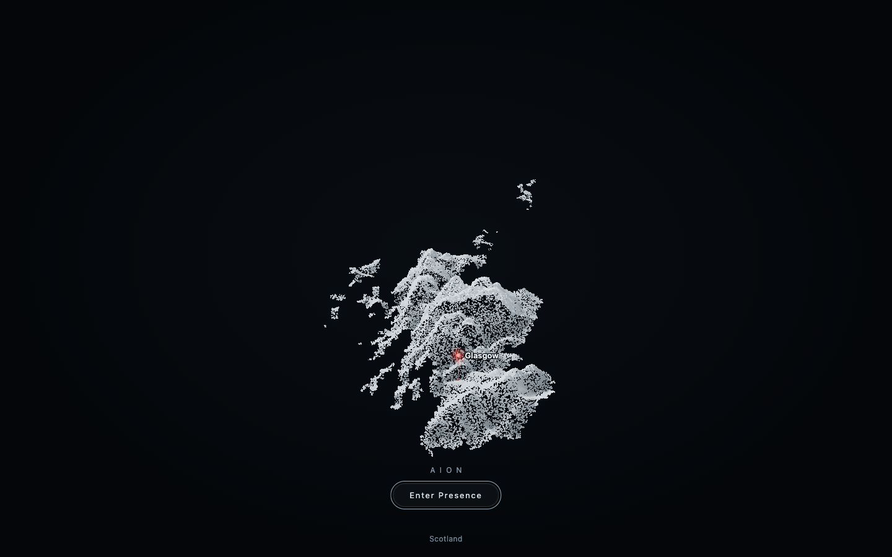
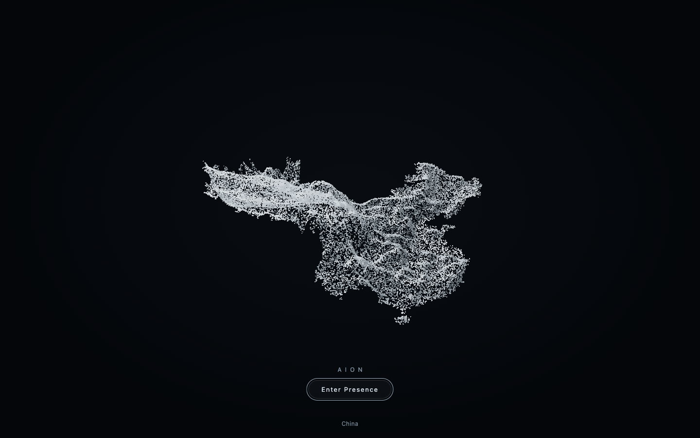
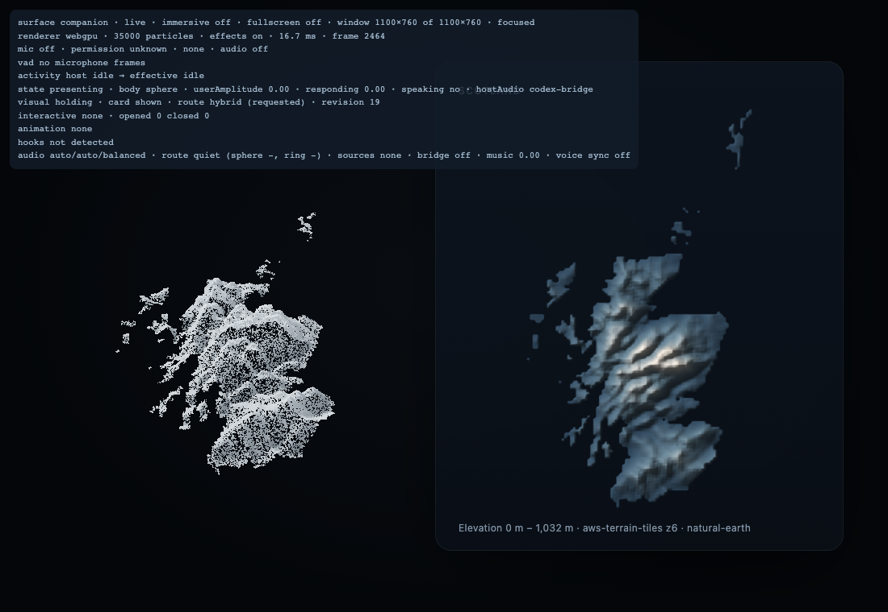
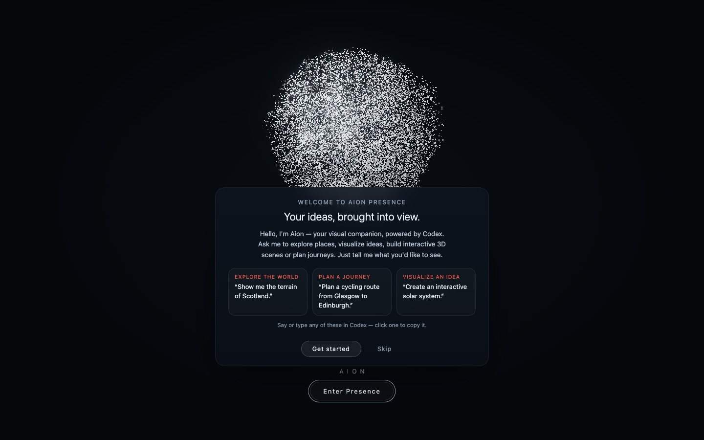
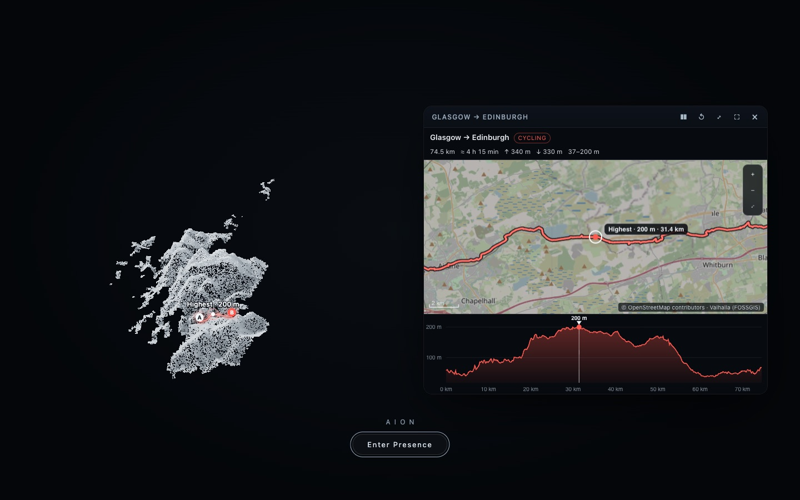
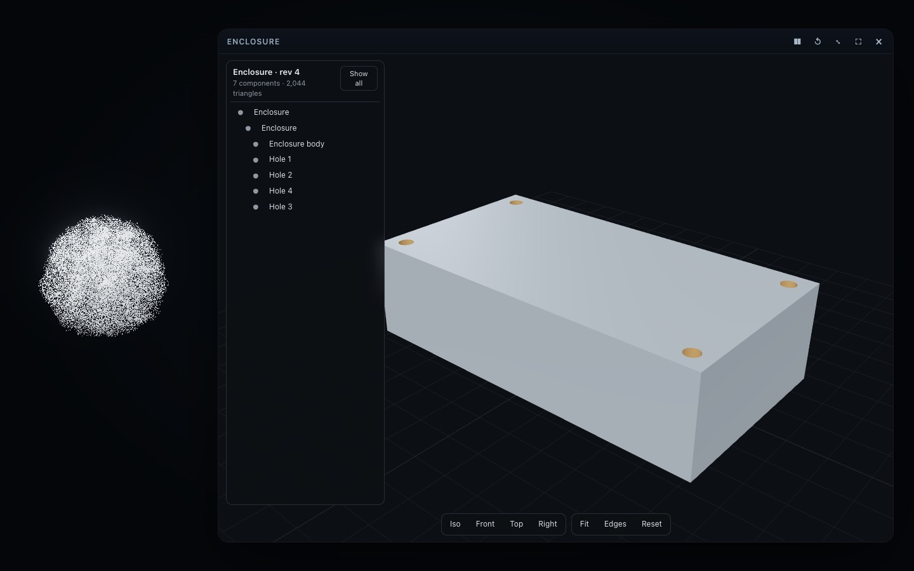

# Scene generation: how it is tested, and real-Codex results (v0.5.1)

Generated scenes are tested at four levels. They prove different things and are reported separately.

| Level | What it proves | What it does not prove | Where |
| --- | --- | --- | --- |
| 1. Unit tests | Validation, repair hints, patches, history, styles, routing, the bridge, the store — deterministic logic | anything about Codex or pixels | `tests/v05.test.ts`, `tests/v051.test.ts` (`npm test`) |
| 2. Fixture-based browser tests | The pipeline renders prepared Scene IR documents in a real browser: routing, patches (change counts and pixels), selection, undo, refusals, cleanup, timings | that Codex can write such documents | `npm run smoke -- --only=v05` (fixtures in `tests/fixtures/scenes/`) |
| 3. Real Codex integration | Codex turns natural language into Scene IR and patches by itself, through the installed plugin, and Aion renders and confirms it | visual judgement by a person; statistics (each prompt is one run) | `npm run scene:eval` (`scripts/scene-eval.ts`) |
| 4. Human-observed demonstration | That it looks and feels right to a person using it | — | the manual procedure below (not yet done for v0.5.1) |

Fixture replay (level 2) is never presented as natural-language generation.

## Level 3: what `npm run scene:eval` does

- Installs **this working tree** as the plugin into a throwaway Codex home (your login is linked, not copied; your
  model and reasoning effort are used), runs a presence hub, and opens Aion's window in headless Chrome, so cards are
  built and confirmed exactly as for a user.
- Each scenario is one Codex session: "Open Aion." first, then its requests, each sent with `codex exec` (resumed).
- **Latency** is measured from sending the request to the moment the hub records the card's confirmation that it
  rendered the new revision (or the body's new form). It includes Codex's reasoning, its tool calls, validation,
  repair attempts and building — everything the user waits for. The card's own build time is reported separately by
  the card (`buildMs`, typically 5–150 ms) and is not the generation time.
- Records every tool call, every refusal and repair, the route, the final document (`<scenario>-<n>.scene.json`),
  Codex's answer, and a screenshot.
- "Change the colour of the selected object" needs a selection: the harness selects the largest gear through the
  card's `select` command, which runs the same selection code and report as a click (clicking itself is covered by
  smoke and was checked by hand).

## Results — 2026-10-18

Codex CLI 0.163.0-alpha.10.2, model `gpt-6.1-sol` at reasoning effort `low` (the owner's defaults), Apple M4, macOS
26.6.2, headless Chrome 155. One run per request. Final state of this branch unless marked.

| | Request | Outcome | First attempt | Repairs | Visible after | Turn | Evidence |
| --- | --- | --- | --- | --- | --- | --- | --- |
| A | "Create three interconnected gears with different diameters and animate their mechanical motion." | card, 7 objects, 3 animations (spin + 2 couplings with tooth ratios) | yes | 0 | 23.4 s | 27.4 s | [png](media/v0.5.1/gears-codex.png) |
| B | "Create a kinetic sculpture with three rotating rings, a glowing sphere, and a moving particle." | hybrid, 5 objects, 5 animations | yes | 0 | 23.7 s | 27.8 s | [png](media/v0.5.1/sculpture-codex.png) |
| C | "Generate an interactive three-dimensional ripple surface and animate its amplitude." | card: `parametric` ripple + `oscillate` scale on y | yes | 0 | 17.3 s | 20.3 s | [png](media/v0.5.1/ripple-codex.png) |
| D | "Create a simplified three-dimensional Dual Active Bridge converter with two full bridges and a high-frequency transformer." | card, 56 objects: two 4-switch bridges, transformer core and windings, series inductance, DC rails, labels; disclosed as not a simulation | yes | 0 | 44.1 s | 49.3 s | [png](media/v0.5.1/dab-codex.png) |
| E1 | (A again, in a new session) | card, 10 objects | yes | 0 | 29.8 s | 35.5 s | [png](media/v0.5.1/edits-1-codex.png) |
| E2 | "Add another gear." | revision 2: a fourth gear added, coupled to its neighbour, base enlarged | yes | 0 | 14.4 s | 17.4 s | [png](media/v0.5.1/edits-2-codex.png) |
| E3 | "Increase the rotation speed." | revision 3: the driving spin faster (coupled gears follow), labels updated | yes | 0 | 7.5 s | 11.5 s | [png](media/v0.5.1/edits-3-codex.png) |
| E4 | "Change the colour of the selected object." (largest gear selected) | revision 4: `update gear-large (material)` via `$selected` | yes | 0 | 9.7 s | 12.2 s | [png](media/v0.5.1/edits-4-codex.png) |
| E5 | "Undo the last modification." | revision 5: the colour change undone | yes | 0 | 4.5 s | 9.2 s | [png](media/v0.5.1/edits-5-codex.png) |
| F1 | "Visualize the passage of time." | **body** (abstract, symbolic): a spiral of moments with a moving present | yes | 0 | 30.3 s | 34.2 s | [png](media/v0.5.1/time-body-codex.png) |
| F2 | "Turn this into an interactive three-dimensional timeline." | card: a spiral timeline with labelled, selectable milestones | yes | 0 | 20.9 s | 26.7 s | [png](media/v0.5.1/time-timeline-codex.png) |
| G | "Calculate an accurate magnetic flux density field." | Codex: "I can visualize a magnetic field, but Aion has no numerical solver, so I cannot compute an accurate field through Aion itself." Offered an analytic case; nothing was shown | — | — | — | 6.6 s | answer text |

A second sample of A and D (a later run, same settings): gears 19.6 s to visible, DAB converter (44 objects) 34.1 s,
both on the first attempt; in both, Codex chose `environment.style: "engineering"` itself.

Scene continuity in E: all five requests changed the same scene in the same card (revisions 1→5, the same object
ids), and every "done" was a confirmed render.

### What the runs found, and what was changed

These are the first runs (same day), before the fixes they prompted:

- **G, first run**: Codex asked for the coil geometry and said it could compute the field, without saying that Aion has
  no solver. The skill now has an explicit rule ("Computation is not visualization") early in its visual-intent
  section; the rerun above follows it.
- **F1, first runs**: Codex declared the scene abstract and symbolic but added two word labels ("past", "future"); any
  text forced the card route. In one run Codex then also re-showed a body-formed scene as a card on its own. Fixed:
  a few words in a scene declared abstract and symbolic no longer force a card (the body says it leaves them out), and
  the skill says a body-formed result is the answer unless the user asks to explore it. The rerun above routes to the
  body.
- **F2, first run**: the first patch was refused with 8 listed problems (labels longer than 80 characters); Codex fixed
  exactly those and the second attempt rendered — the bounded repair loop working as intended (1 repair).
- **C, first run**: the surface's amplitude animation dipped through the ground grid. Fixed: staging and framing now use
  the scene's bounds across its motion; the rerun above is clean.

Across the final results: 11 of 11 scene and edit requests rendered, all on the first attempt; the only repair (F2, first run)
succeeded on the second attempt. Time to a visible scene: 15–44 s for a new scene (most of it Codex writing the
document; D, with 56 objects, is the longest), 4.5–14 s for an edit.

### Limitations of this evidence

- One run per request, with one model at low reasoning effort: the results show that it works, not how often. Other
  models, efforts or phrasings may need more repairs.
- The renderer is headless Chrome on Apple silicon (Metal via ANGLE); the screenshots are real renderer output, but no
  person watched these runs.
- Latency depends on the Codex service at that moment.

## Results — 2026-10-19: real terrain and maps (scenario H, v0.5.2)

`npm run scene:eval -- --only geo`, Codex 0.163.0-alpha.10.2, gpt-6.1-sol, effort low; one session after "Open Aion.".
"Formed" means the hub showed a presentation of that kind during the turn (a terrain holds 14 s, so it is watched while
the turn runs).

| Request | Codex called | Outcome | Turn |
| --- | --- | --- | --- |
| "Show me the terrain of Scotland." | `show_terrain {region: "Scotland"}` | terrain formed (0–1,032 m) | 6.7 s |
| "Show me China's topography." | `show_terrain {region: "China", style: "topography"}` | terrain formed | 6.6 s |
| "Show me the map of Scotland." | `show_map {region: "Scotland"}` | map formed | 5.3 s |
| "Show me the terrain of Scotland and mark Glasgow." | `show_terrain {region: "Scotland", markers: [{place: "Glasgow"}]}` | terrain with the Glasgow pin | 6.4 s |

| Scotland with Glasgow (written by Codex) | China's topography (written by Codex) | Hybrid, WebGPU (smoke) |
| --- | --- | --- |
|  |  |  |

With v0.5.1 installed these requests could not reach `show_terrain` at all (it was hidden from the conversation:
[MCP-TOOLS.md](MCP-TOOLS.md#v052-the-terrain-regression)). One run each; no person watched these runs.

## Results — 2026-10-22: routes and the first run (scenarios I and J, v0.6)

`npm run scene:eval -- --only journey,routes`, Codex 0.163.0-alpha.10.2, gpt-6.1-sol, effort low; a fresh plugin data
directory (so the first-run welcome was due); real routing (FOSSGIS Valhalla), elevation and OpenStreetMap tiles. Each
scenario is one session after "Open Aion.". Outcomes are read from the hub (a route counts only once the card confirmed
it drew that revision). Full record: [media/v0.6.0/codex-routes.json](media/v0.6.0/codex-routes.json).

**I. The final acceptance test** — "Open Aion." → `open_presence`; the window showed the welcome (first run).

| Request | Codex called | Outcome | Visible | Turn |
| --- | --- | --- | --- | --- |
| "Show me Scotland's terrain." | `show_terrain {region: "Scotland"}` | terrain formed | — | 10.4 s |
| "Plan a cycling route from Glasgow to Edinburgh." | `plan_route {from: "Glasgow", to: "Edinburgh", mode: "cycling"}` | drawn on Scotland's terrain: 74.5 km, ↑340 m | 11 s | 14.1 s |
| "Show me the highest point." | `control_interactive_card {action: "show", value: "highest"}` | highlighted on the map, profile and terrain: 200 m at km 31.4 | — | 11.4 s |
| "Reverse the route." | `plan_route {reverse: true}` | Edinburgh → Glasgow, 74.6 km, ↑325 m | 7.2 s | 11.5 s |

Codex's answers (verbatim, abridged): "Here's your cycling route from Glasgow to Edinburgh: 74.5 km, about 4 hours 15
minutes riding, with 340 m of climbing." · "I've highlighted it: approximately 200 m above sea level, 31.4 km from
Glasgow along your route."

**J. Routes, follow-ups and limits**

| Request | Codex called | Outcome | Turn |
| --- | --- | --- | --- |
| "Show me a hiking route from Ambleside to Grasmere." | `plan_route {…, mode: "hiking"}` | drawn on its own terrain: 6.6 km, ↑25 m | 17.2 s |
| "How much climbing is there?" | (none: from the result) | "an estimated 25 metres of total ascent" | 8.3 s |
| "Plan a walking route from Edinburgh Castle to Arthur's Seat." | `plan_route {…, mode: "walking"}` | 4.9 km, ↑185 m | 13.5 s |
| "Remove the route." | `plan_route {clear: true}` | route removed, terrain kept | 14.6 s |
| "Plan a walking route from London to New York." | `plan_route {…}` → `route-too-long` | refused; nothing drawn; "the walking planner has a 100 km limit … about 5,567 km apart" | 12.5 s |
| "Show me the introduction again." | `open_presence {welcome: true, display: "immersive"}` | welcome shown again | 11.2 s |

For the hike Codex added "Check local path conditions and access before setting out." (it never called the path safe).

| The welcome on the first run (Codex's "Open Aion.") | After "Show me the highest point." (Codex) |
| --- | --- |
|  |  |

One run each; no person watched these runs. The welcome screenshot was taken in the immersive window before its click
(Enter Presence beneath it); v0.6 since raises the body a little more in that case.

## Results — 2026-10-22: FreeCAD (scenario K, v0.7)

`npm run scene:eval -- --only freecad`, Codex 0.163.0-alpha.11.1, gpt-6.1-sol, effort low, FreeCAD 1.1.4 on this Mac; a
fresh plugin data directory. Outcomes are read from the hub: a step counts only once the CAD viewer confirmed the new
FreeCAD revision. The hole is "clicked" through the viewer's `select` command (the same code and report as a click).
Full record of the final run: [media/v0.7.0/codex-freecad.json](media/v0.7.0/codex-freecad.json).

**The first run failed, and found a real defect.** `codex exec` starts a new MCP server — and so a new FreeCAD worker —
for every turn. The worker held documents in memory, so from the second request on each turn began with
`missing-document`; Codex recovered by rebuilding the model from scratch every time (it said so), "move this hole"
lost its selection, and "undo" had nothing to undo. Documents now persist (each revision saved in Aion's workspace,
[FREECAD.md](FREECAD.md#documents-revisions-history)), and "move it inward" became one change (`Inset`) so that undo
reverts all of it. The second run found the restored document named after its snapshot file (`r000004`); fixed.

**The final run** (the third; the second gave the same calls and outcomes):

| Request | Codex called | Outcome (confirmed by the viewer) | Visible | Turn |
| --- | --- | --- | --- | --- |
| "Open Aion." | `open_presence` | first run: the spoken welcome due; headless Chrome refused speech, so "Listen to the welcome" | — | 15.8 s |
| "Create a 120 by 80 by 40 millimeter enclosure in FreeCAD." | `create_document`, `add_primitive {box 120 × 80 × 40}` | revision 2: 120 × 80 × 40 mm, 384,000 mm³ | 19.4 s | 24.0 s |
| "Increase the length to 150 millimeters." | `set_parameter {Enclosure, Length, 150}` | revision 3: 150 × 80 × 40 mm | 7.2 s | 9.9 s |
| "Add four 6-millimeter mounting holes near the corners." | `add_holes {Enclosure, Ø6, corners 8}` | revision 4: 475,476 mm³ (four through holes) | 7.5 s | 14.7 s |
| (Hole 2 selected) "Move this hole 5 millimeters inward." | `set_parameter {$selected, Inset, delta 5}` | revision 5: Hole 2 at 13/13 mm, still selected | 6.0 s | 8.9 s |
| "Undo the last change." | `undo` | revision 6: Hole 2 back at 8/8 mm | 10.0 s | 12.9 s |
| "Add a mounting hole 500 millimeters from the corner." | (none) | declined by Codex: "the enclosure is only 150 × 80 mm … Did you mean 50 mm?"; model unchanged | — | 10.5 s |
| "Save the model as …/Enclosure.FCStd." | `save {path}` | saved; reopened independently by FreeCAD: 150 × 80 × 40, four holes, Hole 2 at 8/8 mm, valid, its expressions intact | — | 10.7 s |

Every call succeeded on its first attempt (no refusal, no repair). FreeCAD's own work per step is tens of milliseconds
([FREECAD.md](FREECAD.md#performance)); the 6–10 s are Codex's turn. Codex's answers stayed within the results
("Moved Hole 2 inward by 5 mm on both axes. Its center is now 13 mm from each adjacent edge. The model remains valid.").
Not covered by these runs: an impossible request that reaches FreeCAD (Codex declined it first; FreeCAD's own refusal is
covered by the tests, smoke and `cad:verify`), and the FreeCAD application hand-off. One run; no person watched it.

| After "Add four 6-millimeter mounting holes near the corners." | After "Move this hole 5 millimeters inward." (Hole 2 selected) |
| --- | --- |
|  |  |

## Level 4: manual procedure (for a person)

1. Install this branch: `codex plugin marketplace add <path to this checkout>` then
   `codex plugin add aion-presence@spirit-connect`; restart Codex.
2. Say "Open Aion." Then, one at a time, the requests A–G above (E and F in order, in one conversation). Click an object
   before E4. For terrain (H), in a **new** conversation: "Show me the terrain of Scotland.", "Show me China's
   topography.", "Show me the map of Scotland.", "Show me the terrain of Scotland and mark Glasgow." — each should form
   real relief (or the map) in the Aion window, never a generated landscape.
3. For each, note: did a scene appear without a visible error; how long from pressing Enter until it appeared; whether
   Codex said "Attempt n of 3" or retried; whether the scene matches the request; whether Codex's words match what is
   on screen.
4. In a generated card, try by hand: select an object, press W and drag it, press E and turn it, Undo and Redo in the
   card's bar, then ask Codex "What did I just change?" (it should see the "(by hand)" revisions).
5. Record results in the pull request; attach a screen recording if possible.

To look at any scene without Codex: `npm run dev`, then `npm run scene -- show <file.json>`, `-- patch '<json>'`,
`-- undo`, `-- inspect`.
