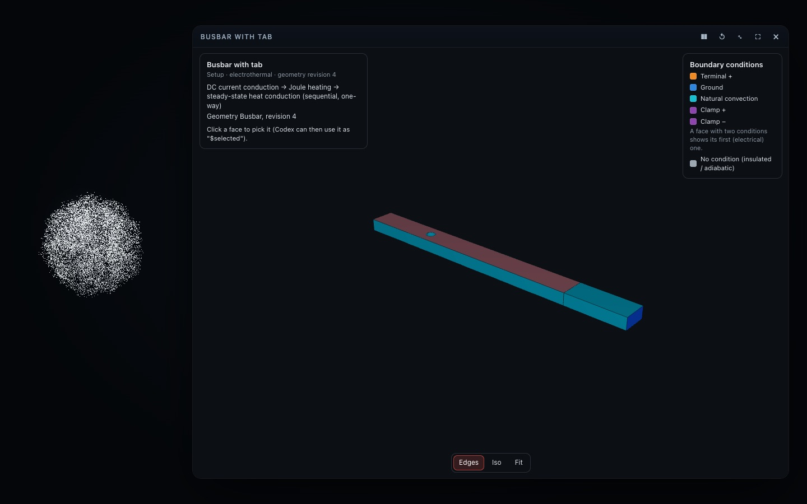
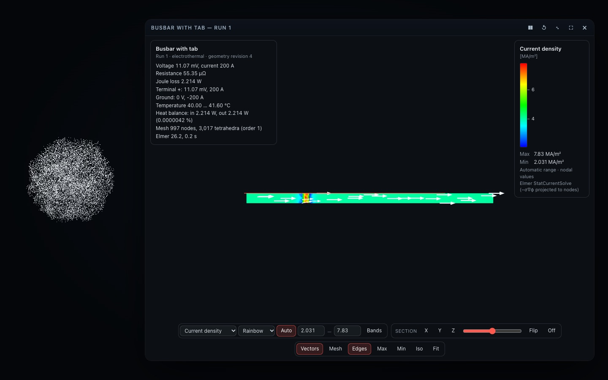
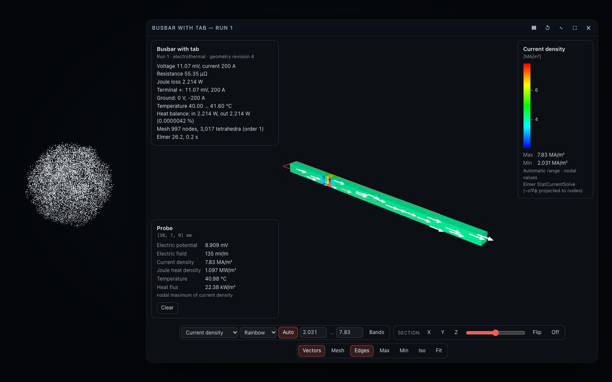

# The Simulation Card (`simulation`, v0.8)

The interactive front of Aion's engineering simulations ([SIMULATION.md](SIMULATION.md)): a study's **setup** (the CAD
faces coloured by their boundary conditions; click a face to pick it) and the **fields a solver computed** (Elmer, via
`simulate`), shown the way engineering software shows them — and nothing else. The card never computes or invents a
field and never runs a solver; it displays a validated field bundle and reports what the user sees and picks.

## Opening it

Only `simulate` opens it (it needs a result or a setup to show): `create`, `open`, `inspect`, `show`, `sync` and
`set_boundary` show the setup (the other setup actions refresh it when the card is already open); `run` shows the
result; `show { run, field }` reopens a stored result (no solve). `show_interactive_card` does not offer it. The tool
result says whether the card confirmed what it loaded (`state.loaded` = `results:<study>:<revision>:<run>`), or that
Aion is not open.

## What it shows

| | Setup | Results |
| --- | --- | --- |
| Surface | the CAD faces, each coloured by its condition (orange terminals, blue grounds, purple fixed temperatures, cyan convection, amber heat inputs, grey none); the picked face tinted | the field, colour-mapped per pixel |
| Legend | the conditions in use with their colours; the picked face | field name, unit (SI prefix chosen from the range: MA/m², mV, kW/m²…; temperature in °C), ticks, max and min, automatic / manual range, "nodal values", the solver module that produced it; grey for nodes where an electric field is not defined (insulators) |
| Info | the analysis and the geometry revision | the headline numbers (voltage, current, resistance, loss, terminals, temperature range, heat balance, mesh, Elmer's version and time), and any omission (interior elements too large for the card) |

Fields (whichever the result carries): `potential` (V), `electric_field` (V/m), `current_density` (A/m²),
`joule_heating` (W/m³), `temperature` (K, shown in °C), `heat_flux` (W/m²). Vector fields are coloured by magnitude.

**Faithful colour.** The fragment shader interpolates the field value across each triangle and looks the colour up in a
256-entry table — the same table the legend draws — with no tone mapping or colour-space change; light only scales it
(0.6–1.0, by the angle to the viewer). Over a field a picked face is **outlined**, never tinted: a tint would change the
colour a value has (an early version did, and the review of its screenshots caught it).

## Interaction

Drag to orbit, scroll or pinch to zoom, right-drag to pan, `F` to fit, Escape to clear. The bar:

- **Field** and **colour map** (rainbow — the usual FEM scale — viridis, inferno, coolwarm, jet, grayscale); **Auto** or
  a manual range (min … max in the legend's unit); **Bands**: 12 discrete contour bands.
- **Section**: X, Y or Z, a slider across the model's extent, **Flip**, **Off**. The cut is computed through the
  tetrahedra (marching tetrahedra: every vertex lies on a mesh edge whose nodes straddle the plane, and carries its two
  nodes and weight, so the section shows the solver's field interpolated linearly along the cut edges). A new section
  removes the half nearer the camera, so its cut face looks at the user. With vectors on, the arrows sit on the section.
- **Vectors** (vector fields): white arrows at evenly spread points (surface nodes, or the section's vertices), length
  proportional to the magnitude.
- **Mesh** (the surface triangles' edges, up to 600,000 triangles) and **Edges** (the CAD faces' edges).
- **Max** / **Min**: a marker on the shown field's nodal extreme, with every field read at that node.
- **Click**: picks the face (reported as `F<number>` with its body, description, area and conditions — Codex uses it as
  `"$selected"`) and, on results, probes the point: every field interpolated linearly on the surface triangle, or inside
  the tetrahedron on a section — the readout says which, and gives the point in the CAD model's millimetres.

## Commands (`control_interactive_card`)

| Command | Value |
| --- | --- |
| `set-field` | a field id from the result |
| `set-colormap` | `rainbow` · `viridis` · `inferno` · `coolwarm` · `jet` · `grayscale` |
| `set-range` | `"auto"` or `"min,max"` in the legend's unit |
| `bands`, `show-mesh`, `show-edges`, `show-vectors` | true / false |
| `section` | `"off"`, `"x 12.5"` (axis and offset, mm), `"normal nx,ny,nz at x,y,z"` |
| `probe` | `"max"`, `"min"` (the shown field) or `"x,y,z"` (mm, inside the solids) |
| `clear-probe`, `clear-selection`, `fit`, `reset-camera` | — |
| `select` | a face id (`F12`) |
| `set-view` | `iso` · `front` · `back` · `left` · `right` · `top` · `bottom` |
| `status` | a short progress note from the backend ("ready": none) |

A field the result does not carry is refused with the fields it has — never substituted.

## State (`inspect_interactive_card`)

`mode` (empty · setup · results), `loaded`, `study`, `run`, `field`, `fields`, `unit`, `colormap`, `range` (as the legend
shows it), `autoRange`, `bands`, `mesh`, `edges`, `vectors`, `section`, `probe` (the readout's text), `selected` (`F12`),
`view`, `triangles`, `interior` (whether the bundle carries the tetrahedra: sections and interior probes need them).

## The bundle and its limits

The card receives a field bundle (`src/sim/field.ts`, `application/vnd.aion.field`, at most 16 MB): nodes, boundary
triangles with their CAD face, tetrahedra, nodal fields (float32), a header with each field's unit, source and range, the
faces, solids and conditions. The hub stores it only after `decodeFieldBundle` accepts it (sizes, offsets, index ranges,
finite values), as the card checks it again before drawing. A field result is accepted only by an application whose
manifest lists the `field` asset kind (and a model only by one that lists `model`). When a mesh is too large for 16 MB,
the tetrahedra are left out first (the card then says that sections and interior probes are not available; Codex's
`simulate results { probe }` still reads the full VTU); a result too large even without them is not sent to the card.

Coordinates: the bundle is the CAD model's (metres, Z up); the card draws millimetres, Y up, and reports CAD
millimetres. Memory is released on close (geometries, materials, the lookup texture; the smoke test checks there are no
page errors).
