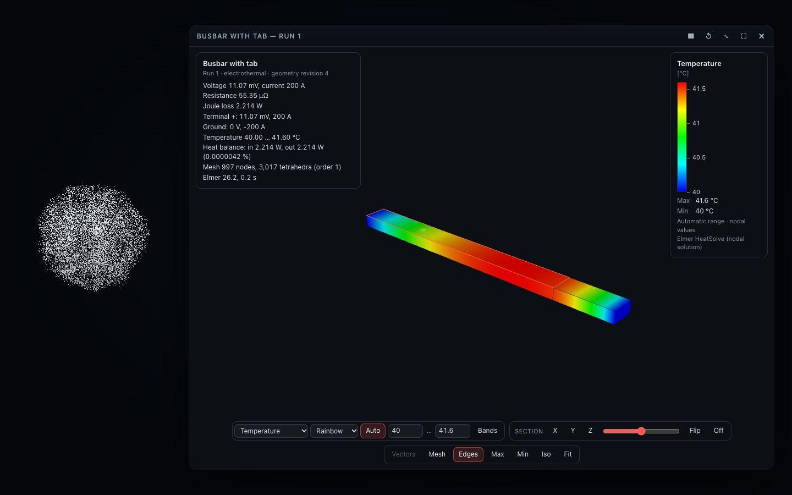

# Engineering simulation: FEM on the FreeCAD model (v0.8)

Since v0.8, Codex can run **real finite-element analyses** on the geometry the user models or opens through Aion's
FreeCAD backend, and Aion shows the computed fields in an interactive **Simulation Card**. The user describes an
engineering problem; Codex turns it into structured operations of one tool, `simulate`; **Gmsh** meshes the geometry and
**Elmer FEM** solves it, both installed on the user's machine; Aion shows only what the solver computed.

```
User ── "Run a DC current-density analysis with 100 A" ──► Codex (plans the study, chooses the operations)
                                                             │  simulate create · set_material · set_boundary · run
                                                             ▼
Aion MCP server ─ simulate: arguments validated, units converted, the study bound to the geometry and checked
   │  FreeCAD worker (sim_geometry): the visible solids made conformal, a BREP and a face table   (geometry)
   │  job runner (runtime/aion-sim.mjs, its own process):
   │     Gmsh (generated .geo) → tetrahedra, one physical group per solid and CAD face → face check  (mesh)
   │     ElmerGrid → Elmer mesh;  ElmerSolver (generated .sif) → VTU, scalars, log → log check       (solve)
   │     results: terminal currents, resistance, losses, temperatures, heat balance, field bundle  (results)
   ▼
Simulation Card ─ colour-mapped fields, legend, sections, vectors, probes; the setup with every face's condition
Codex answers from the numbers the result carries — and says plainly what is not supported.
```

*One intelligence (Codex), one engineering model (the FreeCAD document and the simulation study), several
representations (the CAD viewer, the Simulation Card, the numbers).*



## What is supported

| Analysis | What is computed | Conditions | Results |
| --- | --- | --- | --- |
| `electric` — stationary current conduction (DC) | potential φ, electric field −∇φ, current density −σ∇φ, Joule heat density σ\|∇φ\|² | `voltage`, `ground`, `current` (one equipotential terminal + ground), `insulated` (default) | each terminal's potential and current, resistance (two-terminal), Joule loss, current conservation |
| `thermal` — steady heat conduction | temperature T, heat flux −k∇T | `temperature`, `convection` (h, T∞), `heat_flux`, `heat_flow`, `adiabatic` (default); volumetric `set_source` | extrema with locations, heat leaving through each boundary, heat balance |
| `electrothermal` — sequential coupling | the electrical solution, then T with σ\|∇φ\|² (evaluated from φ at every integration point) as its source | both sets | both sets; the electrical loss is checked to be the thermal source |

Materials are constant and isotropic: a library of nominal 20 °C values (copper, aluminium 1350/6061/6063, brass, silver,
gold, nickel, tin, steel, stainless 304, SAC305 solder, FR-4, alumina, a generic thermal pad — `src/sim/materials.ts`,
with the basis of each value) or the user's own conductivity, resistivity, thermal conductivity and density. Several
touching bodies with different materials are one conformal model (their shared faces are interfaces). Electrical
insulators (no conductivity) take part in the heat equation only.

**Not supported** — refused or declined, never estimated: transient analysis, temperature-dependent or anisotropic
properties, two-way (iterative) coupling, AC / eddy currents / skin and proximity effect / magnetic fields, radiation,
fluid flow, contact resistance between bodies, structural or thermal stress, more than one current-driven terminal.
`simulate status` lists the supported and unsupported analyses.

## The tool

`simulate { action, args?, study? }` — one compact, action-based tool (≈ 0.9 KB of tool metadata; see
[MCP-TOOLS.md](MCP-TOOLS.md)). Actions: `status`, `create`, `list`, `open`, `inspect`, `set_physics`, `set_material`,
`set_boundary`, `set_source`, `remove`, `set_mesh`, `mesh`, `validate`, `run`, `results`, `show`, `sync`, `compare`.
The skill's [simulation reference](../plugins/aion-presence/skills/aion-presence/references/simulation.md) lists every
argument; `src/host/sim/commands.ts` validates them (strict schemas: unknown actions or keys are refused). The service
behind the tool (`src/host/sim/service.ts`) is independent of MCP, so another host can drive the same studies.

| Brief's capability | Action |
| --- | --- |
| create / open / inspect a simulation | `create`, `open` (shows the setup), `inspect`, `list` |
| define the physics | `create { analysis }`, `set_physics` |
| assign materials, conditions, sources | `set_material`, `set_boundary`, `set_source`, `remove` |
| configure / generate the mesh | `set_mesh`, `mesh` |
| validate the setup | `validate` (and before every `run`) |
| run, inspect, show | `run`, `results` (with `probe`), `show` |
| update after a change, compare | `sync` (or any action: the geometry is re-read), `compare` |

## Units

Every value is stored in SI (V, A, K, S/m, W/(m·K), W/(m²·K), W/m², W/m³, W); CAD lengths (mesh sizes, probe points) stay
in the document's millimetres until Gmsh scales the geometry to metres (`Geometry.OCCScaling = 0.001`), so the mesh,
the solver input and the results are SI throughout. Codex gives units as text (`"10 V"`, `"25 °C"`, `"10 W/(m2*K)"`,
`"1.72 uohm*cm"`); a bare number is SI — temperatures without a unit are kelvin, and a temperature below 150 K draws a
warning that names the unit. An unknown unit is refused with the accepted ones (`src/sim/units.ts`). What the user said
is kept beside the converted value for reports.

## Faces: identifying boundary regions

A condition never stores "face 6" alone. It stores how the region was identified — a **selector** — and what it
resolved to:

| Selector | Meaning |
| --- | --- |
| `"left"` … `"top"` | the outermost flat faces on that side (−X +X −Y +Y −Z +Z), of the model or of one body |
| `{facing: "top"}` | every flat face facing that way |
| `"feature:Hole1"` | the faces a CAD feature produced (the worker assigns each face to its feature by geometry) |
| `"remaining"` / `"exterior"` | every exterior face no other condition of the same kind claims (e.g. convection); always yields to specific selectors |
| `[3, 7]`, `{at: [x, y, z]}` | face numbers from `inspect`, or the face nearest a point (refused on an edge between faces) |
| `"$selected"` | the face the user clicked in the Simulation Card (resolved to its number by the MCP server) |

Only exterior faces carry conditions (an interface between two solids is internal). Conflicts are refused, never
silently resolved: two conditions of one kind on a face are an error; a new assignment that covers an earlier one's
faces replaces it and says so; one that would split an earlier *selector* is refused (`conflict`). When it is unclear
which face the user means, Codex asks — the skill says so.

**After a CAD change** (FreeCAD revision N → M), the next action re-exports the geometry and re-binds the study:
semantic selectors are resolved again and the change is reported ("Terminal +: re-resolved on revision 6 — faces 1 → 1,
area 50 → 80 mm²"); faces picked by number or point must still match their stored signature (surface type, area,
centroid, normal) — a face that moved to another number is followed, one that no longer exists makes the condition
**stale**: it is not applied, the result names it, and solving is blocked until it is assigned again.

## Geometry (FreeCAD) and the face numbering

The FreeCAD worker's `sim_geometry` operation (`plugins/aion-presence/cad/aion_freecad_worker.py`) takes the visible
solids (or the bodies named in `create`), refuses overlapping bodies (their material would be ambiguous), fragments
touching bodies into one conformal compound (`generalFuse`, so the mesh is continuous across them), and writes into
Aion's simulation workspace only: `geometry.brep` and `geometry.json` — every solid (with its body) and every face in
OpenCASCADE's order (the order Gmsh uses), with its solids, body, feature, surface type, area, centroid, outward normal
(found by testing a point just outside the face), axis and radius, bounding box, and a tessellation for picking.

Gmsh imports the BREP with every healing option off, so the numbering is kept; Aion does not trust that alone: after
meshing, every physical surface's area and centroid and every solid's volume are compared with the CAD face of the same
number (`checkFaceMapping`), and a mismatch stops the run before anything is solved.

## Mesh (Gmsh)

`src/sim/gmsh.ts` generates the `.geo`: OpenCASCADE import, scaling to metres, one physical group per solid (`S<i>`)
and per face (`F<i>`) — so a mesh never depends on the boundary conditions, and changing a load reuses it — sizes,
curvature-based refinement, optional local refinement (distance/threshold fields around faces, constant fields in
bodies), first- or second-order tetrahedra, MSH 2.2, one thread (Gmsh's parallel 3-D meshing is not deterministic; the
same input gives the same mesh). Presets: `coarse` · `normal` · `fine` · `very_fine` — a characteristic length from the
model's diagonal and its thinnest solid (normal: ≥ 2 elements through the thinnest part), elements per circle 8/12/20/32;
`max_mm`, `min_mm`, `curvature` override them. These are meshing settings, not accuracy guarantees.

Aion reads the mesh back (`readMsh`): nodes, tetrahedra, triangles per face, volume per solid, edge lengths and the
shape quality γ = 3·r_in/R_circ of every tetrahedron (min, mean, counts below 0.1 and 0.3). A mesh is identified by a
hash of the geometry, the sizes and the refinement; an identical mesh is reused. Limits: 1,500,000 elements (an estimate
is checked before meshing), 300 s for Gmsh.

## Solver (Elmer FEM)

`src/sim/elmer.ts` generates the solver input from the bound study — never by hand, and with keywords Elmer 26.2 uses in
its own test cases (`StatCurrentVec`, `ThermalActuator`, `ComponentResistance`):

| Solver | Module | Notes |
| --- | --- | --- |
| Static Current | `StatCurrentSolveVec` | `Calculate Volume Current / Electric Field / Joule Heating / Loads`; `Current Control` for a current terminal (Elmer solves for 1 V and scales) |
| Heat Equation | `HeatSolve` | `Joule Heat = True` in electro-thermal conductors; `Volumetric Heat Source`; `Calculate Loads` |
| Heat Flux | `FluxSolver` | `−k∇T` projected to the nodes |
| Save Scalars | `SaveData` | extrema, `RES: Total Joule Heating`, `RES: Effective Resistance`, `RES: CurrentSolver Scaling` |
| Result Output | `ResultOutputSolver` | VTU, ASCII, `Save Geometry Ids` (linearised elements for second order) |

Every CAD face gets its own Elmer boundary condition with `Geometry Id = Integer <face>` (the typed form: Elmer's parser
does not know the keyword), so every result triangle names its CAD face; a face without a condition has Elmer's natural
condition (insulated, adiabatic). Linear systems: BiCGStab (CG for the flux) with ILU1, tolerance 1e-10,
`Linear System Abort Not Converged`; or UMFPACK (`set_physics { linear: "direct" }`).

**A zero exit code proves nothing.** Found while building this: ElmerSolver exits 0 after rejecting its input file and
solving nothing. The runner therefore requires: no `ERROR::` line, the run reaching `ALL DONE`, finite solution norms, no
unknown-keyword warning, and the result files present and parseable — otherwise the run fails with Elmer's messages and
log, and nothing is presented as a result. Solver diagnostics reported: version, time, each solver's result norm, linear
iterations and final residual, warnings.

## Results

`src/sim/results.ts` reads Elmer's VTU (strictly: ASCII, counts checked, indices bounded) and computes, with its method:

| Quantity | Method |
| --- | --- |
| terminal current | Σ Elmer's nodal reaction currents (`Potential Loads`) over the terminal's nodes |
| Joule loss | Elmer's integral, cross-checked by Aion's Σ σ\|∇φ\|²·V over the tetrahedra (a note if they differ by > 2 %) |
| resistance | ΔV / I for a two-level problem (and Elmer's ΔV²/P beside it); with more levels each terminal is reported instead |
| heat through a face | −Σ Elmer's nodal reaction heat (`Temperature Loads`) over its nodes (fixed-temperature, convective and flux faces alike) |
| heat balance | generated (σ\|∇φ\|² + sources) + prescribed inflow vs the heat rejected — an independent check of the coupling |
| extrema | the nodal maximum / minimum of every field and the node where it occurs (mm) |
| probe | linear interpolation inside the containing tetrahedron (the elements' own shape functions); outside the solids, the nearest node, said so |

Two facts about Elmer 26.2 found by the real runs and handled: with `Current Control`, its reaction currents and its
Joule total are those of the unscaled 1 V solution (Aion scales them by `RES: CurrentSolver Scaling`, linearly and
quadratically); and `Save Geometry Ids` numbers boundary conditions, not faces (hence one condition per face).

Notes the result carries when they apply: a current-density peak far above its mean (a sharp re-entrant edge, where the
exact field is singular — the peak is mesh-dependent), very flat elements, an imbalance of the terminal currents or the
heat, interior elements dropped from the card's bundle. Field values are nodal; the result says so.

## The Simulation Card

`simulation` (1.0.0) shows a validated **field bundle** (`src/sim/field.ts`: nodes in metres, boundary triangles tagged
with their CAD face, tetrahedra, the solver's nodal fields as float32, a JSON header naming each field's unit, source and
range; checked by the hub before it stores the bytes and by the card before it draws them). Two modes:

- **Setup**: the CAD surface, each face coloured by its condition, with a legend; a click picks a face (`F12`), which
  Codex uses as `"$selected"`.
- **Results**: potential, electric field, current density, Joule heat density, temperature (°C), heat flux — each
  colour-mapped per pixel from the interpolated value through the same lookup table the legend draws (no tone mapping, no
  tint over a field: a picked face is outlined), a labelled legend with min, max, unit and source, automatic or manual
  range, six colour maps, banded contours, the mesh and the CAD edges, vectors (white arrows, length ∝ magnitude), a
  **section** through the tetrahedra (marching tetrahedra; the cut removes the half nearer the camera; position, axis or
  any normal, flip), and **probes** (click: interpolated on the surface triangle or inside the tetrahedron of the section;
  Max/Min: the nodal extreme), each saying how its value was obtained.

Details, commands and state: [SIMULATION-CARD.md](SIMULATION-CARD.md).

## Studies persist

A study is a versioned, schema-checked document (`src/sim/study.ts`, format `aion.sim.study/1`): id, name, analysis,
the CAD document and revision, bodies, materials, conditions (selectors, resolved faces, signatures, what the user said),
sources, mesh and solver settings, results (each run's study and geometry revisions, mesh id, headline numbers) and a
history. It lives in Aion's plugin data directory (`sim/studies/<id>/`: `study.json`, `geometry/r<rev>/`,
`meshes/<id>/`, `runs/<n>/` with `job.json`, `status.json`, `case.sif`, `solver.log`, `results/*.vtu`, `summary.json`,
`field.afr`), so it survives the card being closed, a new MCP server for every Codex turn and a restart. Showing a result,
changing the colour map, a section or a probe never runs the solver. Writes are atomic; a lock keeps two conversations
from changing one study at once; runs beyond the last ten keep their summary but not their VTU and bundle.

**Long runs.** Each run is a job executed by `runtime/aion-sim.mjs` in its own (detached) process, recording its stages
in `status.json`. `run` waits up to 40 s (`wait_s`, at most 50 — Codex's tool calls time out at about 60 s); a longer
run continues in the background, and `results` picks it up later, also from a new MCP server. The same runner is a CLI for
another host: `node aion-sim.mjs job <run directory>` and `node aion-sim.mjs tools`.

## Validation before solving

`validate` (and every `run`) reports **errors** that block a solve, **warnings**, and the **defaults** that apply:

- errors: no geometry or an invalid solid; a body without a material, or without the property its physics needs; no
  terminal, no potential difference, more than one current terminal, a current terminal with other voltages; a terminal
  on an insulator; a conducting group touching no terminal (floating: its potential is undefined); no fixed temperature
  or convection (no steady state), or a thermally isolated group; conflicting or stale conditions; a selector that finds
  no face; an over-large mesh estimate;
- warnings: conditions the analysis does not use, unusual property values, an implausible h, a temperature that looks
  like °C given as K, a thermal model with nothing to drive it;
- defaults: unassigned faces are insulated / adiabatic, nominal material data, constant properties, one-way coupling,
  the reference temperature.

## Installation

Gmsh and Elmer are optional, external programs, like FreeCAD. Aion finds them (`src/host/sim/tools.ts`) and proves each
by running it for its version:

- **Gmsh** (4.8+; tested 4.15.0): `AION_GMSH`; the gmsh **FreeCAD 1.x bundles** (`FreeCAD.app/Contents/Resources/bin/gmsh`);
  Homebrew / system paths; `PATH`.
- **Elmer** (9.0+; tested 26.2): `AION_ELMER` (its bin directory); `~/.aion-sim/elmer`; Homebrew / system paths; `PATH`.
  Elmer has no macOS binary release; `sh scripts/sim/build-elmer.sh` builds it from the official source (ElmerCSC/elmerfem,
  release-26.2.1) into `~/.aion-sim/elmer` **without sudo**: micromamba (one static binary) creates a private conda-forge
  toolchain (compilers, CMake, OpenBLAS), Elmer is configured serially (no MPI, no GUI) and installed — about 2 GB and
  10–20 minutes. Homebrew users: `brew tap elmercsc/elmerfem && brew install elmer`. Linux: the distribution's package
  or the ElmerCSC PPA; Windows: Elmer's installer (discovery implemented, **not tested**).

Without them, `simulate` answers `backend-unavailable` with these lines, and everything else in Aion works.
**Tested**: macOS 26.6.2 (Apple silicon), FreeCAD 1.1.4, Gmsh 4.15.0 (FreeCAD's), Elmer 26.2 (built with the script).

## Security and resources

- The programs run with fixed arguments in a job directory under Aion's workspace: no shell, no code or solver input
  from a request — the `.geo` and `.sif` are generated from the validated study (file names and paths checked against a
  safe pattern), with a minimal environment (`LANG=C`, one OpenMP thread).
- Bounded: 1,500,000 elements, 300 s for Gmsh, the study's solver time limit (600 s by default, at most 7,200 s), 50 MB
  of log per program; a program that overruns is stopped and the run fails.
- The FreeCAD worker writes geometry only inside the simulation workspace; the card only displays a validated bundle and
  reports a face id — it never reaches the backend.

## Licences

Gmsh (GPL-2.0-or-later) and Elmer (GPL / LGPL, per its licence policy) are independent programs the user installs; Aion
does not bundle, link or distribute them or any of their files — it runs them as separate processes with input files it
generates, and reads their output files. `scripts/sim/build-elmer.sh` downloads and builds Elmer on the user's own
machine from its official source. See [LICENSING.md](LICENSING.md) and
[THIRD-PARTY-NOTICES](../plugins/aion-presence/THIRD-PARTY-NOTICES.md).

## Verification

Kept apart, as for scenes and CAD ([SCENE-GENERATION-TESTS.md](SCENE-GENERATION-TESTS.md)):

| Kind | Where | Proves |
| --- | --- | --- |
| Unit | `tests/v08-sim.test.ts` (22) | units, materials, face selectors (sides, features, picks, fill, edges refused), binding and stale picks, validation, the Gmsh and Elmer inputs, log parsing (an exit 0 with errors), VTU reading, probes, sections, the field bundle, the card's manifest and colour maps, the service and the tool with stand-ins |
| Real tools | `tests/v08-sim-real.test.ts` (7, skipped without the tools), `npm run sim:verify` | models generated through the public interfaces, against analytic references (below) |
| Real renderer | `npm run smoke -- --only=sim` | setup, a face picked with the mouse, conditions, an electro-thermal run, fields with legends, vectors, a section, the maximum probed (the solver's value), colour maps and bands, a missing field refused, the result reopened without a solve |
| Real Codex | `npm run scene:eval -- --only simulation` (scenario L) | natural language → `simulate` → Elmer → card ([results](SCENE-GENERATION-TESTS.md)) |

Measured (`npm run sim:verify`, this Mac):

| Case | Reference | Aion + Gmsh + Elmer |
| --- | --- | --- |
| Copper busbar 100 × 10 × 5 mm, 1 mV, coarse → very fine (419 → 24,949 tetrahedra) | R = L/(σA) = 3.448276e-5 Ω | 3.448276e-5 Ω, error ≤ 1.1e-6 % at every size (a uniform field: linear elements are exact) |
| Same, P, current conservation | V²/R | equal to 4 digits; terminal currents sum to < 1e-6 of the current |
| Volumetric source 1e6 W/m³, ends fixed | ΔT = qL²/(8k) = 3.2051 K | 3.2051–3.2054 K (fine mesh) |
| Heat flux 10 W/cm² into one end | ΔT = qL/k = 25.64 K; 5 W out | within 0.5 % |
| Electro-thermal, 10 mV, ends 40 °C, h 10 W/(m²·K) to 25 °C | 1-D fin: mid-length rise 1.5457 K | 1.5462 K (0.03 %); heat balance 1.7e-7 |
| Copper + aluminium in series, 100 A | R exact = 5.048276e-5 Ω | 5.048276e-5 Ω; 100.000 A delivered |
| Stepped conductor 60 × 10 × 5 → 60 × 5 × 5 mm | above the 1-D value 6.2069e-5 Ω (constriction) | 6.2223 → 6.2432e-5 Ω coarse → very fine: rising monotonically, as a conforming FEM must (it approaches R from below) |
| CAD change 5 → 8 mm thick, same study | R × 5/8 | within 0.3 %; `compare`: −37.5 % |
| Large plate 100 × 40 × 10 mm, four holes, electro-thermal | — | 245,306 tetrahedra: mesh 3.1 s, solve 5.0 s, results 0.5 s; card bundle 7.9 MB with the interior; balance 2.6e-8 |

The smoke run's electro-thermal busbar with a hole and an aluminium tab (≈ 3,000 elements) took 0.15 s to mesh,
0.2 s to solve and 0.02 s to process. **Not verified**: Linux and Windows; Elmer versions other than 26.2 and Gmsh other
than 4.15; second-order meshes against references (implemented, linearised for output); the card's interaction speed on
meshes above ≈ 25,000 elements in a real browser (the bundle of the 245,000-element plate was produced, not displayed).

## Future AIPE integration

The layers are separable: **Simulation Core** (`src/sim/`: study, units, materials, geometry and selectors, validation,
Gmsh and Elmer inputs, result reading, the field bundle, sections — no Aion or Node dependency), **solver adapters**
(`src/host/sim/`: tool discovery, job runner, store, the service; `freecadBridge.ts` for geometry), and **Aion
integration** (the `simulate` tool in `src/host/mcp/server.ts`, the Simulation Card). An AIPE agent can drive the same
`SimulationService` (or `aion-sim.mjs` jobs) without Aion's particle interface; the Simulation Card is one front end.
