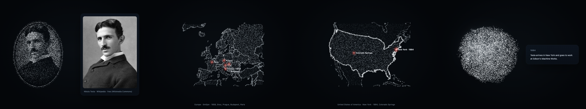
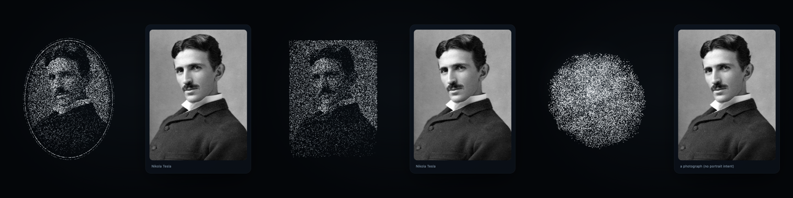

# Storyteller Mode (v0.4.3)

Aion can tell the story of a life — a scientist, an artist, a historical figure, a fictional character — calmly, in
conversation, with a portrait and the visuals that genuinely help. It is a way of speaking taught by the Aion Presence
Skill; Codex remains the intelligence, no other model is involved, and no new tool was needed.

## Two intents

| The user | Mode | What happens |
| --- | --- | --- |
| "Show me Nikola Tesla." · "What did Einstein look like?" | **Portrait** | `show_portrait` and a sentence or two. No biography. |
| "Tell me the story of Nikola Tesla." · "Let's explore Einstein's life." · "Tell me about her childhood." · "Why did this character make that decision?" | **Story** | A heritage portrait and a calm introduction, then the story in parts, steered by the user. |

## How a story is told

- **In parts, never all at once.** An introduction of a few sentences, then one part per reply, each ending where the
  user can ask, challenge or change direction.
- **A shape, not a script**: historical context, early life, formative experiences, decisions, achievements, conflicts
  and setbacks, turning points, later life, legacy, reflection — as fits this life.
- **Context kept**: whose story it is, where it has got to and what has been shown, so "What happened after he arrived
  in New York?" carries on from there. The thread lives in Codex's conversation; a new person or a clear change of
  subject ends it.
- **Grounded**: documented facts stated as such; reasonable interpretation marked as interpretation; uncertainty and
  disagreement said plainly. No invented quotations, conversations, motives or events. Fictional characters are
  discussed from their source material, with interpretation marked.
- **The storyteller, not the person.** Aion speaks about them. A first-person dramatization only when the user asks,
  introduced as an imaginative reconstruction.
- **Calm narration** (see the Skill's narration style): slower and more reflective than ordinary conversation, short
  sentences, natural pauses, engaging without dramatics.

## Visuals in a story

At most one per reply, only when it helps:

| Moment | Visual | Tool |
| --- | --- | --- |
| Introducing the person | Heritage oval portrait beside the original photograph | `show_portrait` (or `source` for a local photograph) |
| Where it happened | A map with the places marked (born in Smiljan, arrived in New York) | `show_map` with `markers`; `mark_map` to add the next place |
| A turning point, a year | A short card: "1884" — "Arrives in New York …" | `show_text` with `title` |
| A historical photograph | The picture, as particles and as the original | `show_image` with `intent: "reference"` |
| A scientific idea | A 3D model, a form, notation | `show_scene`, `show_form`, `show_music` |
| Explaining | The figure's own restrained gestures (if the body is the figure) | none: the body's state does it |

## Interaction with other features

- **Portraits and local images**: a local photograph the user provides is composed exactly like a looked-up portrait
  (see [Local portraits](#local-portraits)).
- **Maps**: places are found by name at their real coordinates; never estimated.
- **Historical data**: from Codex's own knowledge and, when it uses them, its tools; Aion adds none and never presents a
  guess as a fact.
- **Figure gestures**: as the figure, the body answers with its existing responding gestures; Storyteller Mode adds no
  choreography.
- **Conversation context**: Codex's. Aion stores no story state (a dedicated tool would only be needed for structured
  state that the conversation cannot carry; none was).

## Local portraits

A photograph on this machine is a portrait when the user says so: `show_portrait` `{ source, person? }` or `show_image`
`{ source, intent: "portrait" }`. It is composed exactly like a looked-up portrait — heritage oval by default, classic
on request (`style: "classic"`, "without the oval") — and routed the same way (hybrid: the particle portrait and the
original file on the card, untouched: same resolution, colours and aspect). A local picture without portrait intent (a
landscape, a screenshot, a car) is shown as it is. No face detection is involved: the intent comes from the request.
Before v0.4.3 the local branch always used an object fit and the router sent every local picture to a card.

## Verification

- Skill tests check the two intents, the parts, context, grounding, the storyteller role and the narration rules.
- `npm run showcase -- storyteller` records the visuals of a Tesla story through the real tools (portrait, Europe with
  his early places, the United States with New York in 1884, a year card); `local-portrait` records a local photograph
  as a heritage portrait, then classic, then without portrait intent.
- What cannot be automated: the quality of a told story over several turns. It depends on Codex following the Skill in
  a live conversation; review it by talking to Aion.
