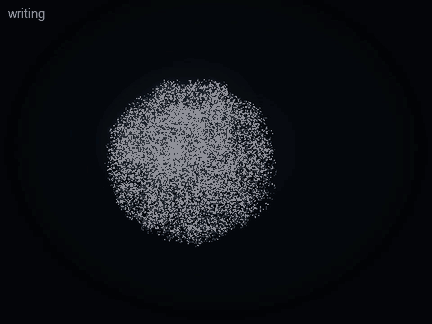
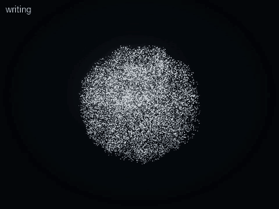
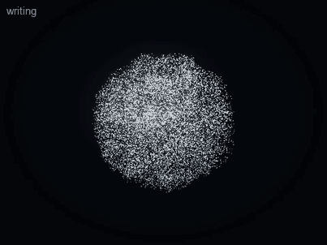
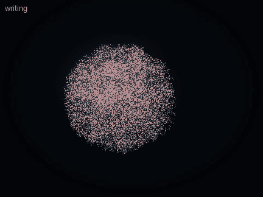

# Writing Education Core (v0.4.3; v0.4.4)

Aion shows **how** something is written, not only what it looks like: the particle body forms it, clears it to a faint
ghost, then writes it stroke by stroke in order while a reference card writes the same stroke at the same moment.

v0.4.4 makes this one Writing Education Core with three packs on a shared animation foundation:

```text
Writing Education Core   lookup (host/writing/resolve.ts) · composition (animation/stroke/compose.ts) · timeline · controls
   ├── Chinese Pack      9,574 characters with true outlines (Chinese Writing Pack, see CHINESE-WRITING.md)
   ├── English Pack      A–Z, a–z, 0–9 in print manuscript; words and names
   └── Music Pack        handwriting of the common symbols, beside their engraving (MUSIC.md)
          ▼
Shared Animation Controller   the writing plan and frame, control_animation (pause, resume, replay, speed, next,
                              previous, repeat a stroke or a character, complete)
          ▼
Aion Particle Renderer        one sampler (true outlines, or round pen lines), one reveal (keys + uniforms)
```

The packs keep their own data and conventions; nothing else is duplicated. A word is several symbols laid side by side on
one scale, each keeping its own strokes in its own order (never one symbol's strokes merged into another's).



## What is supported

| Pack | Symbols | Convention |
| --- | --- | --- |
| Chinese | 9,574 characters (7,465 for simplified writing, 7,260 for traditional; see [CHINESE-WRITING.md](CHINESE-WRITING.md)); words up to 4 | the data's order (Make Me a Hanzi; mainland order for simplified forms) |
| English letters | A–Z, a–z (52); words and names up to 16 letters | print manuscript, "ball and stick": start at the top, pull down, circles anticlockwise from two o'clock |
| Digits | 0–9 | the same manuscript convention |
| Music | 𝄞 𝄢 𝄡 clefs; 𝅝 𝅗𝅥 ♩ ♪ 𝅘𝅥𝅯 notes; 𝄻 𝄼 𝄽 𝄾 rests; ♯ ♭ ♮; 𝄴 common time; 𝄁 𝄂 bar lines (18) | common hand-copying practice, each symbol's convention stated |
| Mathematics | + − = × ÷ π ∫ √ | school handwriting |

**A font outline is not a stroke order.** Chinese stroke shapes come from a dataset that records the order and each
stroke's centre line; letters and music symbols are curated pen paths. Nothing derives an order from a font, and a symbol
without data is refused (`stroke-data-unavailable`, `character-not-in-pack`).

## English (v0.4.4)

Every letter and digit was reviewed on a contact sheet drawn from the composer's own output (`npm run writing:sheet`:
start points, direction arrows, stroke colours by order). The paths were kept — they are one consistent manuscript
standard with correct start points, directions and proportions (cap height 100, x-height 50, descender −40) — and the
drawing improved: round pen ends filled evenly by the same outline sampler as Chinese, words laid out on one baseline and
scale with even spacing, the four-line guide under the whole word, and direction words that describe curves properly
("up-left, curving anticlockwise to up-right" for c, "left, curving anticlockwise, then clockwise" for S). Uppercase and
lowercase are distinct letters.

 

## Music (v0.4.4)

Eleven symbols were added (alto clef, whole, half and sixteenth notes, the four rests, common time, double and final bar
lines), and each curated path is now **measured against its engraving**: on the staff, a SMuFL glyph is 250 font units to a
staff space and sits on its reference line, so the handwriting and Bravura's outline meet in the same coordinates
(`music/visual/compare.ts`). Every symbol's centre lines lie within a mean of 0.04 staff spaces of the engraved shape, ≥ 94 %
within 0.15, at 0.89–1.04 of its height. The measurement found that v0.4.3's sharp, flat and natural were drawn about twice
their engraved height and the bass clef 29 % too tall; they were redrawn. The card shows the engraved symbol on a staff
above the handwriting order.



## History: v0.4.3's hand-authored data

| Dataset | What it offers | License | Decision |
| --- | --- | --- | --- |
| Make Me a Hanzi (and Hanzi Writer, which uses it) | ~9,000 characters: stroke outlines and median lines in order | Graphics derived from Arphic PL fonts, under the Arphic Public License | Not bundled: copyleft terms on derived data need the owner's review first |
| KanjiVG | Japanese kanji, ordered SVG strokes | CC BY-SA 3.0 | Not bundled: share-alike, and Japanese conventions differ from the mainland standard in places |
| AnimCJK | Chinese and Japanese, ordered strokes | Arphic Public License / LGPL | Not bundled, for the same reason as Make Me a Hanzi |

In v0.4.3 the curated set was drawn by hand: each stroke is a centre line in a 100 × 100 practice square,
written in the standard order and direction (`src/animation/stroke/packs/`). Nothing third-party is bundled. A vetted
dataset can be added later as one more pack, with its own `variant`, once its license is reviewed. Regional
conventions that differ (Taiwan's 國字標準字體, Japan's 筆順指導の手びき) belong in such packs; **none is bundled yet**,
and the curated characters are presented as the mainland standard only.

## Data model

```text
StrokePack   system · variant · convention · authoring box · pen width · guide (grid, staff, lines) · symbols
SymbolSpec   symbol · names (eternity, yong, 高音谱号, capital A …) · title · strokes · note
StrokeSpec   d: "M x y L … Q … C … E cx cy rx ry from to" (one continuous movement) · name (横 horizontal …) · width · taper · say
   │  buildSequence: parse, map to normalized space, flatten (the shared path builder), measure, validate
   ▼
StrokeSequence  id ("chinese:永") · symbol · writingSystem · variant · convention · strokes · guides · totalDuration
Stroke          id · order · path (flat polyline) · startPoint · endPoint · direction ("right, then down, then a hook up-left")
                · length · duration · width [start, end] · name
```

Paths support lines, quadratic and cubic curves and elliptical arcs; curves are flattened by
`visual/forms/geometry/path.ts`, so everything downstream sees ordered polylines. Validation bounds every sequence
(≤ 40 strokes, ≤ 4,000 vertices, finite coordinates inside the stage, widths in range). Directions are described from
the geometry itself (straight runs between sharp turns, hooks, loops and their sense); a clef's single stroke has a
hand-written description.

## Engine

```text
Structured stroke data ─► Stroke Path Processor (path.ts) ─► Timeline Controller (stroke/timeline.ts + animation/timeline.ts)
   ─► Particle Path Animator (visual/points.ts: a "strokes" target; render/writing.ts + physics/writing.ts) ─► Aion renderer
```

- **Timeline**: lead (the body forms, complete) · preview · clear to the ghost · ready · stroke 1 · pause · stroke 2 · …
  · end. Each stroke takes 0.4 s + 0.46 s per unit of length (0.45–3.4 s), eased like a hand (accelerate, travel, slow);
  the pause between strokes grows with the distance the pen travels. Speeds: slow ×0.5, normal, fast ×1.6.
- **Sampling, once**: the writing target is sampled once (deterministic; every quality tier is a prefix of the same
  writing). Each grain gets a **reveal key** — its stroke's index plus how far along the stroke it lies; −1 for the faint
  guides (a 米字格 grid, a staff, writing lines); −2 for the pen's own small cluster.
- **Revealing, per frame, on the GPU**: four numbers and a point — progress, complete, the current stroke, the rest
  light, the pen tip. A grain is a faint ghost until progress passes its key, then lit; the stroke being written is a
  little brighter than those already written and just-written grains glow for a moment; the pen's grains ride the tip.
  No geometry is regenerated and nothing is read back: one storage buffer (the keys) and a few uniforms in the existing
  compute and material passes (7 of WebGPU's 8 storage buffers). The Canvas 2D fallback evaluates the same expressions
  from their CPU reference (`render/writing.ts`), which the tests check.
- **Interaction**: play, pause, resume, replay, slower/faster, next and previous stroke, repeat a stroke (the earlier
  strokes shown written, the later ones as ghosts; it stops after the stroke), show the completed symbol. A seek glides
  the pen to its new place instead of jumping.

## MCP

| Tool | What it does |
| --- | --- |
| `show_stroke_animation` `{ symbol, system?, speed?, presentation?, hold_seconds? }` | Writes it. The result lists every stroke in order (`writing.strokes`: number, name, direction) and the convention, for Codex's explanation. Route: hybrid by default (the body writes, a card shows the numbered order); `presentation: "body"` for the body alone. Stays until replaced or cleared. |
| `control_animation` `{ action, stroke?, speed? }` | pause · resume · replay · speed · next · previous · repeat (stroke n, from 1) · complete · stop. The result names the stroke being written. |

Natural language: "Show me the stroke order of 水", "Write it more slowly" (replay, slow), "Repeat the third stroke"
(repeat 3), "Next stroke", "Show the whole character again" (complete), "How do I write a treble clef?". The Skill asks
Codex to explain one stroke or a small group at a time, let the animation finish and pause for the user.

## Verification

- Unit tests (`tests/v43.test.ts`): every pack builds and validates; the Chinese stroke names and directions in order
  (永: 点 横折钩 横撇 撇 捺; 水; 火; 十; 中; 日; 山; every 横 runs right and every 竖 down); letters start in their upper
  part, circles go anticlockwise, case is respected; timing (preview, clear, monotonic progress, the pen at each stroke's
  start and end, lifted between strokes); control (repeat, next, previous, slower, complete); the sampler's keys and
  prefixes; the reveal arithmetic of the CPU reference.
- Real renderer (WebGPU in Chrome, and the canvas fallback): `npm run smoke -- --only=v43` checks that all five strokes
  of 永 are written in order and never backwards, that a repeated stroke shows strokes 1–2 written while the card lights
  the same stroke, slower and complete; `npm run showcase -- stroke-yong stroke-letters stroke-clef` records it.

## Known limitations

- A small curated set; no third-party stroke dataset yet (see above). Regional variants are supported by the data
  model but none is bundled.
- Stroke geometry is hand-drawn centre lines with a simple taper: a clear demonstration of order and direction, not
  calligraphy. The particle "brush" has an even width with tapers on 撇 and 捺, no pressure modelling.
- The treble clef is one long stroke at an even width; its shape was checked by eye against engraved clefs, not
  measured.
- Letters follow one manuscript convention; cursive and D'Nealian would be further packs.
