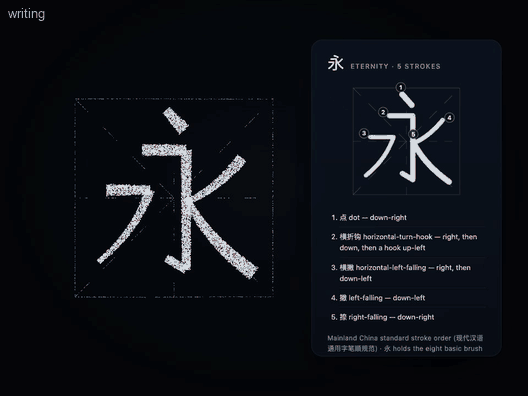
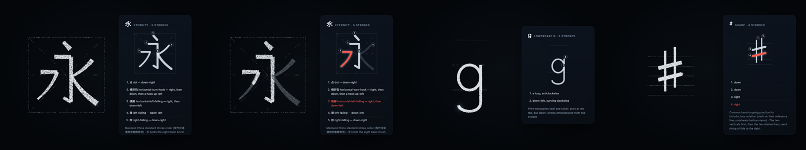

# Stroke animation (v0.4.3)

Aion can show **how** a symbol is written, not only what it looks like: the particle body forms the symbol, clears it
to a faint ghost, then writes it stroke by stroke in order while a card beside it shows the numbered stroke order.
"Teach me how to write the character for eternity" → 永, five strokes, each one written where and in the direction a
hand writes it.





## What is supported

| Pack | Symbols | Convention (`variant`) |
| --- | --- | --- |
| A — Chinese | 一 二 三 十 人 大 天 口 日 月 中 木 山 水 火 永 上 下 小 (19) | Mainland China standard stroke order, 现代汉语通用字笔顺规范 (`zh-Hans`) |
| B — English letters | A–Z, a–z (52) | Print manuscript, "ball and stick": start at the top, pull down, circles anticlockwise from two o'clock (`manuscript`) |
| C — Numbers | 0–9 | The same manuscript convention (`manuscript`) |
| D — Music | 𝄞 treble clef, 𝄢 bass clef, ♩ quarter note, ♪ eighth note, ♯ sharp, ♭ flat, ♮ natural | Common hand-copying practice (`hand-copying`) |
| E — Mathematics | + − = × ÷ π ∫ √ | School handwriting (`school`) |

Where hands genuinely differ, the symbol carries a note that names the demonstrated way, and the tool result passes it
to Codex: the stem of T before its bar (some schools teach the bar first); an open 4; the treble clef drawn in one
stroke from the G line (some teachers start from the hook at the bottom); the sharp's verticals before its bars; the
plus sign's horizontal first (both orders are common).

Anything else is refused with `stroke-data-unavailable` and the list of what exists. **A font outline is not a stroke
order**: it is a filled shape that says nothing about which stroke comes first, where it starts or which way the pen
moves, so Aion never derives an order from a font and never guesses one.

## Data: why hand-authored, and which datasets were evaluated

| Dataset | What it offers | License | Decision |
| --- | --- | --- | --- |
| Make Me a Hanzi (and Hanzi Writer, which uses it) | ~9,000 characters: stroke outlines and median lines in order | Graphics derived from Arphic PL fonts, under the Arphic Public License | Not bundled: copyleft terms on derived data need the owner's review first |
| KanjiVG | Japanese kanji, ordered SVG strokes | CC BY-SA 3.0 | Not bundled: share-alike, and Japanese conventions differ from the mainland standard in places |
| AnimCJK | Chinese and Japanese, ordered strokes | Arphic Public License / LGPL | Not bundled, for the same reason as Make Me a Hanzi |

For this release the curated set is drawn by hand: each stroke is a centre line in a 100 × 100 practice square,
written in the standard order and direction (`src/animation/stroke/packs/`). Nothing third-party is bundled. A vetted
dataset can be added later as one more pack, with its own `variant`, once its license is reviewed. Regional
conventions that differ (Taiwan's 國字標準字體, Japan's 筆順指導の手びき) belong in such packs; **none is bundled yet**,
and the curated characters are presented as the mainland standard only.

## Data model

```text
StrokePack   system · variant · convention · authoring box · pen width · guide (grid, staff, lines) · symbols
SymbolSpec   symbol · names (eternity, yong, 高音谱号, capital A …) · title · strokes · note
StrokeSpec   d: "M x y L … Q … C … E cx cy rx ry from to" (one continuous movement) · name (横 horizontal …) · width · taper · say
   │  buildSequence: parse, map to normalized space, flatten (the shared path builder), measure, validate
   ▼
StrokeSequence  id ("chinese:永") · symbol · writingSystem · variant · convention · strokes · guides · totalDuration
Stroke          id · order · path (flat polyline) · startPoint · endPoint · direction ("right, then down, then a hook up-left")
                · length · duration · width [start, end] · name
```

Paths support lines, quadratic and cubic curves and elliptical arcs; curves are flattened by
`visual/forms/geometry/path.ts`, so everything downstream sees ordered polylines. Validation bounds every sequence
(≤ 40 strokes, ≤ 4,000 vertices, finite coordinates inside the stage, widths in range). Directions are described from
the geometry itself (straight runs between sharp turns, hooks, loops and their sense); a clef's single stroke has a
hand-written description.

## Engine

```text
Structured stroke data ─► Stroke Path Processor (path.ts) ─► Timeline Controller (stroke/timeline.ts + animation/timeline.ts)
   ─► Particle Path Animator (visual/points.ts: a "strokes" target; render/writing.ts + physics/writing.ts) ─► Aion renderer
```

- **Timeline**: lead (the body forms, complete) · preview · clear to the ghost · ready · stroke 1 · pause · stroke 2 · …
  · end. Each stroke takes 0.4 s + 0.46 s per unit of length (0.45–3.4 s), eased like a hand (accelerate, travel, slow);
  the pause between strokes grows with the distance the pen travels. Speeds: slow ×0.5, normal, fast ×1.6.
- **Sampling, once**: the writing target is sampled once (deterministic; every quality tier is a prefix of the same
  writing). Each grain gets a **reveal key** — its stroke's index plus how far along the stroke it lies; −1 for the faint
  guides (a 米字格 grid, a staff, writing lines); −2 for the pen's own small cluster.
- **Revealing, per frame, on the GPU**: four numbers and a point — progress, complete, the current stroke, the rest
  light, the pen tip. A grain is a faint ghost until progress passes its key, then lit; the stroke being written is a
  little brighter than those already written and just-written grains glow for a moment; the pen's grains ride the tip.
  No geometry is regenerated and nothing is read back: one storage buffer (the keys) and a few uniforms in the existing
  compute and material passes (7 of WebGPU's 8 storage buffers). The Canvas 2D fallback evaluates the same expressions
  from their CPU reference (`render/writing.ts`), which the tests check.
- **Interaction**: play, pause, resume, replay, slower/faster, next and previous stroke, repeat a stroke (the earlier
  strokes shown written, the later ones as ghosts; it stops after the stroke), show the completed symbol. A seek glides
  the pen to its new place instead of jumping.

## MCP

| Tool | What it does |
| --- | --- |
| `show_stroke_animation` `{ symbol, system?, speed?, presentation?, hold_seconds? }` | Writes it. The result lists every stroke in order (`writing.strokes`: number, name, direction) and the convention, for Codex's explanation. Route: hybrid by default (the body writes, a card shows the numbered order); `presentation: "body"` for the body alone. Stays until replaced or cleared. |
| `control_animation` `{ action, stroke?, speed? }` | pause · resume · replay · speed · next · previous · repeat (stroke n, from 1) · complete · stop. The result names the stroke being written. |

Natural language: "Show me the stroke order of 水", "Write it more slowly" (replay, slow), "Repeat the third stroke"
(repeat 3), "Next stroke", "Show the whole character again" (complete), "How do I write a treble clef?". The Skill asks
Codex to explain one stroke or a small group at a time, let the animation finish and pause for the user.

## Verification

- Unit tests (`tests/v43.test.ts`): every pack builds and validates; the Chinese stroke names and directions in order
  (永: 点 横折钩 横撇 撇 捺; 水; 火; 十; 中; 日; 山; every 横 runs right and every 竖 down); letters start in their upper
  part, circles go anticlockwise, case is respected; timing (preview, clear, monotonic progress, the pen at each stroke's
  start and end, lifted between strokes); control (repeat, next, previous, slower, complete); the sampler's keys and
  prefixes; the reveal arithmetic of the CPU reference.
- Real renderer (WebGPU in Chrome, and the canvas fallback): `npm run smoke -- --only=v43` checks that all five strokes
  of 永 are written in order and never backwards, that a repeated stroke shows strokes 1–2 written while the card lights
  the same stroke, slower and complete; `npm run showcase -- stroke-yong stroke-letters stroke-clef` records it.

## Known limitations

- A small curated set; no third-party stroke dataset yet (see above). Regional variants are supported by the data
  model but none is bundled.
- Stroke geometry is hand-drawn centre lines with a simple taper: a clear demonstration of order and direction, not
  calligraphy. The particle "brush" has an even width with tapers on 撇 and 捺, no pressure modelling.
- The treble clef is one long stroke at an even width; its shape was checked by eye against engraved clefs, not
  measured.
- Letters follow one manuscript convention; cursive and D'Nealian would be further packs.
